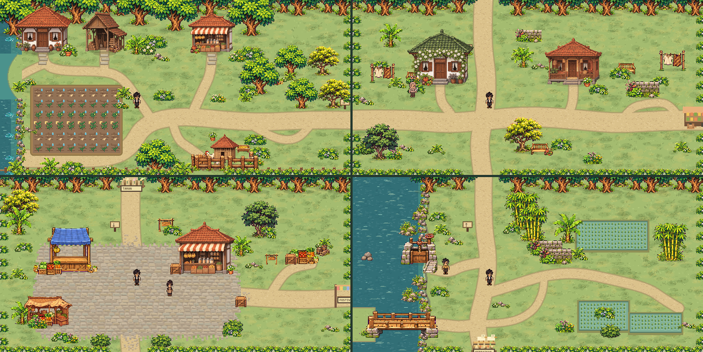

# Revisi empat peta YZ Farm Life

Keempat area luar berukuran 32 × 16 tile. Satu tile berukuran 20 piksel. Pembanding visual adalah empat panel yang diberikan pemain. Gambar di bawah berasal dari renderer game, dengan tanaman dari data contoh agar bentuk bedeng saat terisi dapat diperiksa.

| Wilayah | Susunan yang bisa diperiksa saat bermain |
| --- | --- |
| Kebun | Rumah, gudang, serta warung di utara. Kanal dan petak budidaya di barat. Rute melengkung menuju kandang dan kebun buah di timur. |
| Gang | Teras dua rumah menghadap persimpangan. Jemuran dan kebun kecil dikelompokkan di halaman. Ada ruang berjalan di bawah dedaunan di luar tapak batang. |
| Pasar | Pelataran berpaving menghubungkan lapak sayur, kios anyaman serta warung. Batu lepas menghubungkan tepinya ke jalan tanah. Pintu masuk warung bisa didekati dari sisi depan kios. |
| Sungai | Tepian berbatu mengikuti aliran. Pintu air dapat dibuka. Jembatan mencapai tepian barat. Pematang memisahkan jalur pejalan kaki dari sawah berair di timur. |

## Gerak, tabrakan, dan navigasi

- Gerbang timur kebun sebelumnya masih aktif di kolom 23. Lokasi pemicu, papan, atlas Tiled, dan jalan kini memakai batas kolom 31. Atlas mencakup 64 × 48 tile, dengan empat kawasan aktif.
- Tabrakan mengikuti dinding bawah bangunan, batang pohon, meja lapak, tepi air, dan bedeng sawah. Bentuk sawah pada renderer dan model membaca daftar persegi panjang yang sama. Simpanan lama yang berada di petak yang kini padat dimuat pada petak terbuka terdekat.
- Pintu air memiliki sprite terbuka. Panel kayu naik di dalam rangka, sedangkan pasangan batu dan mekanisme ulir tetap di tempatnya.
- Phaser mengantre langkah per menit dari jadwal warga, termasuk ketika satu aksi memajukan waktu beberapa menit. Saat pemain berjalan di belakang benda tinggi, bagian depan objek melunak agar posisi pemain tetap terbaca.
- YZ Phone → Jelajah menampilkan pintu keluar yang terhubung langsung dan mengantar pemain lewat rute jalan kaki. Esc membatalkan perjalanan. Jika warga menghalangi langkah berikutnya, perjalanan berhenti dengan pemberitahuan.
- Suara kanal mengikuti jarak dari tepi air. Langkah di plaza berbeda dari langkah di tanah. Debu lari muncul di luar ruangan pada permukaan tanah.

## Aset

Tujuh sprite mencakup rumah Yanzen, gudang, kandang, dua rumah warga, warung, dan lapak anyaman. Aset dibuat dengan ImageGen bawaan. Atlas bangunan dipotong mengikuti alpha dan disesuaikan dengan ukuran sprite serta pijakan lama. Enam fasad dapat dilihat pada [lembar sumber](../../game-assets/generated/terrain/fasad-sunda-enam.png). PNG yang digunakan renderer ada di [objek](../../public/game/assets/tiles/farm-kit/objek) dan [landmark](../../public/game/assets/tiles/farm-kit/landmark).

Arahan gambar untuk atlas adalah enam bangunan Sunda terpisah di atas latar transparan, tampak tiga perempat dari depan, atap genteng dan bambu, cahaya pagi dari kiri atas, pintu pada fasad depan. Arahan lapak adalah kios hasil bumi beratap anyaman dan kain oker, dengan bakul cabai, kol, wortel, dan terong, tanpa figur. Aset vegetasi, karakter dan interior yang sesuai dipakai kembali.

## Referensi teknik

Bentuk tabrakan di kaki objek mengikuti praktik editor tileset. Render jalan memakai tepi dan material yang saling menyambung. [Tiled — Tile Collision Editor](https://doc.mapeditor.org/en/stable/manual/editing-tilesets/) · [Tiled — Using Terrains](https://doc.mapeditor.org/en/stable/manual/terrain/)

Urutan gambar memakai tinggi pijakan untuk hubungan depan dan belakang. Petunjuk arah dan tindakan ditampilkan di dekat konteks pemain. [Godot — TileMapLayer dan Y-sort origin](https://docs.godotengine.org/en/4.6/classes/class_tilemaplayer.html) · [Game Accessibility Guidelines — Interactive elements](https://gameaccessibilityguidelines.com/give-a-clear-indication-that-interactive-elements-are-interactive/)

## Pemeriksaan

Suite game mencakup perpindahan dua arah, objek padat dan pendekatan ke objek, jadwal warga, simpan/muat, jembatan serta pintu air. Ekspor Tiled dicek terhadap model. Chromium merender keempat lokasi luar dan dua interior.

Build Docker lokal sebelum revisi disimpan sebagai yz-farm-life-app:sebelum-revisi-empat-peta.

Pada build LAN di port 3002, Chromium berhasil melakukan perjalanan dari YZ Phone melewati gerbang timur, kembali dengan tombol panah, menguji seluruh enam transisi antarpeta, masuk rumah dan warung, membuka pintu air pada malam hari, memeriksa simpanannya di server, serta mendapati warung terkunci selepas jam operasional. Akun uji sementara dihapus sesudah pengujian. Tag build teruji adalah yz-farm-life-app:empat-peta-modular-v2.
