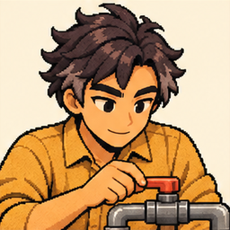

# RYAN ANDRYANA ACHADIAT (A03)

**Peran:** Pengelola irigasi
**Potret:** 
**Status:** Rancangan fiksi publik — belum disahkan sebagai kisah atau gameplay aktif.

> Seluruh cerita dan sifat di halaman ini adalah konsep untuk tokoh fiksi YZ Farm Life, bukan biografi seseorang di dunia nyata.

## Identitas

**preferredName:** Ryan

**ageYears:** 31

**language:** Bahasa Indonesia; sesekali memakai sapaan atau ungkapan Sunda saat suasana percakapan cocok.

**identity:** NPC fiksi berlatar Kota Bandung

**ageDesignNote:** Usia ini pilihan kreatif sementara berdasarkan kematangan visual potret, bukan pengukuran umur dari gambar.

**visualAgeBandDraft:** dewasa dalam rancangan karakter

## Penampilan dan bahasa tubuh

**general:** Potret canonical work-A03 memperlihatkan rincian visual yang dicatat di bawah; jangan menggantinya dengan identitas dari arsip legacy.

**physicalTraits:** Rambut cokelat gelap acak, kemeja kuning oker berlengan panjang; tangan memutar katup pada pipa air.

**bodyLanguageDirection:** tangan memutar katup pada pipa air

**proposedPose:** Gunakan gestur yang terlihat pada potret sebagai rujukan satu pose interaksi; animasi final belum disetujui.

## Busana dan estetika

**signatureClothing:** Rambut cokelat gelap acak, kemeja kuning oker berlengan panjang

**aesthetic:** Pixel-art kehidupan Kota Bandung

**palette:** cokelat, kuning

**costumeConcept:** Pakaian kerja yang memudahkan kegiatan aliran air, tanpa menganggapnya sebagai pakaian nyata sosok dalam dunia nyata

## Pekerjaan dan kehidupan sosial

**education:** Belajar budidaya serta pengamatan lapangan melalui kerja kebun dan pertukaran pengetahuan antarwarga.

**communityActivity:** Mengajak warga mencatat kebutuhan irigasi agar pekerjaan tidak saling bertabrakan.

**functionInWorld:** pertanian

**workRoutineConcept:** memeriksa jalur air sebelum pekerjaan dilanjutkan

**workplaceConcept:** Situasi kerja fiksi mengenai aliran air; lokasi spesifik belum ditetapkan

## Kepribadian fiksi

**traits**
- Ketelitian
- Tekun
- Mau mendengar

**observableHabit:** kerap memeriksa tanah sebelum mengambil keputusan

**values:** Ketelitian

**weakness:** terlalu lama membandingkan pilihan

**strengthConcept:** mencatat hal kecil yang kerap terlewat

**flawConcept:** terlalu berhati-hati ketika keadaan mendesak

**microHabitConcept:** membandingkan dua catatan tentang aliran air sebelum menjawab

## Motivasi dan konflik fiksi

**primaryMotivation:** Menjaga pekerjaan irigasi tetap dapat dipertanggungjawabkan

**need:** Ingin ada waktu memeriksa urusan irigasi sebelum keputusan diambil bersama.

**innerConflict:** Pemilik alat meminta solusi yang berbeda dari kebiasaan

**fear:** Bibit yang rusak

**motivationConcept:** Mencari cara menangani irigasi dengan teliti ketika orang lain ingin pekerjaan cepat selesai

**conflictConcept:** Di bagian irigasi, satu sambungan terlihat baik di hulu, tetapi debit di ujung berbeda; pilihan yang serba cepat terasa berisiko baginya dalam premis fiksi ini

**agencyConcept:** Boleh menolak bantuan yang membuka aliran lebih cepat; dapat memilih menunda pekerjaan sampai jalur yang bermasalah diperiksa meskipun pemain tidak setuju

## Latar cerita

**formativeMemory:** Dulu, pada salah satu hari yang melelahkan, satu sambungan terlihat baik di hulu, tetapi debit di ujung berbeda. Ia memilih untuk kerap memeriksa tanah sebelum mengambil keputusan, meskipun langkah itu membutuhkan lebih banyak waktu.

**narrativeBackground:** Di sela bedengan, bibit, dan musim yang berubah, Ryan Andryana Achadiat menemukan alat lama yang hampir tidak dipakai lagi.

**narrativeStatus:** Konsep fiksi baru; bukan riwayat orang asli

**sceneConcept:** Sebuah kegiatan sehari-hari tentang aliran air terhambat karena satu sambungan terlihat baik di hulu, tetapi debit di ujung berbeda. Ini hanya premis adegan, bukan riwayat pribadi.

## Interaksi dan hubungan

**relationshipHook:** Kedekatan dibangun melalui bantuan terkait jadwal tanam, tanpa relasi keluarga yang ditebak

**trustBehavior:** Meningkat setelah pemain menepati janji dan menghormati pilihan tokoh

**personalBoundary:** Tidak langsung membicarakan masalah pribadi kepada pemain baru

**boundaryConcept:** Tidak membagi urusan pribadi hanya karena pemain sering menyapa; kedekatan tidak sama dengan persetujuan

## Suara dan dialog

**speechSignature:** Awalnya hati-hati ketika menjelaskan irigasi, lalu lugas setelah melihat hasil.

**sampleLine:** Di catatan, urusan irigasi sudah selesai. Di lapangan ternyata belum.

**habitualGesture:** mengusap tanah dari telapak tangan

**reactions**
- **neutral:** Menanggapi seperlunya dan kembali ke pekerjaan
- **happy:** Senyum kecil saat bantuan benar-benar berguna
- **worried:** Memeriksa jadwal tanam sebelum memberi jawaban

**dialogueDrafts**
- Di catatan, urusan irigasi sudah selesai. Di lapangan ternyata belum.
- Aku kurang yakin kalau kita membuka aliran lebih cepat. Untuk irigasi, risikonya belum jelas.
- Kalau aku, lebih baik menunda pekerjaan sampai jalur yang bermasalah diperiksa. Urusan irigasi bisa menunggu sebentar.

**speakingCadence:** tenang dengan jeda saat memastikan rincian

## Perkembangan cerita

**storyArc:** Urusan jadwal tanam mulai mengganggu rutinitas pengelola irigasi

**questHook:** Ketika sedang menangani irigasi, muncul masalah sederhana: satu sambungan terlihat baik di hulu, tetapi debit di ujung berbeda. Pemain boleh membantu, menolak, atau mengajukan cara lain; belum ada quest runtime.

**threeActBeats**
- Masalah irigasi terlihat ketika memeriksa jalur air sebelum pekerjaan dilanjutkan
- Pemain mengetahui bahwa satu sambungan terlihat baik di hulu, tetapi debit di ujung berbeda; pilihan warga tidak selalu sejalan
- Salah satu cara dicoba dalam kegiatan irigasi, lalu hasilnya dievaluasi bersama

**playerChoices**
- Mendukung usulan untuk membuka aliran lebih cepat pada irigasi
- Mengusulkan agar menunda pekerjaan sampai jalur yang bermasalah diperiksa untuk irigasi

**implementation:** draft, belum diaktifkan otomatis

**localContext:** air di kebun awal

**sideQuestConcept**
- **premise:** Saat mengurus irigasi, satu sambungan terlihat baik di hulu, tetapi debit di ujung berbeda.
- **decisionA:** Membuka aliran lebih cepat.
- **decisionB:** Menunda pekerjaan sampai jalur yang bermasalah diperiksa.
- **state:** not-implemented

**choiceConsequencesConcept**
- - **choice:** A
- **result:** Kemungkinan lebih cepat; konsekuensi nyata harus ditulis dan diuji sebelum implementasi
- - **choice:** B
- **result:** Kemungkinan lebih teliti; konsekuensi nyata harus ditulis dan diuji sebelum implementasi

## Referensi visual

**visualContinuity:** Patokan ilustrasi: Rambut cokelat gelap acak, kemeja kuning oker berlengan panjang; tangan memutar katup pada pipa air. Cocokkan penutup kepala, warna, alat bantu, aksesori dan siluet dengan sprite; jangan mengganti portrait key.

**suggestedPalette:** cokelat, kuning

**animationRequired**
- idle
- walk-4-directions
- interact

**observedIllustrationStyle:** Ilustrasi 2D kartun dengan garis tegas dan bidang warna halus; perlu penyeragaman resolusi sprite.

## Kontinuitas dan status runtime

**availability:** Katalog; jadwal dan spawn mengikuti ekspansi bertahap

**playerDependentState:** Tidak boleh tertukar dengan ID cerita lama

**canonStatus:** Nama, pekerjaan dan kunci potret terkunci; detail cerita masih rancangan

**playableRuntimeConfirmed:** Tidak

**questIntegrationConfirmed:** Tidak

**legacyAssociationApproved:** Tidak

**status:** Konsep publik; kehadiran karakter dan cerita di runtime memerlukan implementasi terpisah.

---
Karakter ini merupakan bagian dari katalog fiksi YZ Farm Life. Data identitas canonical dikunci; pengesahan lore dan implementasi gameplay dilakukan terpisah.
