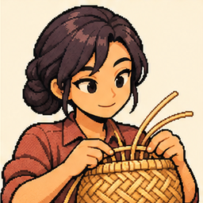

# ASTRI YULIANTI (A08)

**Peran:** Perajin keranjang
**Potret:** 
**Status:** Rancangan fiksi publik — belum disahkan sebagai kisah atau gameplay aktif.

> Seluruh cerita dan sifat di halaman ini adalah konsep untuk tokoh fiksi YZ Farm Life, bukan biografi seseorang di dunia nyata.

## Identitas

**preferredName:** Astri

**ageYears:** 34

**origin:** Sebelum menetap dalam lingkungan cerita Pasirluyu, Astri mengenal keseharian Majalaya. Pengalaman dengan ruang kerja kerajinan rumahan mengajarkannya menghargai waktu untuk membuat karya. (latar fiksi; draf)

**language:** Bahasa Indonesia; sesekali memakai sapaan atau ungkapan Sunda saat suasana percakapan cocok.

**identity:** NPC fiksi berlatar Kota Bandung

**ageDesignNote:** Usia ini pilihan kreatif sementara berdasarkan kematangan visual potret, bukan pengukuran umur dari gambar.

**visualAgeBandDraft:** dewasa dalam rancangan karakter

## Penampilan dan bahasa tubuh

**general:** Potret canonical work-A08 memperlihatkan rincian visual yang dicatat di bawah; jangan menggantinya dengan identitas dari arsip legacy.

**physicalTraits:** Rambut cokelat gelap disanggul rendah, kemeja merah bata; menganyam keranjang bambu.

**bodyLanguageDirection:** menganyam keranjang bambu

**proposedPose:** Gunakan gestur yang terlihat pada potret sebagai rujukan satu pose interaksi; animasi final belum disetujui.

## Busana dan estetika

**signatureClothing:** Rambut cokelat gelap disanggul rendah, kemeja merah bata

**aesthetic:** Pixel-art kehidupan Kota Bandung

**palette:** merah bata, cokelat

**costumeConcept:** Pakaian kerja yang memudahkan kegiatan bahan kerajinan, tanpa menganggapnya sebagai pakaian nyata sosok dalam dunia nyata

## Pekerjaan dan kehidupan sosial

**education:** Mengasah keterampilan kriya lewat praktik, belajar dari pekerja berpengalaman, dan uji coba bahan.

**communityActivity:** Menyiapkan kegiatan kecil seputar keranjang tanpa bergantung pada pemain.

**functionInWorld:** kriya

**workRoutineConcept:** mengukur kebutuhan sebelum memotong atau merangkai bahan

**workplaceConcept:** Situasi kerja fiksi mengenai bahan kerajinan; lokasi spesifik belum ditetapkan

## Kepribadian fiksi

**traits**
- Kesabaran
- Tekun
- Mau mendengar

**observableHabit:** mengukur bahan sebelum memotong

**values:** Kesabaran

**weakness:** ingin hasil sempurna saat waktunya sempit

**strengthConcept:** mengetahui kapan harus meminta bantuan

**flawConcept:** mudah terpaku pada jadwal yang sudah dibuat

**microHabitConcept:** menyebut risiko sebelum menyetujui perubahan bahan kerajinan

## Motivasi dan konflik fiksi

**primaryMotivation:** Menjaga pekerjaan keranjang tetap dapat dipertanggungjawabkan

**need:** Ingin hasil penanganan keranjang dinilai dari keadaan nyata, bukan janji.

**innerConflict:** Dua pihak sama-sama punya alasan yang kuat

**fear:** Bahan berharga terbuang

**motivationConcept:** Mencari cara menangani keranjang dengan teliti ketika orang lain ingin pekerjaan cepat selesai

**conflictConcept:** Di bagian keranjang, ukuran di catatan berbeda sedikit dari hasil kerja; pilihan yang serba cepat terasa berisiko baginya dalam premis fiksi ini

**agencyConcept:** Boleh menolak bantuan yang memperbaiki bentuk dengan cepat; dapat memilih mengulang pengukuran agar bahan tidak terbuang meskipun pemain tidak setuju

## Latar cerita

**familyContext:** Keluarga Astri biasa menawarkan bantuan tanpa menunggu diminta. Ia ingin sikap yang sama hadir dalam pekerjaan perajin keranjang, sambil tetap menghormati batas orang lain. (latar fiksi; draf)

**formativeMemory:** Dulu, pada salah satu hari yang melelahkan, ukuran di catatan berbeda sedikit dari hasil kerja. Daripada cepat menyalahkan keadaan, ia belajar mengulang pemeriksaan kecil.

**narrativeBackground:** Di sela bahan, warna, dan barang buatan tangan, Astri Yulianti menemukan jadwal yang saling bertabrakan.

**narrativeStatus:** Konsep fiksi baru; bukan riwayat orang asli

**sceneConcept:** Sebuah kegiatan sehari-hari tentang bahan kerajinan terhambat karena ukuran di catatan berbeda sedikit dari hasil kerja. Ini hanya premis adegan, bukan riwayat pribadi.

## Interaksi dan hubungan

**relationshipHook:** Kedekatan dibangun melalui bantuan terkait pola kerja, tanpa relasi keluarga yang ditebak

**trustBehavior:** Meningkat setelah pemain menepati janji dan menghormati pilihan tokoh

**personalBoundary:** Tidak langsung membicarakan masalah pribadi kepada pemain baru

**boundaryConcept:** Tidak membagi urusan pribadi hanya karena pemain sering menyapa; kedekatan tidak sama dengan persetujuan

## Suara dan dialog

**speechSignature:** Pilih kata sederhana untuk keranjang; tidak berusaha selalu menyenangkan pemain.

**sampleLine:** Kamu lihat keranjang tadi? Ada satu hal yang ingin kupastikan.

**habitualGesture:** meraba sambungan atau merapikan bahan

**reactions**
- **neutral:** Menanggapi seperlunya dan kembali ke pekerjaan
- **happy:** Senyum kecil saat bantuan benar-benar berguna
- **worried:** Memeriksa pola kerja sebelum memberi jawaban

**dialogueDrafts**
- Kamu lihat keranjang tadi? Ada satu hal yang ingin kupastikan.
- Jangan buru-buru memperbaiki bentuk dengan cepat. Nanti bagian keranjang malah terlewat.
- Untuk bagian keranjang, pilihanku mengulang pengukuran agar bahan tidak terbuang. Kamu boleh tidak setuju.

**speakingCadence:** bertanya sebelum menilai pilihan

## Perkembangan cerita

**storyArc:** Urusan pola kerja mulai mengganggu rutinitas perajin keranjang

**questHook:** Ketika sedang menangani keranjang, muncul masalah sederhana: ukuran di catatan berbeda sedikit dari hasil kerja. Pemain boleh membantu, menolak, atau mengajukan cara lain; belum ada quest runtime.

**threeActBeats**
- Masalah keranjang terlihat ketika mengukur kebutuhan sebelum memotong atau merangkai bahan
- Pemain mengetahui bahwa ukuran di catatan berbeda sedikit dari hasil kerja; pilihan warga tidak selalu sejalan
- Salah satu cara dicoba dalam kegiatan keranjang, lalu hasilnya dievaluasi bersama

**playerChoices**
- Mendukung usulan untuk memperbaiki bentuk dengan cepat pada keranjang
- Mengusulkan agar mengulang pengukuran agar bahan tidak terbuang untuk keranjang

**implementation:** draft, belum diaktifkan otomatis

**sideQuestConcept**
- **premise:** Saat mengurus keranjang, ukuran di catatan berbeda sedikit dari hasil kerja.
- **decisionA:** Memperbaiki bentuk dengan cepat.
- **decisionB:** Mengulang pengukuran agar bahan tidak terbuang.
- **state:** not-implemented

**choiceConsequencesConcept**
- - **choice:** A
- **result:** Kemungkinan lebih cepat; konsekuensi nyata harus ditulis dan diuji sebelum implementasi
- - **choice:** B
- **result:** Kemungkinan lebih teliti; konsekuensi nyata harus ditulis dan diuji sebelum implementasi

## Referensi visual

**visualContinuity:** Patokan ilustrasi: Rambut cokelat gelap disanggul rendah, kemeja merah bata; menganyam keranjang bambu. Cocokkan penutup kepala, warna, alat bantu, aksesori dan siluet dengan sprite; jangan mengganti portrait key.

**suggestedPalette:** merah bata, cokelat

**animationRequired**
- idle
- walk-4-directions
- interact

**observedIllustrationStyle:** Ilustrasi 2D kartun dengan garis tegas dan bidang warna halus; perlu penyeragaman resolusi sprite.

## Kontinuitas dan status runtime

**availability:** Katalog; jadwal dan spawn mengikuti ekspansi bertahap

**playerDependentState:** Tidak boleh tertukar dengan ID cerita lama

**canonStatus:** Nama, pekerjaan dan kunci potret terkunci; detail cerita masih rancangan

**playableRuntimeConfirmed:** Tidak

**questIntegrationConfirmed:** Tidak

**legacyAssociationApproved:** Tidak

**status:** Konsep publik; kehadiran karakter dan cerita di runtime memerlukan implementasi terpisah.

---
Karakter ini merupakan bagian dari katalog fiksi YZ Farm Life. Data identitas canonical dikunci; pengesahan lore dan implementasi gameplay dilakukan terpisah.
