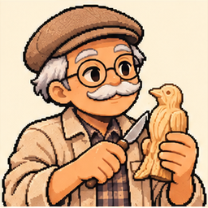

# AGUNG NUGRAHA S R (C03)

**Peran:** Perajin kayu senior
**Potret:** 
**Status:** Rancangan fiksi publik — belum disahkan sebagai kisah atau gameplay aktif.

> Seluruh cerita dan sifat di halaman ini adalah konsep untuk tokoh fiksi YZ Farm Life, bukan biografi seseorang di dunia nyata.

## Identitas

**preferredName:** Agung Nugraha S

**ageYears:** 70

**origin:** Agung Nugraha S lebih mudah mengingat Cicadas dari suasana lorong kios dan meja kerja daripada satu peristiwa besar. Di sanalah ia belajar memahami nilai sebuah pekerjaan dari dekat, lalu mencoba menerapkannya di dekat kebun Pasirluyu. (latar fiksi; draf)

**language:** Bahasa Indonesia; sesekali memakai sapaan atau ungkapan Sunda saat suasana percakapan cocok.

**identity:** NPC fiksi berlatar Kota Bandung

**ageDesignNote:** Usia ini pilihan kreatif sementara berdasarkan kematangan visual potret, bukan pengukuran umur dari gambar.

**visualAgeBandDraft:** lanjut dalam rancangan karakter

## Penampilan dan bahasa tubuh

**general:** Potret canonical work-C03 memperlihatkan rincian visual yang dicatat di bawah; jangan menggantinya dengan identitas dari arsip legacy.

**physicalTraits:** Rambut putih, kumis putih lebat, kacamata bundar dan topi cokelat; mengukir figur burung dari kayu.

**bodyLanguageDirection:** mengukir figur burung dari kayu

**proposedPose:** Gunakan gestur yang terlihat pada potret sebagai rujukan satu pose interaksi; animasi final belum disetujui.

## Busana dan estetika

**signatureClothing:** Rambut putih, kumis putih lebat, kacamata bundar dan topi cokelat

**accessories**
- kacamata

**aesthetic:** Pixel-art kehidupan Kota Bandung

**palette:** cokelat, putih

**costumeConcept:** Pakaian kerja yang memudahkan kegiatan latihan dan perlengkapan acara, tanpa menganggapnya sebagai pakaian nyata sosok dalam dunia nyata

## Pekerjaan dan kehidupan sosial

**education:** Mengasah keterampilan kriya lewat praktik, belajar dari pekerja berpengalaman, dan uji coba bahan.

**communityActivity:** Mengajak warga mencatat kebutuhan kayu senior agar pekerjaan tidak saling bertabrakan.

**functionInWorld:** kriya

**workRoutineConcept:** memeriksa alat sebelum sesi bersama dimulai

**workplaceConcept:** Situasi kerja fiksi mengenai latihan dan perlengkapan acara; lokasi spesifik belum ditetapkan

## Kepribadian fiksi

**traits**
- Kesabaran
- Tekun
- Mau mendengar

**observableHabit:** mengukur bahan sebelum memotong

**values:** Kesabaran

**weakness:** ingin hasil sempurna saat waktunya sempit

**strengthConcept:** mencatat hal kecil yang kerap terlewat

**flawConcept:** terlalu berhati-hati ketika keadaan mendesak

**microHabitConcept:** membandingkan dua catatan tentang latihan dan perlengkapan acara sebelum menjawab

## Motivasi dan konflik fiksi

**primaryMotivation:** Menjaga pekerjaan kayu senior tetap dapat dipertanggungjawabkan

**need:** Ingin ada waktu memeriksa urusan kayu senior sebelum keputusan diambil bersama.

**innerConflict:** Pemilik alat meminta solusi yang berbeda dari kebiasaan

**fear:** Bahan berharga terbuang

**motivationConcept:** Mencari cara menangani kayu senior dengan teliti ketika orang lain ingin pekerjaan cepat selesai

**conflictConcept:** Di bagian kayu senior, satu bagian belum siap walaupun jadwal acara sudah dibagikan; pilihan yang serba cepat terasa berisiko baginya dalam premis fiksi ini

**agencyConcept:** Boleh menolak bantuan yang melanjutkan acara sesuai jadwal; dapat memilih mengatur ulang giliran agar semua bagian siap meskipun pemain tidak setuju

## Latar cerita

**familyContext:** Seorang paman mengajarkan Agung Nugraha S memperbaiki barang sebelum membuangnya. Kebiasaan itu kadang berguna saat bekerja sebagai perajin kayu senior, namun harus ditinggalkan bila keselamatan dipertaruhkan. (latar fiksi; draf)

**formativeMemory:** Ada satu kejadian di tempat kerja yang sulit dilupakan: satu bagian belum siap walaupun jadwal acara sudah dibagikan. Kini ia lebih suka menunjukkan hasil nyata daripada mengandalkan perkiraan.

**narrativeBackground:** Di sela bahan, warna, dan barang buatan tangan, Agung Nugraha S R menemukan alat lama yang hampir tidak dipakai lagi.

**narrativeStatus:** Konsep fiksi baru; bukan riwayat orang asli

**sceneConcept:** Sebuah kegiatan sehari-hari tentang latihan dan perlengkapan acara terhambat karena satu bagian belum siap walaupun jadwal acara sudah dibagikan. Ini hanya premis adegan, bukan riwayat pribadi.

## Interaksi dan hubungan

**relationshipHook:** Kedekatan dibangun melalui bantuan terkait pola kerja, tanpa relasi keluarga yang ditebak

**trustBehavior:** Meningkat setelah pemain menepati janji dan menghormati pilihan tokoh

**personalBoundary:** Tidak langsung membicarakan masalah pribadi kepada pemain baru

**boundaryConcept:** Tidak membagi urusan pribadi hanya karena pemain sering menyapa; kedekatan tidak sama dengan persetujuan

## Suara dan dialog

**speechSignature:** Awalnya hati-hati ketika menjelaskan kayu senior, lalu lugas setelah melihat hasil.

**sampleLine:** Di catatan, urusan kayu senior sudah selesai. Di lapangan ternyata belum.

**habitualGesture:** meraba sambungan atau merapikan bahan

**reactions**
- **neutral:** Menanggapi seperlunya dan kembali ke pekerjaan
- **happy:** Senyum kecil saat bantuan benar-benar berguna
- **worried:** Memeriksa pola kerja sebelum memberi jawaban

**dialogueDrafts**
- Di catatan, urusan kayu senior sudah selesai. Di lapangan ternyata belum.
- Aku kurang yakin kalau kita melanjutkan acara sesuai jadwal. Untuk kayu senior, risikonya belum jelas.
- Kalau aku, lebih baik mengatur ulang giliran agar semua bagian siap. Urusan kayu senior bisa menunggu sebentar.

**speakingCadence:** tenang dengan jeda saat memastikan rincian

## Perkembangan cerita

**storyArc:** Urusan pola kerja mulai mengganggu rutinitas perajin kayu senior

**questHook:** Ketika sedang menangani kayu senior, muncul masalah sederhana: satu bagian belum siap walaupun jadwal acara sudah dibagikan. Pemain boleh membantu, menolak, atau mengajukan cara lain; belum ada quest runtime.

**threeActBeats**
- Masalah kayu senior terlihat ketika memeriksa alat sebelum sesi bersama dimulai
- Pemain mengetahui bahwa satu bagian belum siap walaupun jadwal acara sudah dibagikan; pilihan warga tidak selalu sejalan
- Salah satu cara dicoba dalam kegiatan kayu senior, lalu hasilnya dievaluasi bersama

**playerChoices**
- Mendukung usulan untuk melanjutkan acara sesuai jadwal pada kayu senior
- Mengusulkan agar mengatur ulang giliran agar semua bagian siap untuk kayu senior

**implementation:** draft, belum diaktifkan otomatis

**sideQuestConcept**
- **premise:** Saat mengurus kayu senior, satu bagian belum siap walaupun jadwal acara sudah dibagikan.
- **decisionA:** Melanjutkan acara sesuai jadwal.
- **decisionB:** Mengatur ulang giliran agar semua bagian siap.
- **state:** not-implemented

**choiceConsequencesConcept**
- - **choice:** A
- **result:** Kemungkinan lebih cepat; konsekuensi nyata harus ditulis dan diuji sebelum implementasi
- - **choice:** B
- **result:** Kemungkinan lebih teliti; konsekuensi nyata harus ditulis dan diuji sebelum implementasi

## Referensi visual

**visualContinuity:** Patokan ilustrasi: Rambut putih, kumis putih lebat, kacamata bundar dan topi cokelat; mengukir figur burung dari kayu. Cocokkan penutup kepala, warna, alat bantu, aksesori dan siluet dengan sprite; jangan mengganti portrait key.

**suggestedPalette:** cokelat, putih

**animationRequired**
- idle
- walk-4-directions
- interact

**observedIllustrationStyle:** Ilustrasi 2D kartun dengan garis tegas dan bidang warna halus; perlu penyeragaman resolusi sprite.

## Kontinuitas dan status runtime

**availability:** Katalog; jadwal dan spawn mengikuti ekspansi bertahap

**playerDependentState:** Tidak boleh tertukar dengan ID cerita lama

**canonStatus:** Nama, pekerjaan dan kunci potret terkunci; detail cerita masih rancangan

**playableRuntimeConfirmed:** Tidak

**questIntegrationConfirmed:** Tidak

**legacyAssociationApproved:** Tidak

**status:** Konsep publik; kehadiran karakter dan cerita di runtime memerlukan implementasi terpisah.

---
Karakter ini merupakan bagian dari katalog fiksi YZ Farm Life. Data identitas canonical dikunci; pengesahan lore dan implementasi gameplay dilakukan terpisah.
