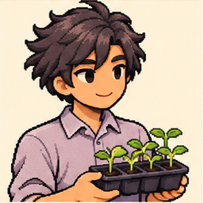

# AHMAD MULYANA (C05)

**Peran:** Pelajar dan peserta klub kebun
**Potret:** 
**Status:** Rancangan fiksi publik — belum disahkan sebagai kisah atau gameplay aktif.

> Seluruh cerita dan sifat di halaman ini adalah konsep untuk tokoh fiksi YZ Farm Life, bukan biografi seseorang di dunia nyata.

## Identitas

**preferredName:** Ahmad

**ageYears:** 29

**origin:** Jejak awal Ahmad dalam cerita ini berangkat dari Baleendah, di antara kegiatan bertani warga. Ia mulai terbiasa menghargai kerja sama dan kesabaran, sesuatu yang kelak memengaruhi cara bekerja dan bergaulnya. (latar fiksi; draf)

**language:** Bahasa Indonesia; sesekali memakai sapaan atau ungkapan Sunda saat suasana percakapan cocok.

**identity:** NPC fiksi berlatar Kota Bandung

**ageDesignNote:** Usia ini pilihan kreatif sementara berdasarkan kematangan visual potret, bukan pengukuran umur dari gambar.

**visualAgeBandDraft:** dewasa dalam rancangan karakter

## Penampilan dan bahasa tubuh

**general:** Potret canonical work-C05 memperlihatkan rincian visual yang dicatat di bawah; jangan menggantinya dengan identitas dari arsip legacy.

**physicalTraits:** Rambut cokelat gelap acak, kemeja ungu pucat; membawa baki bibit hijau.

**bodyLanguageDirection:** membawa baki bibit hijau

**proposedPose:** Gunakan gestur yang terlihat pada potret sebagai rujukan satu pose interaksi; animasi final belum disetujui.

## Busana dan estetika

**signatureClothing:** Rambut cokelat gelap acak, kemeja ungu pucat

**aesthetic:** Pixel-art kehidupan Kota Bandung

**palette:** cokelat, hijau, ungu

**costumeConcept:** Pakaian kerja yang memudahkan kegiatan tanaman dan lingkungan, tanpa menganggapnya sebagai pakaian nyata sosok dalam dunia nyata

## Pekerjaan dan kehidupan sosial

**education:** Belajar budidaya serta pengamatan lapangan melalui kerja kebun dan pertukaran pengetahuan antarwarga.

**communityActivity:** Menyiapkan kegiatan kecil seputar pelajar dan peserta klub kebun tanpa bergantung pada pemain.

**functionInWorld:** pertanian

**workRoutineConcept:** meninjau keadaan area kerja sebelum menerima bantuan

**workplaceConcept:** Situasi kerja fiksi mengenai tanaman dan lingkungan; lokasi spesifik belum ditetapkan

## Kepribadian fiksi

**traits**
- Ketelitian
- Tekun
- Mau mendengar

**observableHabit:** kerap memeriksa tanah sebelum mengambil keputusan

**values:** Ketelitian

**weakness:** terlalu lama membandingkan pilihan

**strengthConcept:** memperhatikan risiko untuk orang lain

**flawConcept:** sulit melepas pekerjaan yang belum rapi

**microHabitConcept:** menunjuk bagian yang perlu dicek saat membicarakan tanaman dan lingkungan

## Motivasi dan konflik fiksi

**primaryMotivation:** Menjaga pekerjaan pelajar dan peserta klub kebun tetap dapat dipertanggungjawabkan

**need:** Berharap warga mau mendengarkan masalah pelajar dan peserta klub kebun sebelum memberi solusi.

**innerConflict:** Dua keterangan warga ternyata tidak sama

**fear:** Bibit yang rusak

**motivationConcept:** Mencari cara menangani pelajar dan peserta klub kebun dengan teliti ketika orang lain ingin pekerjaan cepat selesai

**conflictConcept:** Di bagian pelajar dan peserta klub kebun, perubahan kecil pada tempat tumbuh membuat hasil pemeliharaan tidak seragam; pilihan yang serba cepat terasa berisiko baginya dalam premis fiksi ini

**agencyConcept:** Boleh menolak bantuan yang mengubah seluruh penataan sekaligus; dapat memilih menguji satu perubahan di area terbatas meskipun pemain tidak setuju

## Latar cerita

**familyContext:** Ahmad pernah berjanji lebih sering pulang sebelum malam untuk bercakap dengan keluarga. Sejak bekerja sebagai pelajar dan peserta klub kebun, ia memilih kesepakatan yang lebih realistis. (latar fiksi; draf)

**formativeMemory:** Pernah ada hari ketika perubahan kecil pada tempat tumbuh membuat hasil pemeliharaan tidak seragam. Pelajaran yang dipegangnya sederhana: bekerja cepat tidak sama dengan bekerja tepat.

**narrativeBackground:** Di sela bedengan, bibit, dan musim yang berubah, Ahmad Mulyana menemukan catatan yang tercecer.

**narrativeStatus:** Konsep fiksi baru; bukan riwayat orang asli

**sceneConcept:** Sebuah kegiatan sehari-hari tentang tanaman dan lingkungan terhambat karena perubahan kecil pada tempat tumbuh membuat hasil pemeliharaan tidak seragam. Ini hanya premis adegan, bukan riwayat pribadi.

## Interaksi dan hubungan

**relationshipHook:** Kedekatan dibangun melalui bantuan terkait jadwal tanam, tanpa relasi keluarga yang ditebak

**trustBehavior:** Meningkat setelah pemain menepati janji dan menghormati pilihan tokoh

**personalBoundary:** Tidak langsung membicarakan masalah pribadi kepada pemain baru

**boundaryConcept:** Tidak membagi urusan pribadi hanya karena pemain sering menyapa; kedekatan tidak sama dengan persetujuan

## Suara dan dialog

**speechSignature:** Pilih kata sederhana untuk pelajar dan peserta klub kebun; tidak berusaha selalu menyenangkan pemain.

**sampleLine:** Kalau bicara pelajar dan peserta klub kebun, aku lebih suka melihat kondisinya langsung.

**habitualGesture:** mengusap tanah dari telapak tangan

**reactions**
- **neutral:** Menanggapi seperlunya dan kembali ke pekerjaan
- **happy:** Senyum kecil saat bantuan benar-benar berguna
- **worried:** Memeriksa jadwal tanam sebelum memberi jawaban

**dialogueDrafts**
- Kalau bicara pelajar dan peserta klub kebun, aku lebih suka melihat kondisinya langsung.
- Kalau kamu memilih mengubah seluruh penataan sekaligus untuk pelajar dan peserta klub kebun, aku perlu tahu siapa yang bertanggung jawab.
- Kita coba menguji satu perubahan di area terbatas untuk pelajar dan peserta klub kebun dulu. Kalau tidak cocok, kita ganti rencana.

**speakingCadence:** ringkas saat bekerja, lebih terbuka sesudahnya

## Perkembangan cerita

**storyArc:** Urusan jadwal tanam mulai mengganggu rutinitas pelajar dan peserta klub kebun

**questHook:** Ketika sedang menangani pelajar dan peserta klub kebun, muncul masalah sederhana: perubahan kecil pada tempat tumbuh membuat hasil pemeliharaan tidak seragam. Pemain boleh membantu, menolak, atau mengajukan cara lain; belum ada quest runtime.

**threeActBeats**
- Masalah pelajar dan peserta klub kebun terlihat ketika meninjau keadaan area kerja sebelum menerima bantuan
- Pemain mengetahui bahwa perubahan kecil pada tempat tumbuh membuat hasil pemeliharaan tidak seragam; pilihan warga tidak selalu sejalan
- Salah satu cara dicoba dalam kegiatan pelajar dan peserta klub kebun, lalu hasilnya dievaluasi bersama

**playerChoices**
- Mendukung usulan untuk mengubah seluruh penataan sekaligus pada pelajar dan peserta klub kebun
- Mengusulkan agar menguji satu perubahan di area terbatas untuk pelajar dan peserta klub kebun

**implementation:** draft, belum diaktifkan otomatis

**sideQuestConcept**
- **premise:** Saat mengurus pelajar dan peserta klub kebun, perubahan kecil pada tempat tumbuh membuat hasil pemeliharaan tidak seragam.
- **decisionA:** Mengubah seluruh penataan sekaligus.
- **decisionB:** Menguji satu perubahan di area terbatas.
- **state:** not-implemented

**choiceConsequencesConcept**
- - **choice:** A
- **result:** Kemungkinan lebih cepat; konsekuensi nyata harus ditulis dan diuji sebelum implementasi
- - **choice:** B
- **result:** Kemungkinan lebih teliti; konsekuensi nyata harus ditulis dan diuji sebelum implementasi

## Referensi visual

**visualContinuity:** Patokan ilustrasi: Rambut cokelat gelap acak, kemeja ungu pucat; membawa baki bibit hijau. Cocokkan penutup kepala, warna, alat bantu, aksesori dan siluet dengan sprite; jangan mengganti portrait key.

**suggestedPalette:** cokelat, hijau, ungu

**animationRequired**
- idle
- walk-4-directions
- interact

**observedIllustrationStyle:** Ilustrasi 2D kartun dengan garis tegas dan bidang warna halus; perlu penyeragaman resolusi sprite.

## Kontinuitas dan status runtime

**availability:** Katalog; jadwal dan spawn mengikuti ekspansi bertahap

**playerDependentState:** Tidak boleh tertukar dengan ID cerita lama

**canonStatus:** Nama, pekerjaan dan kunci potret terkunci; detail cerita masih rancangan

**playableRuntimeConfirmed:** Tidak

**questIntegrationConfirmed:** Tidak

**legacyAssociationApproved:** Tidak

**status:** Konsep publik; kehadiran karakter dan cerita di runtime memerlukan implementasi terpisah.

---
Karakter ini merupakan bagian dari katalog fiksi YZ Farm Life. Data identitas canonical dikunci; pengesahan lore dan implementasi gameplay dilakukan terpisah.
