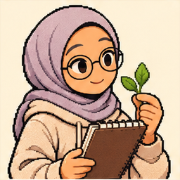

# YANI ANDRIYANI KAUTSAR (C06)

**Peran:** Mahasiswi pertanian
**Potret:** 
**Status:** Rancangan fiksi publik — belum disahkan sebagai kisah atau gameplay aktif.

> Seluruh cerita dan sifat di halaman ini adalah konsep untuk tokoh fiksi YZ Farm Life, bukan biografi seseorang di dunia nyata.

## Identitas

**preferredName:** Yani Andriyani

**ageYears:** 30

**origin:** Dalam versi cerita ini, Yani Andriyani berasal dari lingkungan Pangalengan dengan lereng perkebunan. Ia membawa kebiasaan mencatat hasil percobaan sebelum memberi saran saat mulai membangun hubungan dengan tetangga baru. (latar fiksi; draf)

**language:** Bahasa Indonesia; sesekali memakai sapaan atau ungkapan Sunda saat suasana percakapan cocok.

**identity:** NPC fiksi berlatar Kota Bandung

**ageDesignNote:** Usia ini pilihan kreatif sementara berdasarkan kematangan visual potret, bukan pengukuran umur dari gambar.

**visualAgeBandDraft:** dewasa dalam rancangan karakter

## Penampilan dan bahasa tubuh

**general:** Potret canonical work-C06 memperlihatkan rincian visual yang dicatat di bawah; jangan menggantinya dengan identitas dari arsip legacy.

**physicalTraits:** Kerudung ungu pucat, kacamata bundar dan hoodie krem; memegang buku catatan dan daun kecil.

**bodyLanguageDirection:** memegang buku catatan dan daun kecil

**proposedPose:** Gunakan gestur yang terlihat pada potret sebagai rujukan satu pose interaksi; animasi final belum disetujui.

## Busana dan estetika

**signatureClothing:** Kerudung ungu pucat, kacamata bundar dan hoodie krem

**accessories**
- kerudung
- kacamata
- buku catatan

**aesthetic:** Pixel-art kehidupan Kota Bandung

**palette:** ungu, krem

**costumeConcept:** Pakaian kerja yang memudahkan kegiatan hasil kebun, tanpa menganggapnya sebagai pakaian nyata sosok dalam dunia nyata

## Pekerjaan dan kehidupan sosial

**education:** Belajar budidaya serta pengamatan lapangan melalui kerja kebun dan pertukaran pengetahuan antarwarga.

**communityActivity:** Menyiapkan kegiatan kecil seputar mahasiswi pertanian tanpa bergantung pada pemain.

**functionInWorld:** pertanian

**workRoutineConcept:** mengatur urutan kerja di petak dan tempat penyimpanan

**workplaceConcept:** Situasi kerja fiksi mengenai hasil kebun; lokasi spesifik belum ditetapkan

## Kepribadian fiksi

**traits**
- Ketelitian
- Tekun
- Mau mendengar

**observableHabit:** kerap memeriksa tanah sebelum mengambil keputusan

**values:** Ketelitian

**weakness:** terlalu lama membandingkan pilihan

**strengthConcept:** mengetahui kapan harus meminta bantuan

**flawConcept:** mudah terpaku pada jadwal yang sudah dibuat

**microHabitConcept:** membandingkan dua catatan tentang hasil kebun sebelum menjawab

## Motivasi dan konflik fiksi

**primaryMotivation:** Menjaga pekerjaan mahasiswi pertanian tetap dapat dipertanggungjawabkan

**need:** Ingin ada waktu memeriksa urusan mahasiswi pertanian sebelum keputusan diambil bersama.

**innerConflict:** Rencana awal membuat sebagian orang menunggu lebih lama

**fear:** Bibit yang rusak

**motivationConcept:** Mencari cara menangani mahasiswi pertanian dengan teliti ketika orang lain ingin pekerjaan cepat selesai

**conflictConcept:** Di bagian mahasiswi pertanian, hasil bagus di satu petak belum tentu cocok dengan jadwal petak lain; pilihan yang serba cepat terasa berisiko baginya dalam premis fiksi ini

**agencyConcept:** Boleh menolak bantuan yang mendahulukan pengiriman hari ini; dapat memilih menjaga mutu sebelum mempercepat pengiriman meskipun pemain tidak setuju

## Latar cerita

**familyContext:** Seorang kerabat berharap Yani Andriyani memilih pekerjaan yang dianggap lebih pasti. Yani Andriyani tidak ingin menjauh; ia berharap pekerjaannya sebagai mahasiswi pertanian dapat dipahami lewat hasil nyata. (latar fiksi; draf)

**formativeMemory:** Di awal pekerjaannya sebagai mahasiswi pertanian, hasil bagus di satu petak belum tentu cocok dengan jadwal petak lain. Ia memilih untuk kerap memeriksa tanah sebelum mengambil keputusan, meskipun langkah itu membutuhkan lebih banyak waktu.

**narrativeBackground:** Di sela bedengan, bibit, dan musim yang berubah, Yani Andriyani Kautsar menemukan cuaca berubah saat pekerjaan belum selesai.

**narrativeStatus:** Konsep fiksi baru; bukan riwayat orang asli

**sceneConcept:** Sebuah kegiatan sehari-hari tentang hasil kebun terhambat karena hasil bagus di satu petak belum tentu cocok dengan jadwal petak lain. Ini hanya premis adegan, bukan riwayat pribadi.

## Interaksi dan hubungan

**relationshipHook:** Kedekatan dibangun melalui bantuan terkait jadwal tanam, tanpa relasi keluarga yang ditebak

**trustBehavior:** Meningkat setelah pemain menepati janji dan menghormati pilihan tokoh

**personalBoundary:** Tidak langsung membicarakan masalah pribadi kepada pemain baru

**boundaryConcept:** Tidak membagi urusan pribadi hanya karena pemain sering menyapa; kedekatan tidak sama dengan persetujuan

## Suara dan dialog

**speechSignature:** Pilih kata sederhana untuk mahasiswi pertanian; tidak berusaha selalu menyenangkan pemain.

**sampleLine:** Kamu lihat mahasiswi pertanian tadi? Ada satu hal yang ingin kupastikan.

**habitualGesture:** mengusap tanah dari telapak tangan

**reactions**
- **neutral:** Menanggapi seperlunya dan kembali ke pekerjaan
- **happy:** Senyum kecil saat bantuan benar-benar berguna
- **worried:** Memeriksa jadwal tanam sebelum memberi jawaban

**dialogueDrafts**
- Kamu lihat mahasiswi pertanian tadi? Ada satu hal yang ingin kupastikan.
- Aku kurang yakin kalau kita mendahulukan pengiriman hari ini. Untuk mahasiswi pertanian, risikonya belum jelas.
- Kalau aku, lebih baik menjaga mutu sebelum mempercepat pengiriman. Urusan mahasiswi pertanian bisa menunggu sebentar.

**speakingCadence:** tenang dengan jeda saat memastikan rincian

## Perkembangan cerita

**storyArc:** Urusan jadwal tanam mulai mengganggu rutinitas mahasiswi pertanian

**questHook:** Ketika sedang menangani mahasiswi pertanian, muncul masalah sederhana: hasil bagus di satu petak belum tentu cocok dengan jadwal petak lain. Pemain boleh membantu, menolak, atau mengajukan cara lain; belum ada quest runtime.

**threeActBeats**
- Masalah mahasiswi pertanian terlihat ketika mengatur urutan kerja di petak dan tempat penyimpanan
- Pemain mengetahui bahwa hasil bagus di satu petak belum tentu cocok dengan jadwal petak lain; pilihan warga tidak selalu sejalan
- Salah satu cara dicoba dalam kegiatan mahasiswi pertanian, lalu hasilnya dievaluasi bersama

**playerChoices**
- Mendukung usulan untuk mendahulukan pengiriman hari ini pada mahasiswi pertanian
- Mengusulkan agar menjaga mutu sebelum mempercepat pengiriman untuk mahasiswi pertanian

**implementation:** draft, belum diaktifkan otomatis

**sideQuestConcept**
- **premise:** Saat mengurus mahasiswi pertanian, hasil bagus di satu petak belum tentu cocok dengan jadwal petak lain.
- **decisionA:** Mendahulukan pengiriman hari ini.
- **decisionB:** Menjaga mutu sebelum mempercepat pengiriman.
- **state:** not-implemented

**choiceConsequencesConcept**
- - **choice:** A
- **result:** Kemungkinan lebih cepat; konsekuensi nyata harus ditulis dan diuji sebelum implementasi
- - **choice:** B
- **result:** Kemungkinan lebih teliti; konsekuensi nyata harus ditulis dan diuji sebelum implementasi

## Referensi visual

**visualContinuity:** Patokan ilustrasi: Kerudung ungu pucat, kacamata bundar dan hoodie krem; memegang buku catatan dan daun kecil. Cocokkan penutup kepala, warna, alat bantu, aksesori dan siluet dengan sprite; jangan mengganti portrait key.

**suggestedPalette:** ungu, krem

**animationRequired**
- idle
- walk-4-directions
- interact

**observedIllustrationStyle:** Ilustrasi 2D kartun dengan garis tegas dan bidang warna halus; perlu penyeragaman resolusi sprite.

## Kontinuitas dan status runtime

**availability:** Katalog; jadwal dan spawn mengikuti ekspansi bertahap

**playerDependentState:** Tidak boleh tertukar dengan ID cerita lama

**canonStatus:** Nama, pekerjaan dan kunci potret terkunci; detail cerita masih rancangan

**playableRuntimeConfirmed:** Tidak

**questIntegrationConfirmed:** Tidak

**legacyAssociationApproved:** Tidak

**status:** Konsep publik; kehadiran karakter dan cerita di runtime memerlukan implementasi terpisah.

---
Karakter ini merupakan bagian dari katalog fiksi YZ Farm Life. Data identitas canonical dikunci; pengesahan lore dan implementasi gameplay dilakukan terpisah.
