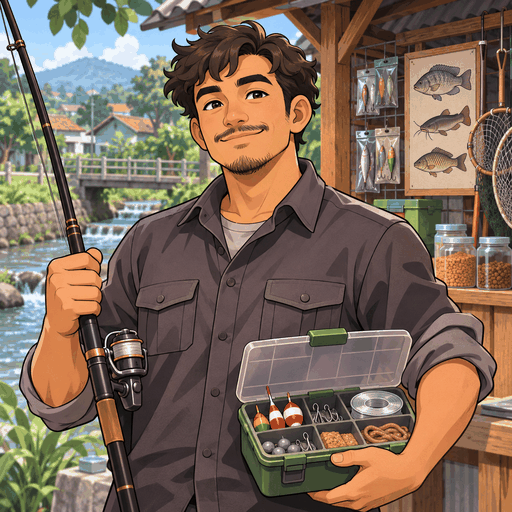

# WIDI MUNAJAT (C07)

**Peran:** Pedagang hasil bumi
**Potret:** 
**Status:** Rancangan fiksi publik — belum disahkan sebagai kisah atau gameplay aktif.

> Seluruh cerita dan sifat di halaman ini adalah konsep untuk tokoh fiksi YZ Farm Life, bukan biografi seseorang di dunia nyata.

## Identitas

**preferredName:** Widi

**ageYears:** 42

**origin:** Widi lama tinggal di sekitar Andir, tempat lapak-lapak pasar menjadi pemandangan akrab. Dari sana ia belajar membedakan janji dan bantuan yang benar-benar datang dan membawa kebiasaan itu ke lingkungan Pasirluyu. (latar fiksi; draf)

**language:** Bahasa Indonesia; sesekali memakai sapaan atau ungkapan Sunda saat suasana percakapan cocok.

**identity:** NPC fiksi berlatar Kota Bandung

**ageDesignNote:** Usia ini pilihan kreatif sementara berdasarkan kematangan visual potret, bukan pengukuran umur dari gambar.

**visualAgeBandDraft:** dewasa dalam rancangan karakter

## Penampilan dan bahasa tubuh

**general:** Potret canonical work-C07 memperlihatkan rincian visual yang dicatat di bawah; jangan menggantinya dengan identitas dari arsip legacy.

**physicalTraits:** Rambut cokelat gelap acak, kemeja abu gelap; memegang keranjang berisi sayuran warna-warni.

**bodyLanguageDirection:** memegang keranjang berisi sayuran warna-warni

**proposedPose:** Gunakan gestur yang terlihat pada potret sebagai rujukan satu pose interaksi; animasi final belum disetujui.

## Busana dan estetika

**signatureClothing:** Rambut cokelat gelap acak, kemeja abu gelap

**aesthetic:** Pixel-art kehidupan Kota Bandung

**palette:** cokelat, abu

**costumeConcept:** Pakaian kerja yang memudahkan kegiatan hasil kebun, tanpa menganggapnya sebagai pakaian nyata sosok dalam dunia nyata

## Pekerjaan dan kehidupan sosial

**education:** Belajar tata barang, layanan pelanggan, dan pengelolaan usaha melalui praktik kios serta kerja komunitas.

**communityActivity:** Membahas cara memeriksa pedagang hasil bumi bersama warga sebelum mengambil keputusan.

**functionInWorld:** perdagangan

**workRoutineConcept:** mengatur urutan kerja di petak dan tempat penyimpanan

**workplaceConcept:** Situasi kerja fiksi mengenai hasil kebun; lokasi spesifik belum ditetapkan

## Kepribadian fiksi

**traits**
- Kejujuran
- Tekun
- Mau mendengar

**observableHabit:** menghitung kembalian dan memeriksa stok

**values:** Kejujuran

**weakness:** kadang sulit menolak tawaran murah

**strengthConcept:** telaten menguji hasil sebelum dibagikan

**flawConcept:** terlalu lama mengecek rincian

**microHabitConcept:** menyebut risiko sebelum menyetujui perubahan hasil kebun

## Motivasi dan konflik fiksi

**primaryMotivation:** Menjaga pekerjaan pedagang hasil bumi tetap dapat dipertanggungjawabkan

**need:** Ingin hasil penanganan pedagang hasil bumi dinilai dari keadaan nyata, bukan janji.

**innerConflict:** Pengguna meminta satu penyesuaian kecil

**fear:** Stok terbuang saat pasar sepi

**motivationConcept:** Mencari cara menangani pedagang hasil bumi dengan teliti ketika orang lain ingin pekerjaan cepat selesai

**conflictConcept:** Di bagian pedagang hasil bumi, hasil bagus di satu petak belum tentu cocok dengan jadwal petak lain; pilihan yang serba cepat terasa berisiko baginya dalam premis fiksi ini

**agencyConcept:** Boleh menolak bantuan yang mendahulukan pengiriman hari ini; dapat memilih menjaga mutu sebelum mempercepat pengiriman meskipun pemain tidak setuju

## Latar cerita

**familyContext:** Widi dan saudaranya menyisihkan uang untuk memperbaiki rumah keluarga secara bertahap. Mereka berusaha menjaga agar pekerjaan pedagang hasil bumi tidak menghabiskan seluruh waktu bersama. (latar fiksi; draf)

**formativeMemory:** Pekerjaan yang tampak biasa berubah rumit saat hasil bagus di satu petak belum tentu cocok dengan jadwal petak lain. Daripada cepat menyalahkan keadaan, ia belajar mengulang pemeriksaan kecil.

**narrativeBackground:** Di sela lapak, tawar-menawar, dan pelanggan tetap, Widi Munajat menemukan hasil kerja yang terlihat bagus tetapi belum nyaman dipakai.

**narrativeStatus:** Konsep fiksi baru; bukan riwayat orang asli

**sceneConcept:** Sebuah kegiatan sehari-hari tentang hasil kebun terhambat karena hasil bagus di satu petak belum tentu cocok dengan jadwal petak lain. Ini hanya premis adegan, bukan riwayat pribadi.

## Interaksi dan hubungan

**relationshipHook:** Kedekatan dibangun melalui bantuan terkait stok dagangan, tanpa relasi keluarga yang ditebak

**trustBehavior:** Meningkat setelah pemain menepati janji dan menghormati pilihan tokoh

**personalBoundary:** Tidak langsung membicarakan masalah pribadi kepada pemain baru

**boundaryConcept:** Tidak membagi urusan pribadi hanya karena pemain sering menyapa; kedekatan tidak sama dengan persetujuan

## Suara dan dialog

**speechSignature:** Bicara singkat soal pedagang hasil bumi; lebih banyak bertanya saat ada risiko.

**sampleLine:** Soal pedagang hasil bumi tadi ada yang kelewat. Aku mau lihat lagi sebentar.

**habitualGesture:** merapikan barang di tepi etalase

**reactions**
- **neutral:** Menanggapi seperlunya dan kembali ke pekerjaan
- **happy:** Senyum kecil saat bantuan benar-benar berguna
- **worried:** Memeriksa stok dagangan sebelum memberi jawaban

**dialogueDrafts**
- Soal pedagang hasil bumi tadi ada yang kelewat. Aku mau lihat lagi sebentar.
- Jangan buru-buru mendahulukan pengiriman hari ini. Nanti bagian pedagang hasil bumi malah terlewat.
- Untuk bagian pedagang hasil bumi, pilihanku menjaga mutu sebelum mempercepat pengiriman. Kamu boleh tidak setuju.

**speakingCadence:** bertanya sebelum menilai pilihan

## Perkembangan cerita

**storyArc:** Urusan stok dagangan mulai mengganggu rutinitas pedagang hasil bumi

**questHook:** Ketika sedang menangani pedagang hasil bumi, muncul masalah sederhana: hasil bagus di satu petak belum tentu cocok dengan jadwal petak lain. Pemain boleh membantu, menolak, atau mengajukan cara lain; belum ada quest runtime.

**threeActBeats**
- Masalah pedagang hasil bumi terlihat ketika mengatur urutan kerja di petak dan tempat penyimpanan
- Pemain mengetahui bahwa hasil bagus di satu petak belum tentu cocok dengan jadwal petak lain; pilihan warga tidak selalu sejalan
- Salah satu cara dicoba dalam kegiatan pedagang hasil bumi, lalu hasilnya dievaluasi bersama

**playerChoices**
- Mendukung usulan untuk mendahulukan pengiriman hari ini pada pedagang hasil bumi
- Mengusulkan agar menjaga mutu sebelum mempercepat pengiriman untuk pedagang hasil bumi

**implementation:** draft, belum diaktifkan otomatis

**localContext:** perdagangan hasil bumi

**sideQuestConcept**
- **premise:** Saat mengurus pedagang hasil bumi, hasil bagus di satu petak belum tentu cocok dengan jadwal petak lain.
- **decisionA:** Mendahulukan pengiriman hari ini.
- **decisionB:** Menjaga mutu sebelum mempercepat pengiriman.
- **state:** not-implemented

**choiceConsequencesConcept**
- - **choice:** A
- **result:** Kemungkinan lebih cepat; konsekuensi nyata harus ditulis dan diuji sebelum implementasi
- - **choice:** B
- **result:** Kemungkinan lebih teliti; konsekuensi nyata harus ditulis dan diuji sebelum implementasi

## Referensi visual

**visualContinuity:** Patokan ilustrasi: Rambut cokelat gelap acak, kemeja abu gelap; memegang keranjang berisi sayuran warna-warni. Cocokkan penutup kepala, warna, alat bantu, aksesori dan siluet dengan sprite; jangan mengganti portrait key.

**suggestedPalette:** cokelat, abu

**animationRequired**
- idle
- walk-4-directions
- interact

**observedIllustrationStyle:** Ilustrasi 2D kartun dengan garis tegas dan bidang warna halus; perlu penyeragaman resolusi sprite.

## Kontinuitas dan status runtime

**availability:** Katalog; jadwal dan spawn mengikuti ekspansi bertahap

**playerDependentState:** Tidak boleh tertukar dengan ID cerita lama

**canonStatus:** Nama, pekerjaan dan kunci potret terkunci; detail cerita masih rancangan

**playableRuntimeConfirmed:** Tidak

**questIntegrationConfirmed:** Tidak

**legacyAssociationApproved:** Tidak

**status:** Konsep publik; kehadiran karakter dan cerita di runtime memerlukan implementasi terpisah.

---
Karakter ini merupakan bagian dari katalog fiksi YZ Farm Life. Data identitas canonical dikunci; pengesahan lore dan implementasi gameplay dilakukan terpisah.
