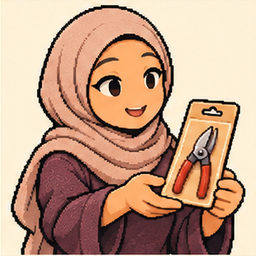

# FATIHAH RIZQIYAH (C12)

**Peran:** Penjaga toko perlengkapan kebun
**Potret:** 
**Status:** Rancangan fiksi publik — belum disahkan sebagai kisah atau gameplay aktif.

> Seluruh cerita dan sifat di halaman ini adalah konsep untuk tokoh fiksi YZ Farm Life, bukan biografi seseorang di dunia nyata.

## Identitas

**identity:** NPC fiksi berlatar Kota Bandung

## Penampilan dan bahasa tubuh

**general:** Rancangan sprite disesuaikan dengan potret work-C12; tidak disimpulkan dari nama atau pekerjaan

**bodyLanguageDirection:** mengusap tanah dari telapak tangan

**proposedPose:** Baca siluet ketika sedang meninjau keadaan area kerja sebelum menerima bantuan; sesuaikan hanya setelah potret benar-benar ditinjau

## Busana dan estetika

**signatureClothing:** apron kerja, pakaian lapang dan alas kaki aman

**aesthetic:** Pixel-art kehidupan Kota Bandung

**palette:** terracotta dan hijau zaitun

**costumeConcept:** Pakaian kerja yang memudahkan kegiatan tanaman dan lingkungan, tanpa menganggapnya sebagai pakaian nyata sosok dalam dunia nyata

## Pekerjaan dan kehidupan sosial

**communityActivity:** Menyiapkan kegiatan kecil seputar toko perlengkapan kebun tanpa bergantung pada pemain.

**functionInWorld:** pertanian

**workRoutineConcept:** meninjau keadaan area kerja sebelum menerima bantuan

**workplaceConcept:** Situasi kerja fiksi mengenai tanaman dan lingkungan; lokasi spesifik belum ditetapkan

## Kepribadian fiksi

**traits**
- Ketelitian
- Tekun
- Mau mendengar

**observableHabit:** kerap memeriksa tanah sebelum mengambil keputusan

**values:** Ketelitian

**weakness:** terlalu lama membandingkan pilihan

**strengthConcept:** mengetahui kapan harus meminta bantuan

**flawConcept:** mudah terpaku pada jadwal yang sudah dibuat

**microHabitConcept:** membandingkan dua catatan tentang tanaman dan lingkungan sebelum menjawab

## Motivasi dan konflik fiksi

**primaryMotivation:** Menjaga pekerjaan toko perlengkapan kebun tetap dapat dipertanggungjawabkan

**need:** Ingin ada waktu memeriksa urusan toko perlengkapan kebun sebelum keputusan diambil bersama.

**innerConflict:** Ada pelanggan atau warga yang belum mendapat giliran

**fear:** Bibit yang rusak

**motivationConcept:** Mencari cara menangani toko perlengkapan kebun dengan teliti ketika orang lain ingin pekerjaan cepat selesai

**conflictConcept:** Di bagian toko perlengkapan kebun, perubahan kecil pada tempat tumbuh membuat hasil pemeliharaan tidak seragam; pilihan yang serba cepat terasa berisiko baginya dalam premis fiksi ini

**agencyConcept:** Boleh menolak bantuan yang mengubah seluruh penataan sekaligus; dapat memilih menguji satu perubahan di area terbatas meskipun pemain tidak setuju

## Latar cerita

**narrativeBackground:** Di sela bedengan, bibit, dan musim yang berubah, Fatihah Rizqiyah menemukan permintaan mendadak di akhir hari.

**narrativeStatus:** Konsep fiksi baru; bukan riwayat orang asli

**sceneConcept:** Sebuah kegiatan sehari-hari tentang tanaman dan lingkungan terhambat karena perubahan kecil pada tempat tumbuh membuat hasil pemeliharaan tidak seragam. Ini hanya premis adegan, bukan riwayat pribadi.

## Interaksi dan hubungan

**relationshipHook:** Kedekatan dibangun melalui bantuan terkait jadwal tanam, tanpa relasi keluarga yang ditebak

**trustBehavior:** Meningkat setelah pemain menepati janji dan menghormati pilihan tokoh

**personalBoundary:** Tidak langsung membicarakan masalah pribadi kepada pemain baru

**boundaryConcept:** Tidak membagi urusan pribadi hanya karena pemain sering menyapa; kedekatan tidak sama dengan persetujuan

## Suara dan dialog

**speechSignature:** Pilih kata sederhana untuk toko perlengkapan kebun; tidak berusaha selalu menyenangkan pemain.

**sampleLine:** Kamu lihat toko perlengkapan kebun tadi? Ada satu hal yang ingin kupastikan.

**habitualGesture:** mengusap tanah dari telapak tangan

**reactions**
- **neutral:** Menanggapi seperlunya dan kembali ke pekerjaan
- **happy:** Senyum kecil saat bantuan benar-benar berguna
- **worried:** Memeriksa jadwal tanam sebelum memberi jawaban

**dialogueDrafts**
- Kamu lihat toko perlengkapan kebun tadi? Ada satu hal yang ingin kupastikan.
- Aku kurang yakin kalau kita mengubah seluruh penataan sekaligus. Untuk toko perlengkapan kebun, risikonya belum jelas.
- Kalau aku, lebih baik menguji satu perubahan di area terbatas. Urusan toko perlengkapan kebun bisa menunggu sebentar.

**speakingCadence:** tenang dengan jeda saat memastikan rincian

## Perkembangan cerita

**storyArc:** Urusan jadwal tanam mulai mengganggu rutinitas penjaga toko perlengkapan kebun

**questHook:** Ketika sedang menangani toko perlengkapan kebun, muncul masalah sederhana: perubahan kecil pada tempat tumbuh membuat hasil pemeliharaan tidak seragam. Pemain boleh membantu, menolak, atau mengajukan cara lain; belum ada quest runtime.

**threeActBeats**
- Masalah toko perlengkapan kebun terlihat ketika meninjau keadaan area kerja sebelum menerima bantuan
- Pemain mengetahui bahwa perubahan kecil pada tempat tumbuh membuat hasil pemeliharaan tidak seragam; pilihan warga tidak selalu sejalan
- Salah satu cara dicoba dalam kegiatan toko perlengkapan kebun, lalu hasilnya dievaluasi bersama

**playerChoices**
- Mendukung usulan untuk mengubah seluruh penataan sekaligus pada toko perlengkapan kebun
- Mengusulkan agar menguji satu perubahan di area terbatas untuk toko perlengkapan kebun

**implementation:** draft, belum diaktifkan otomatis

**sideQuestConcept**
- **premise:** Saat mengurus toko perlengkapan kebun, perubahan kecil pada tempat tumbuh membuat hasil pemeliharaan tidak seragam.
- **decisionA:** Mengubah seluruh penataan sekaligus.
- **decisionB:** Menguji satu perubahan di area terbatas.
- **state:** not-implemented

**choiceConsequencesConcept**
- - **choice:** A
- **result:** Kemungkinan lebih cepat; konsekuensi nyata harus ditulis dan diuji sebelum implementasi
- - **choice:** B
- **result:** Kemungkinan lebih teliti; konsekuensi nyata harus ditulis dan diuji sebelum implementasi

## Referensi visual

**visualContinuity:** Cocokkan palet, proporsi tangan, ekspresi, pakaian, dan arah hadap antara potret, sprite dan aset pekerjaan

**suggestedPalette:** terracotta dan hijau zaitun

**animationRequired**
- idle
- walk-4-directions
- interact

## Kontinuitas dan status runtime

**availability:** Katalog; jadwal dan spawn mengikuti ekspansi bertahap

**playerDependentState:** Tidak boleh tertukar dengan ID cerita lama

**canonStatus:** Nama, pekerjaan dan kunci potret terkunci; detail cerita masih rancangan

**playableRuntimeConfirmed:** Tidak

**questIntegrationConfirmed:** Tidak

**legacyAssociationApproved:** Tidak

**status:** Konsep publik; kehadiran karakter dan cerita di runtime memerlukan implementasi terpisah.

---
Karakter ini merupakan bagian dari katalog fiksi YZ Farm Life. Data identitas canonical dikunci; pengesahan lore dan implementasi gameplay dilakukan terpisah.
