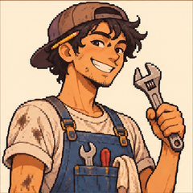

# ARRY YUANDI (K02)

**Peran:** Montir sepeda
**Potret:** 
**Status:** Rancangan fiksi publik — belum disahkan sebagai kisah atau gameplay aktif.

> Seluruh cerita dan sifat di halaman ini adalah konsep untuk tokoh fiksi YZ Farm Life, bukan biografi seseorang di dunia nyata.

## Identitas

**preferredName:** Arry

**ageYears:** 31

**origin:** Cibeunying Kidul adalah lingkungan asal Arry dalam kisah ini. Suasana ruang belajar dan toko perbaikan membuatnya belajar bertanya sebelum membongkar sesuatu, meski kini ia tidak selalu setuju dengan cara yang dahulu dianggap biasa. (latar fiksi; draf)

**language:** Bahasa Indonesia; sesekali memakai sapaan atau ungkapan Sunda saat suasana percakapan cocok.

**identity:** NPC fiksi berlatar Kota Bandung

**ageDesignNote:** Usia ini pilihan kreatif sementara berdasarkan kematangan visual potret, bukan pengukuran umur dari gambar.

**visualAgeBandDraft:** dewasa dalam rancangan karakter

## Penampilan dan bahasa tubuh

**general:** Potret canonical K02 memperlihatkan rincian visual yang dicatat di bawah; jangan menggantinya dengan identitas dari arsip legacy.

**physicalTraits:** Rambut gelap, topi cokelat, kaus krem dan overall denim; memegang kunci pas dengan perlengkapan montir di saku.

**bodyLanguageDirection:** memegang kunci pas dengan perlengkapan montir di saku

**proposedPose:** Gunakan gestur yang terlihat pada potret sebagai rujukan satu pose interaksi; animasi final belum disetujui.

## Busana dan estetika

**signatureClothing:** Rambut gelap, topi cokelat, kaus krem dan overall denim

**accessories**
- kunci pas

**aesthetic:** Pixel-art kehidupan Kota Bandung

**palette:** cokelat, krem

**costumeConcept:** Pakaian kerja yang memudahkan kegiatan peralatan kerja, tanpa menganggapnya sebagai pakaian nyata sosok dalam dunia nyata

## Pekerjaan dan kehidupan sosial

**education:** Memperoleh keterampilan melalui latihan bengkel dan pemecahan masalah peralatan.

**communityActivity:** Membahas cara memeriksa sepeda dan peralatannya bersama warga sebelum mengambil keputusan.

**functionInWorld:** transportasi

**workRoutineConcept:** mencari sumber gangguan sebelum mengganti bagian

**workplaceConcept:** Situasi kerja fiksi mengenai peralatan kerja; lokasi spesifik belum ditetapkan

## Kepribadian fiksi

**traits**
- Keandalan
- Tekun
- Mau mendengar

**observableHabit:** mengingat belokan dan ciri gang

**values:** Keandalan

**weakness:** terlalu percaya pada jalan pintas

**strengthConcept:** telaten menguji hasil sebelum dibagikan

**flawConcept:** terlalu lama mengecek rincian

**microHabitConcept:** menyebut risiko sebelum menyetujui perubahan peralatan kerja

## Motivasi dan konflik fiksi

**primaryMotivation:** Menjaga pekerjaan sepeda dan peralatannya tetap dapat dipertanggungjawabkan

**need:** Ingin hasil penanganan sepeda dan peralatannya dinilai dari keadaan nyata, bukan janji.

**innerConflict:** Orang lain mulai mempertanyakan cara kerja yang selama ini dianggap biasa

**fear:** Kiriman tiba terlambat

**motivationConcept:** Mencari cara menangani sepeda dan peralatannya dengan teliti ketika orang lain ingin pekerjaan cepat selesai

**conflictConcept:** Di bagian sepeda dan peralatannya, gejala kerusakan terlihat di satu bagian, tetapi penyebabnya belum jelas; pilihan yang serba cepat terasa berisiko baginya dalam premis fiksi ini

**agencyConcept:** Boleh menolak bantuan yang mengganti komponen yang paling mudah dijangkau; dapat memilih melakukan pemeriksaan bertahap meskipun pemain tidak setuju

## Latar cerita

**familyContext:** Arry pernah berjanji lebih sering pulang sebelum malam untuk bercakap dengan keluarga. Sejak bekerja sebagai montir sepeda, ia memilih kesepakatan yang lebih realistis. (latar fiksi; draf)

**formativeMemory:** Ada satu kejadian di tempat kerja yang sulit dilupakan: gejala kerusakan terlihat di satu bagian, tetapi penyebabnya belum jelas. Pelajaran yang dipegangnya sederhana: bekerja cepat tidak sama dengan bekerja tepat.

**narrativeBackground:** Di sela jalan sempit, kiriman, dan waktu tempuh, Arry Yuandi menemukan sebuah keputusan kecil yang menimbulkan akibat di kampung.

**narrativeStatus:** Konsep fiksi baru; bukan riwayat orang asli

**sceneConcept:** Sebuah kegiatan sehari-hari tentang peralatan kerja terhambat karena gejala kerusakan terlihat di satu bagian, tetapi penyebabnya belum jelas. Ini hanya premis adegan, bukan riwayat pribadi.

## Interaksi dan hubungan

**relationshipHook:** Kedekatan dibangun melalui bantuan terkait rute kiriman, tanpa relasi keluarga yang ditebak

**trustBehavior:** Meningkat setelah pemain menepati janji dan menghormati pilihan tokoh

**personalBoundary:** Tidak langsung membicarakan masalah pribadi kepada pemain baru

**boundaryConcept:** Tidak membagi urusan pribadi hanya karena pemain sering menyapa; kedekatan tidak sama dengan persetujuan

## Suara dan dialog

**speechSignature:** Bicara singkat soal sepeda dan peralatannya; lebih banyak bertanya saat ada risiko.

**sampleLine:** Rantai sepeda ini masih meloncat. Kalau hanya kusetel dari luar, besok bisa kambuh.

**habitualGesture:** mengecek tali atau roda sebelum berangkat

**reactions**
- **neutral:** Menanggapi seperlunya dan kembali ke pekerjaan
- **happy:** Senyum kecil saat bantuan benar-benar berguna
- **worried:** Memeriksa rute kiriman sebelum memberi jawaban

**dialogueDrafts**
- Rantai sepeda ini masih meloncat. Kalau hanya kusetel dari luar, besok bisa kambuh.
- Jangan buru-buru mengganti komponen yang paling mudah dijangkau. Nanti bagian sepeda dan peralatannya malah terlewat.
- Untuk bagian sepeda dan peralatannya, pilihanku melakukan pemeriksaan bertahap. Kamu boleh tidak setuju.

**speakingCadence:** bertanya sebelum menilai pilihan

## Perkembangan cerita

**storyArc:** Urusan rute kiriman mulai mengganggu rutinitas montir sepeda

**questHook:** Ketika sedang menangani sepeda dan peralatannya, muncul masalah sederhana: gejala kerusakan terlihat di satu bagian, tetapi penyebabnya belum jelas. Pemain boleh membantu, menolak, atau mengajukan cara lain; belum ada quest runtime.

**threeActBeats**
- Masalah sepeda dan peralatannya terlihat ketika mencari sumber gangguan sebelum mengganti bagian
- Pemain mengetahui bahwa gejala kerusakan terlihat di satu bagian, tetapi penyebabnya belum jelas; pilihan warga tidak selalu sejalan
- Salah satu cara dicoba dalam kegiatan sepeda dan peralatannya, lalu hasilnya dievaluasi bersama

**playerChoices**
- Mendukung usulan untuk mengganti komponen yang paling mudah dijangkau pada sepeda dan peralatannya
- Mengusulkan agar melakukan pemeriksaan bertahap untuk sepeda dan peralatannya

**implementation:** draft, belum diaktifkan otomatis

**sideQuestConcept**
- **premise:** Saat mengurus sepeda dan peralatannya, gejala kerusakan terlihat di satu bagian, tetapi penyebabnya belum jelas.
- **decisionA:** Mengganti komponen yang paling mudah dijangkau.
- **decisionB:** Melakukan pemeriksaan bertahap.
- **state:** not-implemented

**choiceConsequencesConcept**
- - **choice:** A
- **result:** Kemungkinan lebih cepat; konsekuensi nyata harus ditulis dan diuji sebelum implementasi
- - **choice:** B
- **result:** Kemungkinan lebih teliti; konsekuensi nyata harus ditulis dan diuji sebelum implementasi

## Referensi visual

**visualContinuity:** Patokan ilustrasi: Rambut gelap, topi cokelat, kaus krem dan overall denim; memegang kunci pas dengan perlengkapan montir di saku. Cocokkan penutup kepala, warna, alat bantu, aksesori dan siluet dengan sprite; jangan mengganti portrait key.

**suggestedPalette:** cokelat, krem

**animationRequired**
- idle
- walk-4-directions
- interact

**observedIllustrationStyle:** Potret ilustrasi karakter lingkungan; kepadatan piksel dan outline perlu diseragamkan.

## Kontinuitas dan status runtime

**availability:** Katalog; jadwal dan spawn mengikuti ekspansi bertahap

**playerDependentState:** Tidak boleh tertukar dengan ID cerita lama

**canonStatus:** Nama, pekerjaan dan kunci potret terkunci; detail cerita masih rancangan

**playableRuntimeConfirmed:** Tidak

**questIntegrationConfirmed:** Tidak

**legacyAssociationApproved:** Tidak

**status:** Konsep publik; kehadiran karakter dan cerita di runtime memerlukan implementasi terpisah.

---
Karakter ini merupakan bagian dari katalog fiksi YZ Farm Life. Data identitas canonical dikunci; pengesahan lore dan implementasi gameplay dilakukan terpisah.
