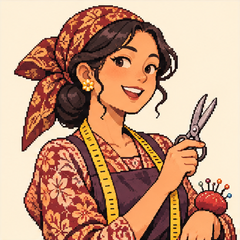

# BANON MAHBUBAH (K07)

**Peran:** Penjahit pasar
**Potret:** 
**Status:** Rancangan fiksi publik — belum disahkan sebagai kisah atau gameplay aktif.

> Seluruh cerita dan sifat di halaman ini adalah konsep untuk tokoh fiksi YZ Farm Life, bukan biografi seseorang di dunia nyata.

## Identitas

**preferredName:** Banon

**ageYears:** 37

**origin:** Dalam versi cerita ini, Banon berasal dari lingkungan Cibaduyut dengan deretan bengkel dan toko. Ia membawa kebiasaan memeriksa hasil sebelum menyebutnya selesai saat mulai membangun hubungan dengan tetangga baru. (latar fiksi; draf)

**language:** Bahasa Indonesia; sesekali memakai sapaan atau ungkapan Sunda saat suasana percakapan cocok.

**identity:** NPC fiksi berlatar Kota Bandung

**ageDesignNote:** Usia ini pilihan kreatif sementara berdasarkan kematangan visual potret, bukan pengukuran umur dari gambar.

**visualAgeBandDraft:** dewasa dalam rancangan karakter

## Penampilan dan bahasa tubuh

**general:** Potret canonical K27 memperlihatkan rincian visual yang dicatat di bawah; jangan menggantinya dengan identitas dari arsip legacy.

**physicalTraits:** Rambut gelap disanggul, kerudung kepala bermotif merah dan pakaian batik merah; memegang gunting serta pita ukur jahit.

**bodyLanguageDirection:** memegang gunting serta pita ukur jahit

**proposedPose:** Gunakan gestur yang terlihat pada potret sebagai rujukan satu pose interaksi; animasi final belum disetujui.

## Busana dan estetika

**signatureClothing:** Rambut gelap disanggul, kerudung kepala bermotif merah dan pakaian batik merah

**accessories**
- kerudung
- pita ukur
- gunting

**aesthetic:** Pixel-art kehidupan Kota Bandung

**palette:** cokelat hangat dan sage

**costumeConcept:** Pakaian kerja yang memudahkan kegiatan bahan dan pola, tanpa menganggapnya sebagai pakaian nyata sosok dalam dunia nyata

## Pekerjaan dan kehidupan sosial

**education:** Mengasah keterampilan kriya lewat praktik, belajar dari pekerja berpengalaman, dan uji coba bahan.

**communityActivity:** Mengajak warga mencatat kebutuhan pasar agar pekerjaan tidak saling bertabrakan.

**functionInWorld:** kriya

**workRoutineConcept:** mencocokkan bahan, warna, serta potongan yang sedang dikerjakan

**workplaceConcept:** Situasi kerja fiksi mengenai bahan dan pola; lokasi spesifik belum ditetapkan

## Kepribadian fiksi

**traits**
- Kesabaran
- Tekun
- Mau mendengar

**observableHabit:** mengukur bahan sebelum memotong

**values:** Kesabaran

**weakness:** ingin hasil sempurna saat waktunya sempit

**strengthConcept:** mencatat hal kecil yang kerap terlewat

**flawConcept:** terlalu berhati-hati ketika keadaan mendesak

**microHabitConcept:** membandingkan dua catatan tentang bahan dan pola sebelum menjawab

## Motivasi dan konflik fiksi

**primaryMotivation:** Menjaga pekerjaan pasar tetap dapat dipertanggungjawabkan

**need:** Ingin ada waktu memeriksa urusan pasar sebelum keputusan diambil bersama.

**innerConflict:** Pengguna meminta satu penyesuaian kecil

**fear:** Bahan berharga terbuang

**motivationConcept:** Mencari cara menangani pasar dengan teliti ketika orang lain ingin pekerjaan cepat selesai

**conflictConcept:** Di bagian pasar, pilihan warna yang menarik belum tentu sesuai dengan pesanan dan bahan; pilihan yang serba cepat terasa berisiko baginya dalam premis fiksi ini

**agencyConcept:** Boleh menolak bantuan yang mengubah desain mendadak; dapat memilih menguji padanan pada contoh kecil meskipun pemain tidak setuju

## Latar cerita

**familyContext:** Seorang kerabat berharap Banon memilih pekerjaan yang dianggap lebih pasti. Banon tidak ingin menjauh; ia berharap pekerjaannya sebagai penjahit pasar dapat dipahami lewat hasil nyata. (latar fiksi; draf)

**formativeMemory:** Ia sempat mengira semuanya akan lancar. Ternyata pilihan warna yang menarik belum tentu sesuai dengan pesanan dan bahan. Pengalaman itu membuatnya percaya pada ketelitian, bukan sekadar rutinitas.

**narrativeBackground:** Di sela bahan, warna, dan barang buatan tangan, Banon Mahbubah menemukan hasil kerja yang terlihat bagus tetapi belum nyaman dipakai.

**narrativeStatus:** Konsep fiksi baru; bukan riwayat orang asli

**sceneConcept:** Sebuah kegiatan sehari-hari tentang bahan dan pola terhambat karena pilihan warna yang menarik belum tentu sesuai dengan pesanan dan bahan. Ini hanya premis adegan, bukan riwayat pribadi.

## Interaksi dan hubungan

**relationshipHook:** Kedekatan dibangun melalui bantuan terkait pola kerja, tanpa relasi keluarga yang ditebak

**trustBehavior:** Meningkat setelah pemain menepati janji dan menghormati pilihan tokoh

**personalBoundary:** Tidak langsung membicarakan masalah pribadi kepada pemain baru

**boundaryConcept:** Tidak membagi urusan pribadi hanya karena pemain sering menyapa; kedekatan tidak sama dengan persetujuan

## Suara dan dialog

**speechSignature:** Awalnya hati-hati ketika menjelaskan pasar, lalu lugas setelah melihat hasil.

**sampleLine:** Di catatan, urusan pasar sudah selesai. Di lapangan ternyata belum.

**habitualGesture:** meraba sambungan atau merapikan bahan

**reactions**
- **neutral:** Menanggapi seperlunya dan kembali ke pekerjaan
- **happy:** Senyum kecil saat bantuan benar-benar berguna
- **worried:** Memeriksa pola kerja sebelum memberi jawaban

**dialogueDrafts**
- Di catatan, urusan pasar sudah selesai. Di lapangan ternyata belum.
- Aku kurang yakin kalau kita mengubah desain mendadak. Untuk pasar, risikonya belum jelas.
- Kalau aku, lebih baik menguji padanan pada contoh kecil. Urusan pasar bisa menunggu sebentar.

**speakingCadence:** tenang dengan jeda saat memastikan rincian

## Perkembangan cerita

**storyArc:** Urusan pola kerja mulai mengganggu rutinitas penjahit pasar

**questHook:** Ketika sedang menangani pasar, muncul masalah sederhana: pilihan warna yang menarik belum tentu sesuai dengan pesanan dan bahan. Pemain boleh membantu, menolak, atau mengajukan cara lain; belum ada quest runtime.

**threeActBeats**
- Masalah pasar terlihat ketika mencocokkan bahan, warna, serta potongan yang sedang dikerjakan
- Pemain mengetahui bahwa pilihan warna yang menarik belum tentu sesuai dengan pesanan dan bahan; pilihan warga tidak selalu sejalan
- Salah satu cara dicoba dalam kegiatan pasar, lalu hasilnya dievaluasi bersama

**playerChoices**
- Mendukung usulan untuk mengubah desain mendadak pada pasar
- Mengusulkan agar menguji padanan pada contoh kecil untuk pasar

**implementation:** draft, belum diaktifkan otomatis

**sideQuestConcept**
- **premise:** Saat mengurus pasar, pilihan warna yang menarik belum tentu sesuai dengan pesanan dan bahan.
- **decisionA:** Mengubah desain mendadak.
- **decisionB:** Menguji padanan pada contoh kecil.
- **state:** not-implemented

**choiceConsequencesConcept**
- - **choice:** A
- **result:** Kemungkinan lebih cepat; konsekuensi nyata harus ditulis dan diuji sebelum implementasi
- - **choice:** B
- **result:** Kemungkinan lebih teliti; konsekuensi nyata harus ditulis dan diuji sebelum implementasi

## Referensi visual

**visualContinuity:** Patokan ilustrasi: Rambut gelap disanggul, kerudung kepala bermotif merah dan pakaian batik merah; memegang gunting serta pita ukur jahit. Cocokkan penutup kepala, warna, alat bantu, aksesori dan siluet dengan sprite; jangan mengganti portrait key.

**suggestedPalette:** cokelat hangat dan sage

**animationRequired**
- idle
- walk-4-directions
- interact

**observedIllustrationStyle:** Potret ilustrasi karakter lingkungan; kepadatan piksel dan outline perlu diseragamkan.

## Kontinuitas dan status runtime

**availability:** Katalog; jadwal dan spawn mengikuti ekspansi bertahap

**playerDependentState:** Tidak boleh tertukar dengan ID cerita lama

**canonStatus:** Nama, pekerjaan dan kunci potret terkunci; detail cerita masih rancangan

**playableRuntimeConfirmed:** Tidak

**questIntegrationConfirmed:** Tidak

**legacyAssociationApproved:** Tidak

**status:** Konsep publik; kehadiran karakter dan cerita di runtime memerlukan implementasi terpisah.

---
Karakter ini merupakan bagian dari katalog fiksi YZ Farm Life. Data identitas canonical dikunci; pengesahan lore dan implementasi gameplay dilakukan terpisah.
