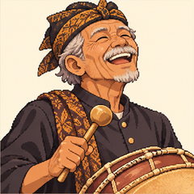

# CAHYADI (K11)

**Peran:** Penabuh benjang
**Potret:** 
**Status:** Rancangan fiksi publik — belum disahkan sebagai kisah atau gameplay aktif.

> Seluruh cerita dan sifat di halaman ini adalah konsep untuk tokoh fiksi YZ Farm Life, bukan biografi seseorang di dunia nyata.

## Identitas

**preferredName:** Cahyadi

**ageYears:** 67

**language:** Bahasa Indonesia; sesekali memakai sapaan atau ungkapan Sunda saat suasana percakapan cocok.

**identity:** NPC fiksi berlatar Kota Bandung

**ageDesignNote:** Usia ini pilihan kreatif sementara berdasarkan kematangan visual potret, bukan pengukuran umur dari gambar.

**visualAgeBandDraft:** lanjut dalam rancangan karakter

## Penampilan dan bahasa tubuh

**general:** Potret canonical K16 memperlihatkan rincian visual yang dicatat di bawah; jangan menggantinya dengan identitas dari arsip legacy.

**physicalTraits:** Rambut memutih, kumis dan janggut putih, ikat kepala jingga bermotif; tertawa sambil menabuh kendang dengan pemukul.

**bodyLanguageDirection:** tertawa sambil menabuh kendang dengan pemukul

**proposedPose:** Gunakan gestur yang terlihat pada potret sebagai rujukan satu pose interaksi; animasi final belum disetujui.

## Busana dan estetika

**signatureClothing:** Rambut memutih, kumis dan janggut putih, ikat kepala jingga bermotif

**accessories**
- ikat kepala

**aesthetic:** Pixel-art kehidupan Kota Bandung

**palette:** jingga, putih

**costumeConcept:** Pakaian kerja yang memudahkan kegiatan latihan dan perlengkapan acara, tanpa menganggapnya sebagai pakaian nyata sosok dalam dunia nyata

## Pekerjaan dan kehidupan sosial

**education:** Keterampilan kerja diperoleh lewat praktik dan bimbingan komunitas.

**communityActivity:** Membahas cara memeriksa benjang bersama warga sebelum mengambil keputusan.

**functionInWorld:** seni budaya

**workRoutineConcept:** memeriksa alat sebelum sesi bersama dimulai

**workplaceConcept:** Situasi kerja fiksi mengenai latihan dan perlengkapan acara; lokasi spesifik belum ditetapkan

## Kepribadian fiksi

**traits**
- Penghargaan karya
- Tekun
- Mau mendengar

**observableHabit:** mendengar irama sekitar sebelum memulai

**values:** Penghargaan karya

**weakness:** sering menunda memperlihatkan karya

**strengthConcept:** cermat memilih pekerjaan yang mesti didahulukan

**flawConcept:** sering mengerjakan sendiri sebelum meminta bantuan

**microHabitConcept:** menunjuk bagian yang perlu dicek saat membicarakan latihan dan perlengkapan acara

## Motivasi dan konflik fiksi

**primaryMotivation:** Menjaga pekerjaan benjang tetap dapat dipertanggungjawabkan

**need:** Berharap warga mau mendengarkan masalah benjang sebelum memberi solusi.

**innerConflict:** Pemilik alat meminta solusi yang berbeda dari kebiasaan

**fear:** Pertunjukan yang tak terdengar

**motivationConcept:** Mencari cara menangani benjang dengan teliti ketika orang lain ingin pekerjaan cepat selesai

**conflictConcept:** Di bagian benjang, satu bagian belum siap walaupun jadwal acara sudah dibagikan; pilihan yang serba cepat terasa berisiko baginya dalam premis fiksi ini

**agencyConcept:** Boleh menolak bantuan yang melanjutkan acara sesuai jadwal; dapat memilih mengatur ulang giliran agar semua bagian siap meskipun pemain tidak setuju

## Latar cerita

**formativeMemory:** Dulu, pada salah satu hari yang melelahkan, satu bagian belum siap walaupun jadwal acara sudah dibagikan. Pelajaran yang dipegangnya sederhana: bekerja cepat tidak sama dengan bekerja tepat.

**narrativeBackground:** Di sela latihan, karya, dan penonton di kampung, Cahyadi menemukan alat lama yang hampir tidak dipakai lagi.

**narrativeStatus:** Konsep fiksi baru; bukan riwayat orang asli

**sceneConcept:** Sebuah kegiatan sehari-hari tentang latihan dan perlengkapan acara terhambat karena satu bagian belum siap walaupun jadwal acara sudah dibagikan. Ini hanya premis adegan, bukan riwayat pribadi.

## Interaksi dan hubungan

**relationshipHook:** Kedekatan dibangun melalui bantuan terkait jadwal pertunjukan, tanpa relasi keluarga yang ditebak

**trustBehavior:** Meningkat setelah pemain menepati janji dan menghormati pilihan tokoh

**personalBoundary:** Tidak langsung membicarakan masalah pribadi kepada pemain baru

**boundaryConcept:** Tidak membagi urusan pribadi hanya karena pemain sering menyapa; kedekatan tidak sama dengan persetujuan

## Suara dan dialog

**speechSignature:** Bicara singkat soal benjang; lebih banyak bertanya saat ada risiko.

**sampleLine:** Aku sedang urus benjang. Bantu lihat bagian yang ini, boleh?

**habitualGesture:** mengatur posisi alat atau menarik napas sebelum tampil

**reactions**
- **neutral:** Menanggapi seperlunya dan kembali ke pekerjaan
- **happy:** Senyum kecil saat bantuan benar-benar berguna
- **worried:** Memeriksa jadwal pertunjukan sebelum memberi jawaban

**dialogueDrafts**
- Aku sedang urus benjang. Bantu lihat bagian yang ini, boleh?
- Kalau kamu memilih melanjutkan acara sesuai jadwal untuk benjang, aku perlu tahu siapa yang bertanggung jawab.
- Kita coba mengatur ulang giliran agar semua bagian siap untuk benjang dulu. Kalau tidak cocok, kita ganti rencana.

**speakingCadence:** ringkas saat bekerja, lebih terbuka sesudahnya

## Perkembangan cerita

**storyArc:** Urusan jadwal pertunjukan mulai mengganggu rutinitas penabuh benjang

**questHook:** Ketika sedang menangani benjang, muncul masalah sederhana: satu bagian belum siap walaupun jadwal acara sudah dibagikan. Pemain boleh membantu, menolak, atau mengajukan cara lain; belum ada quest runtime.

**threeActBeats**
- Masalah benjang terlihat ketika memeriksa alat sebelum sesi bersama dimulai
- Pemain mengetahui bahwa satu bagian belum siap walaupun jadwal acara sudah dibagikan; pilihan warga tidak selalu sejalan
- Salah satu cara dicoba dalam kegiatan benjang, lalu hasilnya dievaluasi bersama

**playerChoices**
- Mendukung usulan untuk melanjutkan acara sesuai jadwal pada benjang
- Mengusulkan agar mengatur ulang giliran agar semua bagian siap untuk benjang

**implementation:** draft, belum diaktifkan otomatis

**sideQuestConcept**
- **premise:** Saat mengurus benjang, satu bagian belum siap walaupun jadwal acara sudah dibagikan.
- **decisionA:** Melanjutkan acara sesuai jadwal.
- **decisionB:** Mengatur ulang giliran agar semua bagian siap.
- **state:** not-implemented

**choiceConsequencesConcept**
- - **choice:** A
- **result:** Kemungkinan lebih cepat; konsekuensi nyata harus ditulis dan diuji sebelum implementasi
- - **choice:** B
- **result:** Kemungkinan lebih teliti; konsekuensi nyata harus ditulis dan diuji sebelum implementasi

## Referensi visual

**visualContinuity:** Patokan ilustrasi: Rambut memutih, kumis dan janggut putih, ikat kepala jingga bermotif; tertawa sambil menabuh kendang dengan pemukul. Cocokkan penutup kepala, warna, alat bantu, aksesori dan siluet dengan sprite; jangan mengganti portrait key.

**suggestedPalette:** jingga, putih

**animationRequired**
- idle
- walk-4-directions
- interact

**observedIllustrationStyle:** Potret ilustrasi karakter lingkungan; kepadatan piksel dan outline perlu diseragamkan.

## Kontinuitas dan status runtime

**availability:** Katalog; jadwal dan spawn mengikuti ekspansi bertahap

**playerDependentState:** Tidak boleh tertukar dengan ID cerita lama

**canonStatus:** Nama, pekerjaan dan kunci potret terkunci; detail cerita masih rancangan

**playableRuntimeConfirmed:** Tidak

**questIntegrationConfirmed:** Tidak

**legacyAssociationApproved:** Tidak

**status:** Konsep publik; kehadiran karakter dan cerita di runtime memerlukan implementasi terpisah.

---
Karakter ini merupakan bagian dari katalog fiksi YZ Farm Life. Data identitas canonical dikunci; pengesahan lore dan implementasi gameplay dilakukan terpisah.
