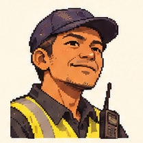

# CECEP SURACHMAN (K12)

**Peran:** Petugas keselamatan pasar
**Potret:** 
**Status:** Rancangan fiksi publik — belum disahkan sebagai kisah atau gameplay aktif.

> Seluruh cerita dan sifat di halaman ini adalah konsep untuk tokoh fiksi YZ Farm Life, bukan biografi seseorang di dunia nyata.

## Identitas

**preferredName:** Cecep

**ageYears:** 33

**language:** Bahasa Indonesia; sesekali memakai sapaan atau ungkapan Sunda saat suasana percakapan cocok.

**identity:** NPC fiksi berlatar Kota Bandung

**ageDesignNote:** Usia ini pilihan kreatif sementara berdasarkan kematangan visual potret, bukan pengukuran umur dari gambar.

**visualAgeBandDraft:** dewasa dalam rancangan karakter

## Penampilan dan bahasa tubuh

**general:** Potret canonical R108 memperlihatkan rincian visual yang dicatat di bawah; jangan menggantinya dengan identitas dari arsip legacy.

**physicalTraits:** Rambut gelap pendek, topi gelap, seragam abu dengan rompi keselamatan kuning dan radio komunikasi.

**bodyLanguageDirection:** mengetuk buku catatan lalu membuka halaman berikutnya

**proposedPose:** Gunakan gestur yang terlihat pada potret sebagai rujukan satu pose interaksi; animasi final belum disetujui.

## Busana dan estetika

**signatureClothing:** Rambut gelap pendek, topi gelap, seragam abu dengan rompi keselamatan kuning dan radio komunikasi

**accessories**
- rompi
- radio

**aesthetic:** Pixel-art kehidupan Kota Bandung

**palette:** kuning, abu

**costumeConcept:** Pakaian kerja yang memudahkan kegiatan barang dagangan dan catatan stok, tanpa menganggapnya sebagai pakaian nyata sosok dalam dunia nyata

## Pekerjaan dan kehidupan sosial

**education:** Mempelajari prosedur keselamatan dan pelayanan publik dari latihan serta pengalaman lapangan.

**communityActivity:** Membahas cara memeriksa keselamatan pasar bersama warga sebelum mengambil keputusan.

**functionInWorld:** layanan

**workRoutineConcept:** mencocokkan stok nyata dengan permintaan yang masuk

**workplaceConcept:** Situasi kerja fiksi mengenai barang dagangan dan catatan stok; lokasi spesifik belum ditetapkan

## Kepribadian fiksi

**traits**
- Keadilan
- Tekun
- Mau mendengar

**observableHabit:** mengonfirmasi daftar sebelum memulai

**values:** Keadilan

**weakness:** terlalu terpaku pada prosedur

**strengthConcept:** cermat memilih pekerjaan yang mesti didahulukan

**flawConcept:** sering mengerjakan sendiri sebelum meminta bantuan

**microHabitConcept:** merapikan alat setelah mencocokkan stok nyata dengan permintaan yang masuk

## Motivasi dan konflik fiksi

**primaryMotivation:** Menjaga pekerjaan keselamatan pasar tetap dapat dipertanggungjawabkan

**need:** Butuh ruang untuk menolak jalan pintas dalam pekerjaan keselamatan pasar.

**innerConflict:** Ada pelanggan atau warga yang belum mendapat giliran

**fear:** Warga tidak mendapat giliran

**motivationConcept:** Mencari cara menangani keselamatan pasar dengan teliti ketika orang lain ingin pekerjaan cepat selesai

**conflictConcept:** Di bagian keselamatan pasar, catatan jumlah barang belum sama dengan yang tersusun di rak; pilihan yang serba cepat terasa berisiko baginya dalam premis fiksi ini

**agencyConcept:** Boleh menolak bantuan yang melayani pesanan sebelum mengecek stok; dapat memilih menyelesaikan pengecekan lalu menyepakati jumlah meskipun pemain tidak setuju

## Latar cerita

**formativeMemory:** Pekerjaan yang tampak biasa berubah rumit saat catatan jumlah barang belum sama dengan yang tersusun di rak. Hari tersebut membuatnya lebih sabar mendengar pendapat orang lain.

**narrativeBackground:** Di sela jadwal warga, antrean, dan kerja sama, Cecep Surachman menemukan permintaan mendadak di akhir hari.

**narrativeStatus:** Konsep fiksi baru; bukan riwayat orang asli

**sceneConcept:** Sebuah kegiatan sehari-hari tentang barang dagangan dan catatan stok terhambat karena catatan jumlah barang belum sama dengan yang tersusun di rak. Ini hanya premis adegan, bukan riwayat pribadi.

## Interaksi dan hubungan

**relationshipHook:** Kedekatan dibangun melalui bantuan terkait jadwal layanan, tanpa relasi keluarga yang ditebak

**trustBehavior:** Meningkat setelah pemain menepati janji dan menghormati pilihan tokoh

**personalBoundary:** Tidak langsung membicarakan masalah pribadi kepada pemain baru

**boundaryConcept:** Tidak membagi urusan pribadi hanya karena pemain sering menyapa; kedekatan tidak sama dengan persetujuan

## Suara dan dialog

**speechSignature:** Bicara singkat soal keselamatan pasar; lebih banyak bertanya saat ada risiko.

**sampleLine:** Sebentar, urusan keselamatan pasar ini perlu ditangani sesuai prosedur. Jangan asal coba.

**habitualGesture:** mengetuk buku catatan lalu membuka halaman berikutnya

**reactions**
- **neutral:** Menanggapi seperlunya dan kembali ke pekerjaan
- **happy:** Senyum kecil saat bantuan benar-benar berguna
- **worried:** Memeriksa jadwal layanan sebelum memberi jawaban

**dialogueDrafts**
- Sebentar, urusan keselamatan pasar ini perlu ditangani sesuai prosedur. Jangan asal coba.
- Kalau ada risiko untuk orang lain, kita dahulukan keselamatannya. Bagian keselamatan pasar jangan ditebak-tebak.
- Yang mendesak harus ditangani lebih dulu. Kalau di luar kewenanganku, kita hubungi petugas yang tepat.

**speakingCadence:** to the point, lalu memberi kesempatan lawan bicara

## Perkembangan cerita

**storyArc:** Urusan jadwal layanan mulai mengganggu rutinitas petugas keselamatan pasar

**questHook:** Ketika sedang menangani keselamatan pasar, muncul masalah sederhana: catatan jumlah barang belum sama dengan yang tersusun di rak. Pemain boleh membantu, menolak, atau mengajukan cara lain; belum ada quest runtime.

**threeActBeats**
- Masalah keselamatan pasar terlihat ketika mencocokkan stok nyata dengan permintaan yang masuk
- Pemain mengetahui bahwa catatan jumlah barang belum sama dengan yang tersusun di rak; pilihan warga tidak selalu sejalan
- Salah satu cara dicoba dalam kegiatan keselamatan pasar, lalu hasilnya dievaluasi bersama

**playerChoices**
- Minta petugas berwenang menilai risiko terlebih dahulu
- Tunda langkah nonmendesak sambil memastikan keselamatan

**implementation:** draft, belum diaktifkan otomatis

**sideQuestConcept**
- **premise:** Saat mengurus keselamatan pasar, catatan jumlah barang belum sama dengan yang tersusun di rak.
- **decisionA:** Melayani pesanan sebelum mengecek stok.
- **decisionB:** Menyelesaikan pengecekan lalu menyepakati jumlah.
- **state:** not-implemented

**choiceConsequencesConcept**
- - **choice:** A
- **result:** Kemungkinan lebih cepat; konsekuensi nyata harus ditulis dan diuji sebelum implementasi
- - **choice:** B
- **result:** Kemungkinan lebih teliti; konsekuensi nyata harus ditulis dan diuji sebelum implementasi

## Referensi visual

**visualContinuity:** Patokan ilustrasi: Rambut gelap pendek, topi gelap, seragam abu dengan rompi keselamatan kuning dan radio komunikasi. Cocokkan penutup kepala, warna, alat bantu, aksesori dan siluet dengan sprite; jangan mengganti portrait key.

**suggestedPalette:** kuning, abu

**animationRequired**
- idle
- walk-4-directions
- interact

**observedIllustrationStyle:** Potret pixel-art bertekstur dengan variasi shading wajah; cocokkan kepadatan piksel antaraset.

## Kontinuitas dan status runtime

**availability:** Katalog; jadwal dan spawn mengikuti ekspansi bertahap

**playerDependentState:** Tidak boleh tertukar dengan ID cerita lama

**canonStatus:** Nama, pekerjaan dan kunci potret terkunci; detail cerita masih rancangan

**playableRuntimeConfirmed:** Tidak

**questIntegrationConfirmed:** Tidak

**legacyAssociationApproved:** Tidak

**status:** Konsep publik; kehadiran karakter dan cerita di runtime memerlukan implementasi terpisah.

---
Karakter ini merupakan bagian dari katalog fiksi YZ Farm Life. Data identitas canonical dikunci; pengesahan lore dan implementasi gameplay dilakukan terpisah.
