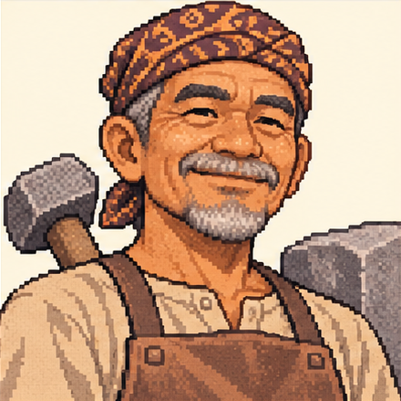

# DADAN RANGGANI (K14)

**Peran:** Perajin batu dan pengenal mineral
**Potret:** 
**Status:** Rancangan fiksi publik — belum disahkan sebagai kisah atau gameplay aktif.

> Seluruh cerita dan sifat di halaman ini adalah konsep untuk tokoh fiksi YZ Farm Life, bukan biografi seseorang di dunia nyata.

## Identitas

**preferredName:** Dadan Ranggani

**ageYears:** 50

**language:** Bahasa Indonesia; sesekali memakai sapaan atau ungkapan Sunda saat suasana percakapan cocok.

**identity:** NPC fiksi berlatar Kota Bandung

**ageDesignNote:** Usia ini pilihan kreatif sementara berdasarkan kematangan visual potret, bukan pengukuran umur dari gambar.

**visualAgeBandDraft:** dewasa matang dalam rancangan karakter

## Penampilan dan bahasa tubuh

**general:** Potret canonical N06 memperlihatkan rincian visual yang dicatat di bawah; jangan menggantinya dengan identitas dari arsip legacy.

**physicalTraits:** Rambut dan janggut beruban, ikat kepala batik cokelat, baju krem dan celemek kulit; palu dan batu berada di dekatnya.

**bodyLanguageDirection:** palu dan batu berada di dekatnya

**proposedPose:** Gunakan gestur yang terlihat pada potret sebagai rujukan satu pose interaksi; animasi final belum disetujui.

## Busana dan estetika

**signatureClothing:** Rambut dan janggut beruban, ikat kepala batik cokelat, baju krem dan celemek kulit

**accessories**
- ikat kepala
- celemek
- palu

**aesthetic:** Pixel-art kehidupan Kota Bandung

**palette:** cokelat, krem

**costumeConcept:** Pakaian kerja yang memudahkan kegiatan bahan kerajinan, tanpa menganggapnya sebagai pakaian nyata sosok dalam dunia nyata

## Pekerjaan dan kehidupan sosial

**education:** Mengasah keterampilan kriya lewat praktik, belajar dari pekerja berpengalaman, dan uji coba bahan.

**communityActivity:** Menyiapkan kegiatan kecil seputar batu dan pengenal mineral tanpa bergantung pada pemain.

**functionInWorld:** kriya

**workRoutineConcept:** mengukur kebutuhan sebelum memotong atau merangkai bahan

**workplaceConcept:** Situasi kerja fiksi mengenai bahan kerajinan; lokasi spesifik belum ditetapkan

## Kepribadian fiksi

**traits**
- Kesabaran
- Tekun
- Mau mendengar

**observableHabit:** mengukur bahan sebelum memotong

**values:** Kesabaran

**weakness:** ingin hasil sempurna saat waktunya sempit

**strengthConcept:** mengetahui kapan harus meminta bantuan

**flawConcept:** mudah terpaku pada jadwal yang sudah dibuat

**microHabitConcept:** membandingkan dua catatan tentang bahan kerajinan sebelum menjawab

## Motivasi dan konflik fiksi

**primaryMotivation:** Menjaga pekerjaan batu dan pengenal mineral tetap dapat dipertanggungjawabkan

**need:** Ingin ada waktu memeriksa urusan batu dan pengenal mineral sebelum keputusan diambil bersama.

**innerConflict:** Rencana awal membuat sebagian orang menunggu lebih lama

**fear:** Bahan berharga terbuang

**motivationConcept:** Mencari cara menangani batu dan pengenal mineral dengan teliti ketika orang lain ingin pekerjaan cepat selesai

**conflictConcept:** Di bagian batu dan pengenal mineral, ukuran di catatan berbeda sedikit dari hasil kerja; pilihan yang serba cepat terasa berisiko baginya dalam premis fiksi ini

**agencyConcept:** Boleh menolak bantuan yang memperbaiki bentuk dengan cepat; dapat memilih mengulang pengukuran agar bahan tidak terbuang meskipun pemain tidak setuju

## Latar cerita

**formativeMemory:** Ia sempat mengira semuanya akan lancar. Ternyata ukuran di catatan berbeda sedikit dari hasil kerja. Kebiasaan mengukur bahan sebelum memotong tumbuh dari pengalaman itu.

**narrativeBackground:** Di sela bahan, warna, dan barang buatan tangan, Dadan Ranggani menemukan cuaca berubah saat pekerjaan belum selesai.

**narrativeStatus:** Konsep fiksi baru; bukan riwayat orang asli

**sceneConcept:** Sebuah kegiatan sehari-hari tentang bahan kerajinan terhambat karena ukuran di catatan berbeda sedikit dari hasil kerja. Ini hanya premis adegan, bukan riwayat pribadi.

## Interaksi dan hubungan

**relationshipHook:** Kedekatan dibangun melalui bantuan terkait pola kerja, tanpa relasi keluarga yang ditebak

**trustBehavior:** Meningkat setelah pemain menepati janji dan menghormati pilihan tokoh

**personalBoundary:** Tidak langsung membicarakan masalah pribadi kepada pemain baru

**boundaryConcept:** Tidak membagi urusan pribadi hanya karena pemain sering menyapa; kedekatan tidak sama dengan persetujuan

## Suara dan dialog

**speechSignature:** Pilih kata sederhana untuk batu dan pengenal mineral; tidak berusaha selalu menyenangkan pemain.

**sampleLine:** Kamu lihat batu dan pengenal mineral tadi? Ada satu hal yang ingin kupastikan.

**habitualGesture:** meraba sambungan atau merapikan bahan

**reactions**
- **neutral:** Menanggapi seperlunya dan kembali ke pekerjaan
- **happy:** Senyum kecil saat bantuan benar-benar berguna
- **worried:** Memeriksa pola kerja sebelum memberi jawaban

**dialogueDrafts**
- Kamu lihat batu dan pengenal mineral tadi? Ada satu hal yang ingin kupastikan.
- Aku kurang yakin kalau kita memperbaiki bentuk dengan cepat. Untuk batu dan pengenal mineral, risikonya belum jelas.
- Kalau aku, lebih baik mengulang pengukuran agar bahan tidak terbuang. Urusan batu dan pengenal mineral bisa menunggu sebentar.

**speakingCadence:** tenang dengan jeda saat memastikan rincian

## Perkembangan cerita

**storyArc:** Urusan pola kerja mulai mengganggu rutinitas perajin batu dan pengenal mineral

**questHook:** Ketika sedang menangani batu dan pengenal mineral, muncul masalah sederhana: ukuran di catatan berbeda sedikit dari hasil kerja. Pemain boleh membantu, menolak, atau mengajukan cara lain; belum ada quest runtime.

**threeActBeats**
- Masalah batu dan pengenal mineral terlihat ketika mengukur kebutuhan sebelum memotong atau merangkai bahan
- Pemain mengetahui bahwa ukuran di catatan berbeda sedikit dari hasil kerja; pilihan warga tidak selalu sejalan
- Salah satu cara dicoba dalam kegiatan batu dan pengenal mineral, lalu hasilnya dievaluasi bersama

**playerChoices**
- Mendukung usulan untuk memperbaiki bentuk dengan cepat pada batu dan pengenal mineral
- Mengusulkan agar mengulang pengukuran agar bahan tidak terbuang untuk batu dan pengenal mineral

**implementation:** draft, belum diaktifkan otomatis

**sideQuestConcept**
- **premise:** Saat mengurus batu dan pengenal mineral, ukuran di catatan berbeda sedikit dari hasil kerja.
- **decisionA:** Memperbaiki bentuk dengan cepat.
- **decisionB:** Mengulang pengukuran agar bahan tidak terbuang.
- **state:** not-implemented

**choiceConsequencesConcept**
- - **choice:** A
- **result:** Kemungkinan lebih cepat; konsekuensi nyata harus ditulis dan diuji sebelum implementasi
- - **choice:** B
- **result:** Kemungkinan lebih teliti; konsekuensi nyata harus ditulis dan diuji sebelum implementasi

## Referensi visual

**visualContinuity:** Patokan ilustrasi: Rambut dan janggut beruban, ikat kepala batik cokelat, baju krem dan celemek kulit; palu dan batu berada di dekatnya. Cocokkan penutup kepala, warna, alat bantu, aksesori dan siluet dengan sprite; jangan mengganti portrait key.

**suggestedPalette:** cokelat, krem

**animationRequired**
- idle
- walk-4-directions
- interact

**observedIllustrationStyle:** Potret pixel-art bertekstur dengan detail wajah kuat; lakukan QA ukuran dan animasi.

## Kontinuitas dan status runtime

**availability:** Katalog; jadwal dan spawn mengikuti ekspansi bertahap

**playerDependentState:** Tidak boleh tertukar dengan ID cerita lama

**canonStatus:** Nama, pekerjaan dan kunci potret terkunci; detail cerita masih rancangan

**playableRuntimeConfirmed:** Tidak

**questIntegrationConfirmed:** Tidak

**legacyAssociationApproved:** Tidak

**status:** Konsep publik; kehadiran karakter dan cerita di runtime memerlukan implementasi terpisah.

---
Karakter ini merupakan bagian dari katalog fiksi YZ Farm Life. Data identitas canonical dikunci; pengesahan lore dan implementasi gameplay dilakukan terpisah.
