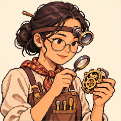

# DIANNISA PERMATASARI (K20)

**Peran:** Teknisi jam mekanis
**Potret:** 
**Status:** Rancangan fiksi publik — belum disahkan sebagai kisah atau gameplay aktif.

> Seluruh cerita dan sifat di halaman ini adalah konsep untuk tokoh fiksi YZ Farm Life, bukan biografi seseorang di dunia nyata.

## Identitas

**identity:** NPC fiksi berlatar Kota Bandung

## Penampilan dan bahasa tubuh

**general:** Rancangan sprite disesuaikan dengan potret K29; tidak disimpulkan dari nama atau pekerjaan

**bodyLanguageDirection:** mengecek sambungan dan menata perkakas

**proposedPose:** Baca siluet ketika sedang mencari sumber gangguan sebelum mengganti bagian; sesuaikan hanya setelah potret benar-benar ditinjau

## Busana dan estetika

**signatureClothing:** busana bengkel sederhana dengan perlengkapan keselamatan

**aesthetic:** Pixel-art kehidupan Kota Bandung

**palette:** terracotta dan hijau zaitun

**costumeConcept:** Pakaian kerja yang memudahkan kegiatan peralatan kerja, tanpa menganggapnya sebagai pakaian nyata sosok dalam dunia nyata

## Pekerjaan dan kehidupan sosial

**communityActivity:** Mengajak warga mencatat kebutuhan jam mekanis agar pekerjaan tidak saling bertabrakan.

**functionInWorld:** teknologi

**workRoutineConcept:** mencari sumber gangguan sebelum mengganti bagian

**workplaceConcept:** Situasi kerja fiksi mengenai peralatan kerja; lokasi spesifik belum ditetapkan

## Kepribadian fiksi

**traits**
- Ketepatan
- Tekun
- Mau mendengar

**observableHabit:** menguji sekali lagi sebelum menyerahkan alat

**values:** Ketepatan

**weakness:** sulit melepas masalah sebelum selesai

**strengthConcept:** mau mengubah cara kerja ketika ada bukti

**flawConcept:** cenderung menunda percakapan sulit

**microHabitConcept:** menunjuk bagian yang perlu dicek saat membicarakan peralatan kerja

## Motivasi dan konflik fiksi

**primaryMotivation:** Menjaga pekerjaan jam mekanis tetap dapat dipertanggungjawabkan

**need:** Berharap warga mau mendengarkan masalah jam mekanis sebelum memberi solusi.

**innerConflict:** Ada pelanggan atau warga yang belum mendapat giliran

**fear:** Alat rusak saat dibutuhkan

**motivationConcept:** Mencari cara menangani jam mekanis dengan teliti ketika orang lain ingin pekerjaan cepat selesai

**conflictConcept:** Di bagian jam mekanis, gejala kerusakan terlihat di satu bagian, tetapi penyebabnya belum jelas; pilihan yang serba cepat terasa berisiko baginya dalam premis fiksi ini

**agencyConcept:** Boleh menolak bantuan yang mengganti komponen yang paling mudah dijangkau; dapat memilih melakukan pemeriksaan bertahap meskipun pemain tidak setuju

## Latar cerita

**narrativeBackground:** Di sela baut, catatan, dan benda yang perlu diperbaiki, Diannisa Permatasari menemukan permintaan mendadak di akhir hari.

**narrativeStatus:** Konsep fiksi baru; bukan riwayat orang asli

**sceneConcept:** Sebuah kegiatan sehari-hari tentang peralatan kerja terhambat karena gejala kerusakan terlihat di satu bagian, tetapi penyebabnya belum jelas. Ini hanya premis adegan, bukan riwayat pribadi.

## Interaksi dan hubungan

**relationshipHook:** Kedekatan dibangun melalui bantuan terkait daftar perawatan, tanpa relasi keluarga yang ditebak

**trustBehavior:** Meningkat setelah pemain menepati janji dan menghormati pilihan tokoh

**personalBoundary:** Tidak langsung membicarakan masalah pribadi kepada pemain baru

**boundaryConcept:** Tidak membagi urusan pribadi hanya karena pemain sering menyapa; kedekatan tidak sama dengan persetujuan

## Suara dan dialog

**speechSignature:** Awalnya hati-hati ketika menjelaskan jam mekanis, lalu lugas setelah melihat hasil.

**sampleLine:** Tunggu. Bagian jam mekanis belum beres dicek. Jangan ditutup dulu.

**habitualGesture:** mengecek sambungan dan menata perkakas

**reactions**
- **neutral:** Menanggapi seperlunya dan kembali ke pekerjaan
- **happy:** Senyum kecil saat bantuan benar-benar berguna
- **worried:** Memeriksa daftar perawatan sebelum memberi jawaban

**dialogueDrafts**
- Tunggu. Bagian jam mekanis belum beres dicek. Jangan ditutup dulu.
- Kalau kamu memilih mengganti komponen yang paling mudah dijangkau untuk jam mekanis, aku perlu tahu siapa yang bertanggung jawab.
- Kita coba melakukan pemeriksaan bertahap untuk jam mekanis dulu. Kalau tidak cocok, kita ganti rencana.

**speakingCadence:** ringkas saat bekerja, lebih terbuka sesudahnya

## Perkembangan cerita

**storyArc:** Urusan daftar perawatan mulai mengganggu rutinitas teknisi jam mekanis

**questHook:** Ketika sedang menangani jam mekanis, muncul masalah sederhana: gejala kerusakan terlihat di satu bagian, tetapi penyebabnya belum jelas. Pemain boleh membantu, menolak, atau mengajukan cara lain; belum ada quest runtime.

**threeActBeats**
- Masalah jam mekanis terlihat ketika mencari sumber gangguan sebelum mengganti bagian
- Pemain mengetahui bahwa gejala kerusakan terlihat di satu bagian, tetapi penyebabnya belum jelas; pilihan warga tidak selalu sejalan
- Salah satu cara dicoba dalam kegiatan jam mekanis, lalu hasilnya dievaluasi bersama

**playerChoices**
- Mendukung usulan untuk mengganti komponen yang paling mudah dijangkau pada jam mekanis
- Mengusulkan agar melakukan pemeriksaan bertahap untuk jam mekanis

**implementation:** draft, belum diaktifkan otomatis

**sideQuestConcept**
- **premise:** Saat mengurus jam mekanis, gejala kerusakan terlihat di satu bagian, tetapi penyebabnya belum jelas.
- **decisionA:** Mengganti komponen yang paling mudah dijangkau.
- **decisionB:** Melakukan pemeriksaan bertahap.
- **state:** not-implemented

**choiceConsequencesConcept**
- - **choice:** A
- **result:** Kemungkinan lebih cepat; konsekuensi nyata harus ditulis dan diuji sebelum implementasi
- - **choice:** B
- **result:** Kemungkinan lebih teliti; konsekuensi nyata harus ditulis dan diuji sebelum implementasi

## Referensi visual

**visualContinuity:** Cocokkan palet, proporsi tangan, ekspresi, pakaian, dan arah hadap antara potret, sprite dan aset pekerjaan

**suggestedPalette:** terracotta dan hijau zaitun

**animationRequired**
- idle
- walk-4-directions
- interact

## Kontinuitas dan status runtime

**availability:** Katalog; jadwal dan spawn mengikuti ekspansi bertahap

**playerDependentState:** Tidak boleh tertukar dengan ID cerita lama

**canonStatus:** Nama, pekerjaan dan kunci potret terkunci; detail cerita masih rancangan

**playableRuntimeConfirmed:** Tidak

**questIntegrationConfirmed:** Tidak

**legacyAssociationApproved:** Tidak

**status:** Konsep publik; kehadiran karakter dan cerita di runtime memerlukan implementasi terpisah.

---
Karakter ini merupakan bagian dari katalog fiksi YZ Farm Life. Data identitas canonical dikunci; pengesahan lore dan implementasi gameplay dilakukan terpisah.
