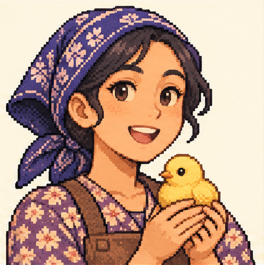

# ALIFIA ANJANI (N01)

**Peran:** Peternak unggas
**Potret:** 
**Status:** Rancangan fiksi publik — belum disahkan sebagai kisah atau gameplay aktif.

> Seluruh cerita dan sifat di halaman ini adalah konsep untuk tokoh fiksi YZ Farm Life, bukan biografi seseorang di dunia nyata.

## Identitas

**preferredName:** Alifia

**ageYears:** 42

**origin:** Jejak awal Alifia dalam cerita ini berangkat dari Ciwidey, di antara kebun yang sering berkabut. Ia mulai terbiasa membaca perubahan musim sebelum memutuskan, sesuatu yang kelak memengaruhi cara bekerja dan bergaulnya. (latar fiksi; draf)

**language:** Bahasa Indonesia; sesekali memakai sapaan atau ungkapan Sunda saat suasana percakapan cocok.

**identity:** NPC fiksi berlatar Kota Bandung

**ageDesignNote:** Usia ini pilihan kreatif sementara berdasarkan kematangan visual potret, bukan pengukuran umur dari gambar.

**visualAgeBandDraft:** dewasa dalam rancangan karakter

## Penampilan dan bahasa tubuh

**general:** Potret canonical N01 memperlihatkan rincian visual yang dicatat di bawah; jangan menggantinya dengan identitas dari arsip legacy.

**physicalTraits:** Rambut gelap di balik kain kepala biru bermotif bunga, blus ungu bermotif, celemek cokelat; menggendong anak itik kuning.

**bodyLanguageDirection:** menggendong anak itik kuning

**proposedPose:** Gunakan gestur yang terlihat pada potret sebagai rujukan satu pose interaksi; animasi final belum disetujui.

## Busana dan estetika

**signatureClothing:** Rambut gelap di balik kain kepala biru bermotif bunga, blus ungu bermotif, celemek cokelat

**accessories**
- kain kepala
- celemek

**aesthetic:** Pixel-art kehidupan Kota Bandung

**palette:** cokelat, kuning, ungu

**costumeConcept:** Pakaian kerja yang memudahkan kegiatan hewan dan habitatnya, tanpa menganggapnya sebagai pakaian nyata sosok dalam dunia nyata

## Pekerjaan dan kehidupan sosial

**education:** Belajar pengamatan ekosistem dan penanganan lapangan melalui praktik komunitas.

**communityActivity:** Mengajak warga mencatat kebutuhan peternak unggas agar pekerjaan tidak saling bertabrakan.

**functionInWorld:** lingkungan

**workRoutineConcept:** mengamati kondisi lingkungan sebelum memindahkan peralatan

**workplaceConcept:** Situasi kerja fiksi mengenai hewan dan habitatnya; lokasi spesifik belum ditetapkan

## Kepribadian fiksi

**traits**
- Kepedulian lingkungan
- Tekun
- Mau mendengar

**observableHabit:** mengamati dari jauh sebelum mendekat

**values:** Kepedulian lingkungan

**weakness:** terlalu hati-hati ketika harus bertindak

**strengthConcept:** mau mengubah cara kerja ketika ada bukti

**flawConcept:** cenderung menunda percakapan sulit

**microHabitConcept:** merapikan alat setelah mengamati kondisi lingkungan sebelum memindahkan peralatan

## Motivasi dan konflik fiksi

**primaryMotivation:** Menjaga pekerjaan peternak unggas tetap dapat dipertanggungjawabkan

**need:** Butuh ruang untuk menolak jalan pintas dalam pekerjaan peternak unggas.

**innerConflict:** Pengguna meminta satu penyesuaian kecil

**fear:** Habitat kehilangan keseimbangan

**motivationConcept:** Mencari cara menangani peternak unggas dengan teliti ketika orang lain ingin pekerjaan cepat selesai

**conflictConcept:** Di bagian peternak unggas, tanda-tanda di sekitar habitat belum cukup untuk mengambil keputusan cepat; pilihan yang serba cepat terasa berisiko baginya dalam premis fiksi ini

**agencyConcept:** Boleh menolak bantuan yang mengikuti kebiasaan lama tanpa pemeriksaan; dapat memilih mencatat pengamatan lebih dulu dan mengubah langkah seperlunya meskipun pemain tidak setuju

## Latar cerita

**familyContext:** Saat keluarga berkumpul, Alifia lebih suka membantu menyiapkan makanan daripada menjadi pusat percakapan. Mereka tahu ia bisa keras kepala jika membahas pekerjaan peternak unggas. (latar fiksi; draf)

**formativeMemory:** Ketika baru terbiasa dengan pekerjaan peternak unggas, tanda-tanda di sekitar habitat belum cukup untuk mengambil keputusan cepat. Ia belajar bahwa keputusan kecil pun bisa memengaruhi orang lain.

**narrativeBackground:** Di sela kandang, air, dan kehidupan di sekitar kota, Alifia Anjani menemukan hasil kerja yang terlihat bagus tetapi belum nyaman dipakai.

**narrativeStatus:** Konsep fiksi baru; bukan riwayat orang asli

**sceneConcept:** Sebuah kegiatan sehari-hari tentang hewan dan habitatnya terhambat karena tanda-tanda di sekitar habitat belum cukup untuk mengambil keputusan cepat. Ini hanya premis adegan, bukan riwayat pribadi.

## Interaksi dan hubungan

**relationshipHook:** Kedekatan dibangun melalui bantuan terkait catatan pengamatan, tanpa relasi keluarga yang ditebak

**trustBehavior:** Meningkat setelah pemain menepati janji dan menghormati pilihan tokoh

**personalBoundary:** Tidak langsung membicarakan masalah pribadi kepada pemain baru

**boundaryConcept:** Tidak membagi urusan pribadi hanya karena pemain sering menyapa; kedekatan tidak sama dengan persetujuan

## Suara dan dialog

**speechSignature:** Awalnya hati-hati ketika menjelaskan peternak unggas, lalu lugas setelah melihat hasil.

**sampleLine:** Tunggu. Bagian peternak unggas belum beres dicek. Jangan ditutup dulu.

**habitualGesture:** menunduk mengamati jejak atau permukaan air

**reactions**
- **neutral:** Menanggapi seperlunya dan kembali ke pekerjaan
- **happy:** Senyum kecil saat bantuan benar-benar berguna
- **worried:** Memeriksa catatan pengamatan sebelum memberi jawaban

**dialogueDrafts**
- Tunggu. Bagian peternak unggas belum beres dicek. Jangan ditutup dulu.
- Boleh saja mengikuti kebiasaan lama tanpa pemeriksaan, tapi urusan peternak unggas ini belum selesai diperiksa.
- Aku akan mencatat pengamatan lebih dulu dan mengubah langkah seperlunya. Kalau hasilnya beda, baru kita cari cara lain.

**speakingCadence:** to the point, lalu memberi kesempatan lawan bicara

## Perkembangan cerita

**storyArc:** Urusan catatan pengamatan mulai mengganggu rutinitas peternak unggas

**questHook:** Ketika sedang menangani peternak unggas, muncul masalah sederhana: tanda-tanda di sekitar habitat belum cukup untuk mengambil keputusan cepat. Pemain boleh membantu, menolak, atau mengajukan cara lain; belum ada quest runtime.

**threeActBeats**
- Masalah peternak unggas terlihat ketika mengamati kondisi lingkungan sebelum memindahkan peralatan
- Pemain mengetahui bahwa tanda-tanda di sekitar habitat belum cukup untuk mengambil keputusan cepat; pilihan warga tidak selalu sejalan
- Salah satu cara dicoba dalam kegiatan peternak unggas, lalu hasilnya dievaluasi bersama

**playerChoices**
- Mendukung usulan untuk mengikuti kebiasaan lama tanpa pemeriksaan pada peternak unggas
- Mengusulkan agar mencatat pengamatan lebih dulu dan mengubah langkah seperlunya untuk peternak unggas

**implementation:** draft, belum diaktifkan otomatis

**sideQuestConcept**
- **premise:** Saat mengurus peternak unggas, tanda-tanda di sekitar habitat belum cukup untuk mengambil keputusan cepat.
- **decisionA:** Mengikuti kebiasaan lama tanpa pemeriksaan.
- **decisionB:** Mencatat pengamatan lebih dulu dan mengubah langkah seperlunya.
- **state:** not-implemented

**choiceConsequencesConcept**
- - **choice:** A
- **result:** Kemungkinan lebih cepat; konsekuensi nyata harus ditulis dan diuji sebelum implementasi
- - **choice:** B
- **result:** Kemungkinan lebih teliti; konsekuensi nyata harus ditulis dan diuji sebelum implementasi

## Referensi visual

**visualContinuity:** Patokan ilustrasi: Rambut gelap di balik kain kepala biru bermotif bunga, blus ungu bermotif, celemek cokelat; menggendong anak itik kuning. Cocokkan penutup kepala, warna, alat bantu, aksesori dan siluet dengan sprite; jangan mengganti portrait key.

**suggestedPalette:** cokelat, kuning, ungu

**animationRequired**
- idle
- walk-4-directions
- interact

**observedIllustrationStyle:** Potret pixel-art bertekstur dengan detail wajah kuat; lakukan QA ukuran dan animasi.

## Kontinuitas dan status runtime

**availability:** Katalog; jadwal dan spawn mengikuti ekspansi bertahap

**playerDependentState:** Tidak boleh tertukar dengan ID cerita lama

**canonStatus:** Nama, pekerjaan dan kunci potret terkunci; detail cerita masih rancangan

**playableRuntimeConfirmed:** Tidak

**questIntegrationConfirmed:** Tidak

**legacyAssociationApproved:** Tidak

**status:** Konsep publik; kehadiran karakter dan cerita di runtime memerlukan implementasi terpisah.

---
Karakter ini merupakan bagian dari katalog fiksi YZ Farm Life. Data identitas canonical dikunci; pengesahan lore dan implementasi gameplay dilakukan terpisah.
