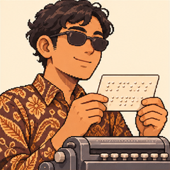

# FARID ROKHMAT (W007)

**Peran:** Penyusun label Braille
**Potret:** 
**Status:** Rancangan fiksi publik — belum disahkan sebagai kisah atau gameplay aktif.

> Seluruh cerita dan sifat di halaman ini adalah konsep untuk tokoh fiksi YZ Farm Life, bukan biografi seseorang di dunia nyata.

## Identitas

**preferredName:** Farid Rokhmat

**ageYears:** 26

**language:** Bahasa Indonesia; sesekali memakai sapaan atau ungkapan Sunda saat suasana percakapan cocok.

**identity:** NPC fiksi berlatar Kota Bandung

**ageDesignNote:** Usia ini pilihan kreatif sementara berdasarkan kematangan visual potret, bukan pengukuran umur dari gambar.

**visualAgeBandDraft:** dewasa dalam rancangan karakter

## Penampilan dan bahasa tubuh

**general:** Potret canonical K24 memperlihatkan rincian visual yang dicatat di bawah; jangan menggantinya dengan identitas dari arsip legacy.

**physicalTraits:** Rambut gelap pendek, kacamata hitam, kemeja batik jingga; memeriksa lembar bertitik Braille di depan mesin ketik.

**bodyLanguageDirection:** memeriksa lembar bertitik Braille di depan mesin ketik

**proposedPose:** Gunakan gestur yang terlihat pada potret sebagai rujukan satu pose interaksi; animasi final belum disetujui.

## Busana dan estetika

**signatureClothing:** Rambut gelap pendek, kacamata hitam, kemeja batik jingga

**accessories**
- kacamata

**aesthetic:** Pixel-art kehidupan Kota Bandung

**palette:** jingga, hitam

**costumeConcept:** Pakaian kerja yang memudahkan kegiatan catatan dan dokumen, tanpa menganggapnya sebagai pakaian nyata sosok dalam dunia nyata

## Pekerjaan dan kehidupan sosial

**education:** Keterampilan kerja diperoleh lewat praktik dan bimbingan komunitas.

**communityActivity:** Menyiapkan kegiatan kecil seputar label braille tanpa bergantung pada pemain.

**functionInWorld:** kehidupan kota

**workRoutineConcept:** menyusun catatan agar mudah ditemukan kembali

**workplaceConcept:** Situasi kerja fiksi mengenai catatan dan dokumen; lokasi spesifik belum ditetapkan

## Kepribadian fiksi

**traits**
- Saling membantu
- Tekun
- Mau mendengar

**observableHabit:** memperhatikan perubahan kecil di sekitar

**values:** Saling membantu

**weakness:** kadang menahan pendapat

**strengthConcept:** mengetahui kapan harus meminta bantuan

**flawConcept:** mudah terpaku pada jadwal yang sudah dibuat

**microHabitConcept:** menyebut risiko sebelum menyetujui perubahan catatan dan dokumen

## Motivasi dan konflik fiksi

**primaryMotivation:** Menjaga pekerjaan label braille tetap dapat dipertanggungjawabkan

**need:** Ingin hasil penanganan label braille dinilai dari keadaan nyata, bukan janji.

**innerConflict:** Dua keterangan warga ternyata tidak sama

**fear:** Urusan tertunda tanpa kabar

**motivationConcept:** Mencari cara menangani label braille dengan teliti ketika orang lain ingin pekerjaan cepat selesai

**conflictConcept:** Di bagian label braille, satu catatan tidak sama dengan salinan yang beredar; pilihan yang serba cepat terasa berisiko baginya dalam premis fiksi ini

**agencyConcept:** Boleh menolak bantuan yang memakai catatan yang paling baru terlihat; dapat memilih menelusuri asal dan tanggal catatan meskipun pemain tidak setuju

## Latar cerita

**formativeMemory:** Ketika baru terbiasa dengan pekerjaan penyusun label braille, satu catatan tidak sama dengan salinan yang beredar. Kebiasaan memperhatikan perubahan kecil di sekitar tumbuh dari pengalaman itu.

**narrativeBackground:** Di sela jalan kampung, pekerjaan, dan tetangga, Farid Rokhmat menemukan catatan yang tercecer.

**narrativeStatus:** Konsep fiksi baru; bukan riwayat orang asli

**sceneConcept:** Sebuah kegiatan sehari-hari tentang catatan dan dokumen terhambat karena satu catatan tidak sama dengan salinan yang beredar. Ini hanya premis adegan, bukan riwayat pribadi.

## Interaksi dan hubungan

**relationshipHook:** Kedekatan dibangun melalui bantuan terkait catatan pekerjaan, tanpa relasi keluarga yang ditebak

**trustBehavior:** Meningkat setelah pemain menepati janji dan menghormati pilihan tokoh

**personalBoundary:** Tidak langsung membicarakan masalah pribadi kepada pemain baru

**boundaryConcept:** Tidak membagi urusan pribadi hanya karena pemain sering menyapa; kedekatan tidak sama dengan persetujuan

## Suara dan dialog

**speechSignature:** Pilih kata sederhana untuk label braille; tidak berusaha selalu menyenangkan pemain.

**sampleLine:** Kamu lihat label braille tadi? Ada satu hal yang ingin kupastikan.

**habitualGesture:** berhenti sejenak lalu membuka catatan

**reactions**
- **neutral:** Menanggapi seperlunya dan kembali ke pekerjaan
- **happy:** Senyum kecil saat bantuan benar-benar berguna
- **worried:** Memeriksa catatan pekerjaan sebelum memberi jawaban

**dialogueDrafts**
- Kamu lihat label braille tadi? Ada satu hal yang ingin kupastikan.
- Jangan buru-buru memakai catatan yang paling baru terlihat. Nanti bagian label braille malah terlewat.
- Untuk bagian label braille, pilihanku menelusuri asal dan tanggal catatan. Kamu boleh tidak setuju.

**speakingCadence:** bertanya sebelum menilai pilihan

## Perkembangan cerita

**storyArc:** Urusan catatan pekerjaan mulai mengganggu rutinitas penyusun label braille

**questHook:** Ketika sedang menangani label braille, muncul masalah sederhana: satu catatan tidak sama dengan salinan yang beredar. Pemain boleh membantu, menolak, atau mengajukan cara lain; belum ada quest runtime.

**threeActBeats**
- Masalah label braille terlihat ketika menyusun catatan agar mudah ditemukan kembali
- Pemain mengetahui bahwa satu catatan tidak sama dengan salinan yang beredar; pilihan warga tidak selalu sejalan
- Salah satu cara dicoba dalam kegiatan label braille, lalu hasilnya dievaluasi bersama

**playerChoices**
- Mendukung usulan untuk memakai catatan yang paling baru terlihat pada label braille
- Mengusulkan agar menelusuri asal dan tanggal catatan untuk label braille

**implementation:** draft, belum diaktifkan otomatis

**sideQuestConcept**
- **premise:** Saat mengurus label braille, satu catatan tidak sama dengan salinan yang beredar.
- **decisionA:** Memakai catatan yang paling baru terlihat.
- **decisionB:** Menelusuri asal dan tanggal catatan.
- **state:** not-implemented

**choiceConsequencesConcept**
- - **choice:** A
- **result:** Kemungkinan lebih cepat; konsekuensi nyata harus ditulis dan diuji sebelum implementasi
- - **choice:** B
- **result:** Kemungkinan lebih teliti; konsekuensi nyata harus ditulis dan diuji sebelum implementasi

## Referensi visual

**visualContinuity:** Patokan ilustrasi: Rambut gelap pendek, kacamata hitam, kemeja batik jingga; memeriksa lembar bertitik Braille di depan mesin ketik. Cocokkan penutup kepala, warna, alat bantu, aksesori dan siluet dengan sprite; jangan mengganti portrait key.

**suggestedPalette:** jingga, hitam

**animationRequired**
- idle
- walk-4-directions
- interact

**observedIllustrationStyle:** Potret ilustrasi karakter lingkungan; kepadatan piksel dan outline perlu diseragamkan.

## Kontinuitas dan status runtime

**availability:** Katalog; jadwal dan spawn mengikuti ekspansi bertahap

**playerDependentState:** Tidak boleh tertukar dengan ID cerita lama

**canonStatus:** Nama, pekerjaan dan kunci potret terkunci; detail cerita masih rancangan

**playableRuntimeConfirmed:** Tidak

**questIntegrationConfirmed:** Tidak

**legacyAssociationApproved:** Tidak

**status:** Konsep publik; kehadiran karakter dan cerita di runtime memerlukan implementasi terpisah.

---
Karakter ini merupakan bagian dari katalog fiksi YZ Farm Life. Data identitas canonical dikunci; pengesahan lore dan implementasi gameplay dilakukan terpisah.
