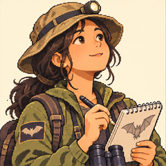

# FEBRIYANI DAMAYANTI (W010)

**Peran:** Pengamat satwa malam
**Potret:** 
**Status:** Rancangan fiksi publik — belum disahkan sebagai kisah atau gameplay aktif.

> Seluruh cerita dan sifat di halaman ini adalah konsep untuk tokoh fiksi YZ Farm Life, bukan biografi seseorang di dunia nyata.

## Identitas

**preferredName:** Febriyani

**ageYears:** 24

**origin:** Febriyani lama tinggal di sekitar Banjaran, tempat pekarangan dekat lahan garapan menjadi pemandangan akrab. Dari sana ia belajar memeriksa pekerjaan kecil lebih dulu dan membawa kebiasaan itu ke lingkungan Pasirluyu. (latar fiksi; draf)

**language:** Bahasa Indonesia; sesekali memakai sapaan atau ungkapan Sunda saat suasana percakapan cocok.

**identity:** NPC fiksi berlatar Kota Bandung

**ageDesignNote:** Usia ini pilihan kreatif sementara berdasarkan kematangan visual potret, bukan pengukuran umur dari gambar.

**visualAgeBandDraft:** dewasa dalam rancangan karakter

## Penampilan dan bahasa tubuh

**general:** Potret canonical K12 memperlihatkan rincian visual yang dicatat di bawah; jangan menggantinya dengan identitas dari arsip legacy.

**physicalTraits:** Rambut gelap sebahu, topi lapangan dengan lampu kepala, jaket hijau dan teropong gantung; menulis sketsa burung di buku.

**bodyLanguageDirection:** menulis sketsa burung di buku

**proposedPose:** Gunakan gestur yang terlihat pada potret sebagai rujukan satu pose interaksi; animasi final belum disetujui.

## Busana dan estetika

**signatureClothing:** Rambut gelap sebahu, topi lapangan dengan lampu kepala, jaket hijau dan teropong gantung

**accessories**
- topi lapangan
- teropong

**aesthetic:** Pixel-art kehidupan Kota Bandung

**palette:** abu arang dan oranye pucat

**costumeConcept:** Pakaian kerja yang memudahkan kegiatan hewan dan habitatnya, tanpa menganggapnya sebagai pakaian nyata sosok dalam dunia nyata

## Pekerjaan dan kehidupan sosial

**education:** Belajar pengamatan ekosistem dan penanganan lapangan melalui praktik komunitas.

**communityActivity:** Menyiapkan kegiatan kecil seputar satwa malam tanpa bergantung pada pemain.

**functionInWorld:** lingkungan

**workRoutineConcept:** mengamati kondisi lingkungan sebelum memindahkan peralatan

**workplaceConcept:** Situasi kerja fiksi mengenai hewan dan habitatnya; lokasi spesifik belum ditetapkan

## Kepribadian fiksi

**traits**
- Kepedulian lingkungan
- Tekun
- Mau mendengar

**observableHabit:** mengamati dari jauh sebelum mendekat

**values:** Kepedulian lingkungan

**weakness:** terlalu hati-hati ketika harus bertindak

**strengthConcept:** memperhatikan risiko untuk orang lain

**flawConcept:** sulit melepas pekerjaan yang belum rapi

**microHabitConcept:** menunjuk bagian yang perlu dicek saat membicarakan hewan dan habitatnya

## Motivasi dan konflik fiksi

**primaryMotivation:** Menjaga pekerjaan satwa malam tetap dapat dipertanggungjawabkan

**need:** Berharap warga mau mendengarkan masalah satwa malam sebelum memberi solusi.

**innerConflict:** Dua pihak sama-sama punya alasan yang kuat

**fear:** Habitat kehilangan keseimbangan

**motivationConcept:** Mencari cara menangani satwa malam dengan teliti ketika orang lain ingin pekerjaan cepat selesai

**conflictConcept:** Di bagian satwa malam, tanda-tanda di sekitar habitat belum cukup untuk mengambil keputusan cepat; pilihan yang serba cepat terasa berisiko baginya dalam premis fiksi ini

**agencyConcept:** Boleh menolak bantuan yang mengikuti kebiasaan lama tanpa pemeriksaan; dapat memilih mencatat pengamatan lebih dulu dan mengubah langkah seperlunya meskipun pemain tidak setuju

## Latar cerita

**familyContext:** Febriyani dan seorang sepupu bergantian mengurus rumah keluarga. Mereka akrab, walaupun perbedaan cara bekerja sesekali menjadi bahan perdebatan sepulang dari tugas pengamat satwa malam. (latar fiksi; draf)

**formativeMemory:** Ada satu kejadian di tempat kerja yang sulit dilupakan: tanda-tanda di sekitar habitat belum cukup untuk mengambil keputusan cepat. Daripada cepat menyalahkan keadaan, ia belajar mengulang pemeriksaan kecil.

**narrativeBackground:** Di sela kandang, air, dan kehidupan di sekitar kota, Febriyani Damayanti menemukan jadwal yang saling bertabrakan.

**narrativeStatus:** Konsep fiksi baru; bukan riwayat orang asli

**sceneConcept:** Sebuah kegiatan sehari-hari tentang hewan dan habitatnya terhambat karena tanda-tanda di sekitar habitat belum cukup untuk mengambil keputusan cepat. Ini hanya premis adegan, bukan riwayat pribadi.

## Interaksi dan hubungan

**relationshipHook:** Kedekatan dibangun melalui bantuan terkait catatan pengamatan, tanpa relasi keluarga yang ditebak

**trustBehavior:** Meningkat setelah pemain menepati janji dan menghormati pilihan tokoh

**personalBoundary:** Tidak langsung membicarakan masalah pribadi kepada pemain baru

**boundaryConcept:** Tidak membagi urusan pribadi hanya karena pemain sering menyapa; kedekatan tidak sama dengan persetujuan

## Suara dan dialog

**speechSignature:** Pilih kata sederhana untuk satwa malam; tidak berusaha selalu menyenangkan pemain.

**sampleLine:** Kalau bicara satwa malam, aku lebih suka melihat kondisinya langsung.

**habitualGesture:** menunduk mengamati jejak atau permukaan air

**reactions**
- **neutral:** Menanggapi seperlunya dan kembali ke pekerjaan
- **happy:** Senyum kecil saat bantuan benar-benar berguna
- **worried:** Memeriksa catatan pengamatan sebelum memberi jawaban

**dialogueDrafts**
- Kalau bicara satwa malam, aku lebih suka melihat kondisinya langsung.
- Kalau kamu memilih mengikuti kebiasaan lama tanpa pemeriksaan untuk satwa malam, aku perlu tahu siapa yang bertanggung jawab.
- Kita coba mencatat pengamatan lebih dulu dan mengubah langkah seperlunya untuk satwa malam dulu. Kalau tidak cocok, kita ganti rencana.

**speakingCadence:** ringkas saat bekerja, lebih terbuka sesudahnya

## Perkembangan cerita

**storyArc:** Urusan catatan pengamatan mulai mengganggu rutinitas pengamat satwa malam

**questHook:** Ketika sedang menangani satwa malam, muncul masalah sederhana: tanda-tanda di sekitar habitat belum cukup untuk mengambil keputusan cepat. Pemain boleh membantu, menolak, atau mengajukan cara lain; belum ada quest runtime.

**threeActBeats**
- Masalah satwa malam terlihat ketika mengamati kondisi lingkungan sebelum memindahkan peralatan
- Pemain mengetahui bahwa tanda-tanda di sekitar habitat belum cukup untuk mengambil keputusan cepat; pilihan warga tidak selalu sejalan
- Salah satu cara dicoba dalam kegiatan satwa malam, lalu hasilnya dievaluasi bersama

**playerChoices**
- Mendukung usulan untuk mengikuti kebiasaan lama tanpa pemeriksaan pada satwa malam
- Mengusulkan agar mencatat pengamatan lebih dulu dan mengubah langkah seperlunya untuk satwa malam

**implementation:** draft, belum diaktifkan otomatis

**sideQuestConcept**
- **premise:** Saat mengurus satwa malam, tanda-tanda di sekitar habitat belum cukup untuk mengambil keputusan cepat.
- **decisionA:** Mengikuti kebiasaan lama tanpa pemeriksaan.
- **decisionB:** Mencatat pengamatan lebih dulu dan mengubah langkah seperlunya.
- **state:** not-implemented

**choiceConsequencesConcept**
- - **choice:** A
- **result:** Kemungkinan lebih cepat; konsekuensi nyata harus ditulis dan diuji sebelum implementasi
- - **choice:** B
- **result:** Kemungkinan lebih teliti; konsekuensi nyata harus ditulis dan diuji sebelum implementasi

## Referensi visual

**visualContinuity:** Patokan ilustrasi: Rambut gelap sebahu, topi lapangan dengan lampu kepala, jaket hijau dan teropong gantung; menulis sketsa burung di buku. Cocokkan penutup kepala, warna, alat bantu, aksesori dan siluet dengan sprite; jangan mengganti portrait key.

**suggestedPalette:** abu arang dan oranye pucat

**animationRequired**
- idle
- walk-4-directions
- interact

**observedIllustrationStyle:** Potret ilustrasi karakter lingkungan; kepadatan piksel dan outline perlu diseragamkan.

## Kontinuitas dan status runtime

**availability:** Katalog; jadwal dan spawn mengikuti ekspansi bertahap

**playerDependentState:** Tidak boleh tertukar dengan ID cerita lama

**canonStatus:** Nama, pekerjaan dan kunci potret terkunci; detail cerita masih rancangan

**playableRuntimeConfirmed:** Tidak

**questIntegrationConfirmed:** Tidak

**legacyAssociationApproved:** Tidak

**status:** Konsep publik; kehadiran karakter dan cerita di runtime memerlukan implementasi terpisah.

---
Karakter ini merupakan bagian dari katalog fiksi YZ Farm Life. Data identitas canonical dikunci; pengesahan lore dan implementasi gameplay dilakukan terpisah.
