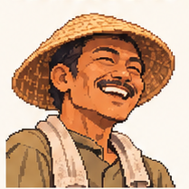

# GUGUM GUNAWAN (W016)

**Peran:** Petani padi
**Potret:** 
**Status:** Rancangan fiksi publik — belum disahkan sebagai kisah atau gameplay aktif.

> Seluruh cerita dan sifat di halaman ini adalah konsep untuk tokoh fiksi YZ Farm Life, bukan biografi seseorang di dunia nyata.

## Identitas

**preferredName:** Gugum

**ageYears:** 41

**origin:** Dalam versi cerita ini, Gugum berasal dari lingkungan Banjaran dengan pekarangan dekat lahan garapan. Ia membawa kebiasaan memeriksa pekerjaan kecil lebih dulu saat mulai membangun hubungan dengan tetangga baru. (latar fiksi; draf)

**language:** Bahasa Indonesia; sesekali memakai sapaan atau ungkapan Sunda saat suasana percakapan cocok.

**identity:** NPC fiksi berlatar Kota Bandung

**ageDesignNote:** Usia ini pilihan kreatif sementara berdasarkan kematangan visual potret, bukan pengukuran umur dari gambar.

**visualAgeBandDraft:** dewasa dalam rancangan karakter

## Penampilan dan bahasa tubuh

**general:** Potret canonical R047 memperlihatkan rincian visual yang dicatat di bawah; jangan menggantinya dengan identitas dari arsip legacy.

**physicalTraits:** Rambut gelap, kumis tipis, topi anyaman lebar, kemeja hijau zaitun dan handuk putih di bahu; tertawa.

**bodyLanguageDirection:** tertawa

**proposedPose:** Gunakan gestur yang terlihat pada potret sebagai rujukan satu pose interaksi; animasi final belum disetujui.

## Busana dan estetika

**signatureClothing:** Rambut gelap, kumis tipis, topi anyaman lebar, kemeja hijau zaitun dan handuk putih di bahu

**accessories**
- topi anyaman

**aesthetic:** Pixel-art kehidupan Kota Bandung

**palette:** hijau zaitun, putih

**costumeConcept:** Pakaian kerja yang memudahkan kegiatan hasil kebun, tanpa menganggapnya sebagai pakaian nyata sosok dalam dunia nyata

## Pekerjaan dan kehidupan sosial

**education:** Belajar budidaya serta pengamatan lapangan melalui kerja kebun dan pertukaran pengetahuan antarwarga.

**communityActivity:** Mengajak warga mencatat kebutuhan padi agar pekerjaan tidak saling bertabrakan.

**functionInWorld:** pertanian

**workRoutineConcept:** mengatur urutan kerja di petak dan tempat penyimpanan

**workplaceConcept:** Situasi kerja fiksi mengenai hasil kebun; lokasi spesifik belum ditetapkan

## Kepribadian fiksi

**traits**
- Ketelitian
- Tekun
- Mau mendengar

**observableHabit:** kerap memeriksa tanah sebelum mengambil keputusan

**values:** Ketelitian

**weakness:** terlalu lama membandingkan pilihan

**strengthConcept:** mau mengubah cara kerja ketika ada bukti

**flawConcept:** cenderung menunda percakapan sulit

**microHabitConcept:** merapikan alat setelah mengatur urutan kerja di petak dan tempat penyimpanan

## Motivasi dan konflik fiksi

**primaryMotivation:** Menjaga pekerjaan padi tetap dapat dipertanggungjawabkan

**need:** Butuh ruang untuk menolak jalan pintas dalam pekerjaan padi.

**innerConflict:** Rencana awal membuat sebagian orang menunggu lebih lama

**fear:** Bibit yang rusak

**motivationConcept:** Mencari cara menangani padi dengan teliti ketika orang lain ingin pekerjaan cepat selesai

**conflictConcept:** Di bagian padi, hasil bagus di satu petak belum tentu cocok dengan jadwal petak lain; pilihan yang serba cepat terasa berisiko baginya dalam premis fiksi ini

**agencyConcept:** Boleh menolak bantuan yang mendahulukan pengiriman hari ini; dapat memilih menjaga mutu sebelum mempercepat pengiriman meskipun pemain tidak setuju

## Latar cerita

**familyContext:** Karena jadwal keluarga berbeda, secarik pesan di dekat pintu sering menggantikan obrolan panjang. Gugum jadi terbiasa memberi kabar jika tugas petani padi berubah mendadak. (latar fiksi; draf)

**formativeMemory:** Di awal pekerjaannya sebagai petani padi, hasil bagus di satu petak belum tentu cocok dengan jadwal petak lain. Ia belajar bahwa keputusan kecil pun bisa memengaruhi orang lain.

**narrativeBackground:** Di sela bedengan, bibit, dan musim yang berubah, Gugum Gunawan menemukan cuaca berubah saat pekerjaan belum selesai.

**narrativeStatus:** Konsep fiksi baru; bukan riwayat orang asli

**sceneConcept:** Sebuah kegiatan sehari-hari tentang hasil kebun terhambat karena hasil bagus di satu petak belum tentu cocok dengan jadwal petak lain. Ini hanya premis adegan, bukan riwayat pribadi.

## Interaksi dan hubungan

**relationshipHook:** Kedekatan dibangun melalui bantuan terkait jadwal tanam, tanpa relasi keluarga yang ditebak

**trustBehavior:** Meningkat setelah pemain menepati janji dan menghormati pilihan tokoh

**personalBoundary:** Tidak langsung membicarakan masalah pribadi kepada pemain baru

**boundaryConcept:** Tidak membagi urusan pribadi hanya karena pemain sering menyapa; kedekatan tidak sama dengan persetujuan

## Suara dan dialog

**speechSignature:** Awalnya hati-hati ketika menjelaskan padi, lalu lugas setelah melihat hasil.

**sampleLine:** Petak padi ini belum kering merata. Aku belum mau menebak waktu panennya.

**habitualGesture:** mengusap tanah dari telapak tangan

**reactions**
- **neutral:** Menanggapi seperlunya dan kembali ke pekerjaan
- **happy:** Senyum kecil saat bantuan benar-benar berguna
- **worried:** Memeriksa jadwal tanam sebelum memberi jawaban

**dialogueDrafts**
- Petak padi ini belum kering merata. Aku belum mau menebak waktu panennya.
- Boleh saja mendahulukan pengiriman hari ini, tapi urusan padi ini belum selesai diperiksa.
- Aku akan menjaga mutu sebelum mempercepat pengiriman. Kalau hasilnya beda, baru kita cari cara lain.

**speakingCadence:** to the point, lalu memberi kesempatan lawan bicara

## Perkembangan cerita

**storyArc:** Urusan jadwal tanam mulai mengganggu rutinitas petani padi

**questHook:** Ketika sedang menangani padi, muncul masalah sederhana: hasil bagus di satu petak belum tentu cocok dengan jadwal petak lain. Pemain boleh membantu, menolak, atau mengajukan cara lain; belum ada quest runtime.

**threeActBeats**
- Masalah padi terlihat ketika mengatur urutan kerja di petak dan tempat penyimpanan
- Pemain mengetahui bahwa hasil bagus di satu petak belum tentu cocok dengan jadwal petak lain; pilihan warga tidak selalu sejalan
- Salah satu cara dicoba dalam kegiatan padi, lalu hasilnya dievaluasi bersama

**playerChoices**
- Mendukung usulan untuk mendahulukan pengiriman hari ini pada padi
- Mengusulkan agar menjaga mutu sebelum mempercepat pengiriman untuk padi

**implementation:** draft, belum diaktifkan otomatis

**sideQuestConcept**
- **premise:** Saat mengurus padi, hasil bagus di satu petak belum tentu cocok dengan jadwal petak lain.
- **decisionA:** Mendahulukan pengiriman hari ini.
- **decisionB:** Menjaga mutu sebelum mempercepat pengiriman.
- **state:** not-implemented

**choiceConsequencesConcept**
- - **choice:** A
- **result:** Kemungkinan lebih cepat; konsekuensi nyata harus ditulis dan diuji sebelum implementasi
- - **choice:** B
- **result:** Kemungkinan lebih teliti; konsekuensi nyata harus ditulis dan diuji sebelum implementasi

## Referensi visual

**visualContinuity:** Patokan ilustrasi: Rambut gelap, kumis tipis, topi anyaman lebar, kemeja hijau zaitun dan handuk putih di bahu; tertawa. Cocokkan penutup kepala, warna, alat bantu, aksesori dan siluet dengan sprite; jangan mengganti portrait key.

**suggestedPalette:** hijau zaitun, putih

**animationRequired**
- idle
- walk-4-directions
- interact

**observedIllustrationStyle:** Potret pixel-art bertekstur dengan variasi shading wajah; cocokkan kepadatan piksel antaraset.

## Kontinuitas dan status runtime

**availability:** Katalog; jadwal dan spawn mengikuti ekspansi bertahap

**playerDependentState:** Tidak boleh tertukar dengan ID cerita lama

**canonStatus:** Nama, pekerjaan dan kunci potret terkunci; detail cerita masih rancangan

**playableRuntimeConfirmed:** Tidak

**questIntegrationConfirmed:** Tidak

**legacyAssociationApproved:** Tidak

**status:** Konsep publik; kehadiran karakter dan cerita di runtime memerlukan implementasi terpisah.

---
Karakter ini merupakan bagian dari katalog fiksi YZ Farm Life. Data identitas canonical dikunci; pengesahan lore dan implementasi gameplay dilakukan terpisah.
