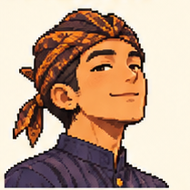

# EKI SUNGKAWA (W018)

**Peran:** Penata kostum pertunjukan
**Potret:** 
**Status:** Rancangan fiksi publik — belum disahkan sebagai kisah atau gameplay aktif.

> Seluruh cerita dan sifat di halaman ini adalah konsep untuk tokoh fiksi YZ Farm Life, bukan biografi seseorang di dunia nyata.

## Identitas

**preferredName:** Eki

**ageYears:** 35

**language:** Bahasa Indonesia; sesekali memakai sapaan atau ungkapan Sunda saat suasana percakapan cocok.

**identity:** NPC fiksi berlatar Kota Bandung

**ageDesignNote:** Usia ini pilihan kreatif sementara berdasarkan kematangan visual potret, bukan pengukuran umur dari gambar.

**visualAgeBandDraft:** dewasa dalam rancangan karakter

## Penampilan dan bahasa tubuh

**general:** Potret canonical R082 memperlihatkan rincian visual yang dicatat di bawah; jangan menggantinya dengan identitas dari arsip legacy.

**physicalTraits:** Rambut gelap, ikat kepala batik jingga dan busana ungu tua berkerah; menatap ke samping.

**bodyLanguageDirection:** menatap ke samping

**proposedPose:** Gunakan gestur yang terlihat pada potret sebagai rujukan satu pose interaksi; animasi final belum disetujui.

## Busana dan estetika

**signatureClothing:** Rambut gelap, ikat kepala batik jingga dan busana ungu tua berkerah

**accessories**
- ikat kepala

**aesthetic:** Pixel-art kehidupan Kota Bandung

**palette:** ungu tua, jingga

**costumeConcept:** Pakaian kerja yang memudahkan kegiatan bahan dan pola, tanpa menganggapnya sebagai pakaian nyata sosok dalam dunia nyata

## Pekerjaan dan kehidupan sosial

**education:** Mengasah keterampilan kriya lewat praktik, belajar dari pekerja berpengalaman, dan uji coba bahan.

**communityActivity:** Mengajak warga mencatat kebutuhan kostum pertunjukan agar pekerjaan tidak saling bertabrakan.

**functionInWorld:** seni budaya

**workRoutineConcept:** mencocokkan bahan, warna, serta potongan yang sedang dikerjakan

**workplaceConcept:** Situasi kerja fiksi mengenai bahan dan pola; lokasi spesifik belum ditetapkan

## Kepribadian fiksi

**traits**
- Penghargaan karya
- Tekun
- Mau mendengar

**observableHabit:** mendengar irama sekitar sebelum memulai

**values:** Penghargaan karya

**weakness:** sering menunda memperlihatkan karya

**strengthConcept:** mau mengubah cara kerja ketika ada bukti

**flawConcept:** cenderung menunda percakapan sulit

**microHabitConcept:** merapikan alat setelah mencocokkan bahan, warna, serta potongan yang sedang dikerjakan

## Motivasi dan konflik fiksi

**primaryMotivation:** Menjaga pekerjaan kostum pertunjukan tetap dapat dipertanggungjawabkan

**need:** Butuh ruang untuk menolak jalan pintas dalam pekerjaan kostum pertunjukan.

**innerConflict:** Dua pihak sama-sama punya alasan yang kuat

**fear:** Pertunjukan yang tak terdengar

**motivationConcept:** Mencari cara menangani kostum pertunjukan dengan teliti ketika orang lain ingin pekerjaan cepat selesai

**conflictConcept:** Di bagian kostum pertunjukan, pilihan warna yang menarik belum tentu sesuai dengan pesanan dan bahan; pilihan yang serba cepat terasa berisiko baginya dalam premis fiksi ini

**agencyConcept:** Boleh menolak bantuan yang mengubah desain mendadak; dapat memilih menguji padanan pada contoh kecil meskipun pemain tidak setuju

## Latar cerita

**formativeMemory:** Bertahun-tahun kemudian pun ia masih ingat ketika pilihan warna yang menarik belum tentu sesuai dengan pesanan dan bahan. Ia belajar bahwa keputusan kecil pun bisa memengaruhi orang lain.

**narrativeBackground:** Di sela latihan, karya, dan penonton di kampung, Eki Sungkawa menemukan jadwal yang saling bertabrakan.

**narrativeStatus:** Konsep fiksi baru; bukan riwayat orang asli

**sceneConcept:** Sebuah kegiatan sehari-hari tentang bahan dan pola terhambat karena pilihan warna yang menarik belum tentu sesuai dengan pesanan dan bahan. Ini hanya premis adegan, bukan riwayat pribadi.

## Interaksi dan hubungan

**relationshipHook:** Kedekatan dibangun melalui bantuan terkait jadwal pertunjukan, tanpa relasi keluarga yang ditebak

**trustBehavior:** Meningkat setelah pemain menepati janji dan menghormati pilihan tokoh

**personalBoundary:** Tidak langsung membicarakan masalah pribadi kepada pemain baru

**boundaryConcept:** Tidak membagi urusan pribadi hanya karena pemain sering menyapa; kedekatan tidak sama dengan persetujuan

## Suara dan dialog

**speechSignature:** Awalnya hati-hati ketika menjelaskan kostum pertunjukan, lalu lugas setelah melihat hasil.

**sampleLine:** Tunggu. Bagian kostum pertunjukan belum beres dicek. Jangan ditutup dulu.

**habitualGesture:** mengatur posisi alat atau menarik napas sebelum tampil

**reactions**
- **neutral:** Menanggapi seperlunya dan kembali ke pekerjaan
- **happy:** Senyum kecil saat bantuan benar-benar berguna
- **worried:** Memeriksa jadwal pertunjukan sebelum memberi jawaban

**dialogueDrafts**
- Tunggu. Bagian kostum pertunjukan belum beres dicek. Jangan ditutup dulu.
- Boleh saja mengubah desain mendadak, tapi urusan kostum pertunjukan ini belum selesai diperiksa.
- Aku akan menguji padanan pada contoh kecil. Kalau hasilnya beda, baru kita cari cara lain.

**speakingCadence:** to the point, lalu memberi kesempatan lawan bicara

## Perkembangan cerita

**storyArc:** Urusan jadwal pertunjukan mulai mengganggu rutinitas penata kostum pertunjukan

**questHook:** Ketika sedang menangani kostum pertunjukan, muncul masalah sederhana: pilihan warna yang menarik belum tentu sesuai dengan pesanan dan bahan. Pemain boleh membantu, menolak, atau mengajukan cara lain; belum ada quest runtime.

**threeActBeats**
- Masalah kostum pertunjukan terlihat ketika mencocokkan bahan, warna, serta potongan yang sedang dikerjakan
- Pemain mengetahui bahwa pilihan warna yang menarik belum tentu sesuai dengan pesanan dan bahan; pilihan warga tidak selalu sejalan
- Salah satu cara dicoba dalam kegiatan kostum pertunjukan, lalu hasilnya dievaluasi bersama

**playerChoices**
- Mendukung usulan untuk mengubah desain mendadak pada kostum pertunjukan
- Mengusulkan agar menguji padanan pada contoh kecil untuk kostum pertunjukan

**implementation:** draft, belum diaktifkan otomatis

**sideQuestConcept**
- **premise:** Saat mengurus kostum pertunjukan, pilihan warna yang menarik belum tentu sesuai dengan pesanan dan bahan.
- **decisionA:** Mengubah desain mendadak.
- **decisionB:** Menguji padanan pada contoh kecil.
- **state:** not-implemented

**choiceConsequencesConcept**
- - **choice:** A
- **result:** Kemungkinan lebih cepat; konsekuensi nyata harus ditulis dan diuji sebelum implementasi
- - **choice:** B
- **result:** Kemungkinan lebih teliti; konsekuensi nyata harus ditulis dan diuji sebelum implementasi

## Referensi visual

**visualContinuity:** Patokan ilustrasi: Rambut gelap, ikat kepala batik jingga dan busana ungu tua berkerah; menatap ke samping. Cocokkan penutup kepala, warna, alat bantu, aksesori dan siluet dengan sprite; jangan mengganti portrait key.

**suggestedPalette:** ungu tua, jingga

**animationRequired**
- idle
- walk-4-directions
- interact

**observedIllustrationStyle:** Potret pixel-art bertekstur dengan variasi shading wajah; cocokkan kepadatan piksel antaraset.

## Kontinuitas dan status runtime

**availability:** Katalog; jadwal dan spawn mengikuti ekspansi bertahap

**playerDependentState:** Tidak boleh tertukar dengan ID cerita lama

**canonStatus:** Nama, pekerjaan dan kunci potret terkunci; detail cerita masih rancangan

**playableRuntimeConfirmed:** Tidak

**questIntegrationConfirmed:** Tidak

**legacyAssociationApproved:** Tidak

**status:** Konsep publik; kehadiran karakter dan cerita di runtime memerlukan implementasi terpisah.

---
Karakter ini merupakan bagian dari katalog fiksi YZ Farm Life. Data identitas canonical dikunci; pengesahan lore dan implementasi gameplay dilakukan terpisah.
