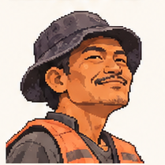

# IRWAN NURLIAWAN (W023)

**Peran:** Pengawas pekerjaan kebun
**Potret:** 
**Status:** Rancangan fiksi publik — belum disahkan sebagai kisah atau gameplay aktif.

> Seluruh cerita dan sifat di halaman ini adalah konsep untuk tokoh fiksi YZ Farm Life, bukan biografi seseorang di dunia nyata.

## Identitas

**preferredName:** Irwan

**ageYears:** 24

**origin:** Jejak awal Irwan dalam cerita ini berangkat dari Soreang, di antara jalan kampung di dekat lahan tanam. Ia mulai terbiasa mendengar pengalaman petani lain, sesuatu yang kelak memengaruhi cara bekerja dan bergaulnya. (latar fiksi; draf)

**language:** Bahasa Indonesia; sesekali memakai sapaan atau ungkapan Sunda saat suasana percakapan cocok.

**identity:** NPC fiksi berlatar Kota Bandung

**ageDesignNote:** Usia ini pilihan kreatif sementara berdasarkan kematangan visual potret, bukan pengukuran umur dari gambar.

**visualAgeBandDraft:** dewasa dalam rancangan karakter

## Penampilan dan bahasa tubuh

**general:** Potret canonical R054 memperlihatkan rincian visual yang dicatat di bawah; jangan menggantinya dengan identitas dari arsip legacy.

**physicalTraits:** Rambut gelap pendek, kumis tipis, topi abu dan rompi keselamatan jingga; tersenyum.

**bodyLanguageDirection:** tersenyum

**proposedPose:** Gunakan gestur yang terlihat pada potret sebagai rujukan satu pose interaksi; animasi final belum disetujui.

## Busana dan estetika

**signatureClothing:** Rambut gelap pendek, kumis tipis, topi abu dan rompi keselamatan jingga

**accessories**
- rompi

**aesthetic:** Pixel-art kehidupan Kota Bandung

**palette:** jingga, abu

**costumeConcept:** Pakaian kerja yang memudahkan kegiatan tanaman dan lingkungan, tanpa menganggapnya sebagai pakaian nyata sosok dalam dunia nyata

## Pekerjaan dan kehidupan sosial

**education:** Belajar budidaya serta pengamatan lapangan melalui kerja kebun dan pertukaran pengetahuan antarwarga.

**communityActivity:** Mengajak warga mencatat kebutuhan pekerjaan kebun agar pekerjaan tidak saling bertabrakan.

**functionInWorld:** pertanian

**workRoutineConcept:** meninjau keadaan area kerja sebelum menerima bantuan

**workplaceConcept:** Situasi kerja fiksi mengenai tanaman dan lingkungan; lokasi spesifik belum ditetapkan

## Kepribadian fiksi

**traits**
- Ketelitian
- Tekun
- Mau mendengar

**observableHabit:** kerap memeriksa tanah sebelum mengambil keputusan

**values:** Ketelitian

**weakness:** terlalu lama membandingkan pilihan

**strengthConcept:** mau mengubah cara kerja ketika ada bukti

**flawConcept:** cenderung menunda percakapan sulit

**microHabitConcept:** merapikan alat setelah meninjau keadaan area kerja sebelum menerima bantuan

## Motivasi dan konflik fiksi

**primaryMotivation:** Menjaga pekerjaan pekerjaan kebun tetap dapat dipertanggungjawabkan

**need:** Butuh ruang untuk menolak jalan pintas dalam pekerjaan pekerjaan kebun.

**innerConflict:** Dua keterangan warga ternyata tidak sama

**fear:** Bibit yang rusak

**motivationConcept:** Mencari cara menangani pekerjaan kebun dengan teliti ketika orang lain ingin pekerjaan cepat selesai

**conflictConcept:** Di bagian pekerjaan kebun, perubahan kecil pada tempat tumbuh membuat hasil pemeliharaan tidak seragam; pilihan yang serba cepat terasa berisiko baginya dalam premis fiksi ini

**agencyConcept:** Boleh menolak bantuan yang mengubah seluruh penataan sekaligus; dapat memilih menguji satu perubahan di area terbatas meskipun pemain tidak setuju

## Latar cerita

**familyContext:** Keluarga Irwan biasa menawarkan bantuan tanpa menunggu diminta. Ia ingin sikap yang sama hadir dalam pekerjaan pengawas pekerjaan kebun, sambil tetap menghormati batas orang lain. (latar fiksi; draf)

**formativeMemory:** Ia sempat mengira semuanya akan lancar. Ternyata perubahan kecil pada tempat tumbuh membuat hasil pemeliharaan tidak seragam. Sejak saat itu, ia selalu menyisakan waktu untuk memeriksa kembali langkahnya.

**narrativeBackground:** Di sela bedengan, bibit, dan musim yang berubah, Irwan Nurliawan menemukan catatan yang tercecer.

**narrativeStatus:** Konsep fiksi baru; bukan riwayat orang asli

**sceneConcept:** Sebuah kegiatan sehari-hari tentang tanaman dan lingkungan terhambat karena perubahan kecil pada tempat tumbuh membuat hasil pemeliharaan tidak seragam. Ini hanya premis adegan, bukan riwayat pribadi.

## Interaksi dan hubungan

**relationshipHook:** Kedekatan dibangun melalui bantuan terkait jadwal tanam, tanpa relasi keluarga yang ditebak

**trustBehavior:** Meningkat setelah pemain menepati janji dan menghormati pilihan tokoh

**personalBoundary:** Tidak langsung membicarakan masalah pribadi kepada pemain baru

**boundaryConcept:** Tidak membagi urusan pribadi hanya karena pemain sering menyapa; kedekatan tidak sama dengan persetujuan

## Suara dan dialog

**speechSignature:** Awalnya hati-hati ketika menjelaskan pekerjaan kebun, lalu lugas setelah melihat hasil.

**sampleLine:** Tunggu. Bagian pekerjaan kebun belum beres dicek. Jangan ditutup dulu.

**habitualGesture:** mengusap tanah dari telapak tangan

**reactions**
- **neutral:** Menanggapi seperlunya dan kembali ke pekerjaan
- **happy:** Senyum kecil saat bantuan benar-benar berguna
- **worried:** Memeriksa jadwal tanam sebelum memberi jawaban

**dialogueDrafts**
- Tunggu. Bagian pekerjaan kebun belum beres dicek. Jangan ditutup dulu.
- Boleh saja mengubah seluruh penataan sekaligus, tapi urusan pekerjaan kebun ini belum selesai diperiksa.
- Aku akan menguji satu perubahan di area terbatas. Kalau hasilnya beda, baru kita cari cara lain.

**speakingCadence:** to the point, lalu memberi kesempatan lawan bicara

## Perkembangan cerita

**storyArc:** Urusan jadwal tanam mulai mengganggu rutinitas pengawas pekerjaan kebun

**questHook:** Ketika sedang menangani pekerjaan kebun, muncul masalah sederhana: perubahan kecil pada tempat tumbuh membuat hasil pemeliharaan tidak seragam. Pemain boleh membantu, menolak, atau mengajukan cara lain; belum ada quest runtime.

**threeActBeats**
- Masalah pekerjaan kebun terlihat ketika meninjau keadaan area kerja sebelum menerima bantuan
- Pemain mengetahui bahwa perubahan kecil pada tempat tumbuh membuat hasil pemeliharaan tidak seragam; pilihan warga tidak selalu sejalan
- Salah satu cara dicoba dalam kegiatan pekerjaan kebun, lalu hasilnya dievaluasi bersama

**playerChoices**
- Mendukung usulan untuk mengubah seluruh penataan sekaligus pada pekerjaan kebun
- Mengusulkan agar menguji satu perubahan di area terbatas untuk pekerjaan kebun

**implementation:** draft, belum diaktifkan otomatis

**sideQuestConcept**
- **premise:** Saat mengurus pekerjaan kebun, perubahan kecil pada tempat tumbuh membuat hasil pemeliharaan tidak seragam.
- **decisionA:** Mengubah seluruh penataan sekaligus.
- **decisionB:** Menguji satu perubahan di area terbatas.
- **state:** not-implemented

**choiceConsequencesConcept**
- - **choice:** A
- **result:** Kemungkinan lebih cepat; konsekuensi nyata harus ditulis dan diuji sebelum implementasi
- - **choice:** B
- **result:** Kemungkinan lebih teliti; konsekuensi nyata harus ditulis dan diuji sebelum implementasi

## Referensi visual

**visualContinuity:** Patokan ilustrasi: Rambut gelap pendek, kumis tipis, topi abu dan rompi keselamatan jingga; tersenyum. Cocokkan penutup kepala, warna, alat bantu, aksesori dan siluet dengan sprite; jangan mengganti portrait key.

**suggestedPalette:** jingga, abu

**animationRequired**
- idle
- walk-4-directions
- interact

**observedIllustrationStyle:** Potret pixel-art bertekstur dengan variasi shading wajah; cocokkan kepadatan piksel antaraset.

## Kontinuitas dan status runtime

**availability:** Katalog; jadwal dan spawn mengikuti ekspansi bertahap

**playerDependentState:** Tidak boleh tertukar dengan ID cerita lama

**canonStatus:** Nama, pekerjaan dan kunci potret terkunci; detail cerita masih rancangan

**playableRuntimeConfirmed:** Tidak

**questIntegrationConfirmed:** Tidak

**legacyAssociationApproved:** Tidak

**status:** Konsep publik; kehadiran karakter dan cerita di runtime memerlukan implementasi terpisah.

---
Karakter ini merupakan bagian dari katalog fiksi YZ Farm Life. Data identitas canonical dikunci; pengesahan lore dan implementasi gameplay dilakukan terpisah.
