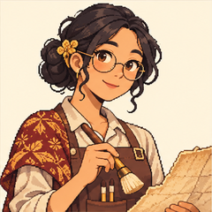

# KARTIKA SHINTA RARASATI (W031)

**Peran:** Konservator kertas
**Potret:** 
**Status:** Rancangan fiksi publik — belum disahkan sebagai kisah atau gameplay aktif.

> Seluruh cerita dan sifat di halaman ini adalah konsep untuk tokoh fiksi YZ Farm Life, bukan biografi seseorang di dunia nyata.

## Identitas

**identity:** NPC fiksi berlatar Kota Bandung

## Penampilan dan bahasa tubuh

**general:** Rancangan sprite disesuaikan dengan potret K13; tidak disimpulkan dari nama atau pekerjaan

**bodyLanguageDirection:** berhenti sejenak lalu membuka catatan

**proposedPose:** Baca siluet ketika sedang menyusun catatan agar mudah ditemukan kembali; sesuaikan hanya setelah potret benar-benar ditinjau

## Busana dan estetika

**signatureClothing:** busana kasual yang sesuai pekerjaan dan cuaca Bandung

**aesthetic:** Pixel-art kehidupan Kota Bandung

**palette:** biru kabut dan putih tulang

**costumeConcept:** Pakaian kerja yang memudahkan kegiatan catatan dan dokumen, tanpa menganggapnya sebagai pakaian nyata sosok dalam dunia nyata

## Pekerjaan dan kehidupan sosial

**communityActivity:** Membahas cara memeriksa kertas bersama warga sebelum mengambil keputusan.

**functionInWorld:** kehidupan kota

**workRoutineConcept:** menyusun catatan agar mudah ditemukan kembali

**workplaceConcept:** Situasi kerja fiksi mengenai catatan dan dokumen; lokasi spesifik belum ditetapkan

## Kepribadian fiksi

**traits**
- Saling membantu
- Tekun
- Mau mendengar

**observableHabit:** memperhatikan perubahan kecil di sekitar

**values:** Saling membantu

**weakness:** kadang menahan pendapat

**strengthConcept:** telaten menguji hasil sebelum dibagikan

**flawConcept:** terlalu lama mengecek rincian

**microHabitConcept:** membandingkan dua catatan tentang catatan dan dokumen sebelum menjawab

## Motivasi dan konflik fiksi

**primaryMotivation:** Menjaga pekerjaan kertas tetap dapat dipertanggungjawabkan

**need:** Ingin ada waktu memeriksa urusan kertas sebelum keputusan diambil bersama.

**innerConflict:** Dua keterangan warga ternyata tidak sama

**fear:** Urusan tertunda tanpa kabar

**motivationConcept:** Mencari cara menangani kertas dengan teliti ketika orang lain ingin pekerjaan cepat selesai

**conflictConcept:** Di bagian kertas, satu catatan tidak sama dengan salinan yang beredar; pilihan yang serba cepat terasa berisiko baginya dalam premis fiksi ini

**agencyConcept:** Boleh menolak bantuan yang memakai catatan yang paling baru terlihat; dapat memilih menelusuri asal dan tanggal catatan meskipun pemain tidak setuju

## Latar cerita

**narrativeBackground:** Di sela jalan kampung, pekerjaan, dan tetangga, Kartika Shinta Rarasati menemukan catatan yang tercecer.

**narrativeStatus:** Konsep fiksi baru; bukan riwayat orang asli

**sceneConcept:** Sebuah kegiatan sehari-hari tentang catatan dan dokumen terhambat karena satu catatan tidak sama dengan salinan yang beredar. Ini hanya premis adegan, bukan riwayat pribadi.

## Interaksi dan hubungan

**relationshipHook:** Kedekatan dibangun melalui bantuan terkait catatan pekerjaan, tanpa relasi keluarga yang ditebak

**trustBehavior:** Meningkat setelah pemain menepati janji dan menghormati pilihan tokoh

**personalBoundary:** Tidak langsung membicarakan masalah pribadi kepada pemain baru

**boundaryConcept:** Tidak membagi urusan pribadi hanya karena pemain sering menyapa; kedekatan tidak sama dengan persetujuan

## Suara dan dialog

**speechSignature:** Bicara singkat soal kertas; lebih banyak bertanya saat ada risiko.

**sampleLine:** Soal kertas tadi ada yang kelewat. Aku mau lihat lagi sebentar.

**habitualGesture:** berhenti sejenak lalu membuka catatan

**reactions**
- **neutral:** Menanggapi seperlunya dan kembali ke pekerjaan
- **happy:** Senyum kecil saat bantuan benar-benar berguna
- **worried:** Memeriksa catatan pekerjaan sebelum memberi jawaban

**dialogueDrafts**
- Soal kertas tadi ada yang kelewat. Aku mau lihat lagi sebentar.
- Aku kurang yakin kalau kita memakai catatan yang paling baru terlihat. Untuk kertas, risikonya belum jelas.
- Kalau aku, lebih baik menelusuri asal dan tanggal catatan. Urusan kertas bisa menunggu sebentar.

**speakingCadence:** tenang dengan jeda saat memastikan rincian

## Perkembangan cerita

**storyArc:** Urusan catatan pekerjaan mulai mengganggu rutinitas konservator kertas

**questHook:** Ketika sedang menangani kertas, muncul masalah sederhana: satu catatan tidak sama dengan salinan yang beredar. Pemain boleh membantu, menolak, atau mengajukan cara lain; belum ada quest runtime.

**threeActBeats**
- Masalah kertas terlihat ketika menyusun catatan agar mudah ditemukan kembali
- Pemain mengetahui bahwa satu catatan tidak sama dengan salinan yang beredar; pilihan warga tidak selalu sejalan
- Salah satu cara dicoba dalam kegiatan kertas, lalu hasilnya dievaluasi bersama

**playerChoices**
- Mendukung usulan untuk memakai catatan yang paling baru terlihat pada kertas
- Mengusulkan agar menelusuri asal dan tanggal catatan untuk kertas

**implementation:** draft, belum diaktifkan otomatis

**sideQuestConcept**
- **premise:** Saat mengurus kertas, satu catatan tidak sama dengan salinan yang beredar.
- **decisionA:** Memakai catatan yang paling baru terlihat.
- **decisionB:** Menelusuri asal dan tanggal catatan.
- **state:** not-implemented

**choiceConsequencesConcept**
- - **choice:** A
- **result:** Kemungkinan lebih cepat; konsekuensi nyata harus ditulis dan diuji sebelum implementasi
- - **choice:** B
- **result:** Kemungkinan lebih teliti; konsekuensi nyata harus ditulis dan diuji sebelum implementasi

## Referensi visual

**visualContinuity:** Cocokkan palet, proporsi tangan, ekspresi, pakaian, dan arah hadap antara potret, sprite dan aset pekerjaan

**suggestedPalette:** biru kabut dan putih tulang

**animationRequired**
- idle
- walk-4-directions
- interact

## Kontinuitas dan status runtime

**availability:** Katalog; jadwal dan spawn mengikuti ekspansi bertahap

**playerDependentState:** Tidak boleh tertukar dengan ID cerita lama

**canonStatus:** Nama, pekerjaan dan kunci potret terkunci; detail cerita masih rancangan

**playableRuntimeConfirmed:** Tidak

**questIntegrationConfirmed:** Tidak

**legacyAssociationApproved:** Tidak

**status:** Konsep publik; kehadiran karakter dan cerita di runtime memerlukan implementasi terpisah.

---
Karakter ini merupakan bagian dari katalog fiksi YZ Farm Life. Data identitas canonical dikunci; pengesahan lore dan implementasi gameplay dilakukan terpisah.
