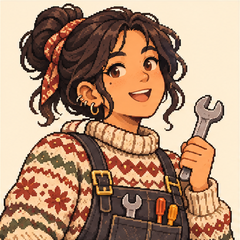

# LILIH SHOLIHAH (W034)

**Peran:** Teknisi mesin rajut
**Potret:** 
**Status:** Rancangan fiksi publik — belum disahkan sebagai kisah atau gameplay aktif.

> Seluruh cerita dan sifat di halaman ini adalah konsep untuk tokoh fiksi YZ Farm Life, bukan biografi seseorang di dunia nyata.

## Identitas

**preferredName:** Lilih

**ageYears:** 38

**origin:** Lilih lebih mudah mengingat Gedebage dari suasana gudang dan jalur distribusi daripada satu peristiwa besar. Di sanalah ia belajar mencatat detail saat pergantian tugas, lalu mencoba menerapkannya di dekat kebun Pasirluyu. (latar fiksi; draf)

**language:** Bahasa Indonesia; sesekali memakai sapaan atau ungkapan Sunda saat suasana percakapan cocok.

**identity:** NPC fiksi berlatar Kota Bandung

**ageDesignNote:** Usia ini pilihan kreatif sementara berdasarkan kematangan visual potret, bukan pengukuran umur dari gambar.

**visualAgeBandDraft:** dewasa dalam rancangan karakter

## Penampilan dan bahasa tubuh

**general:** Potret canonical K19 memperlihatkan rincian visual yang dicatat di bawah; jangan menggantinya dengan identitas dari arsip legacy.

**physicalTraits:** Rambut gelap disanggul dua, bando merah bermotif, sweter krem motif merah dan apron gelap; membawa kunci pas.

**bodyLanguageDirection:** membawa kunci pas

**proposedPose:** Gunakan gestur yang terlihat pada potret sebagai rujukan satu pose interaksi; animasi final belum disetujui.

## Busana dan estetika

**signatureClothing:** Rambut gelap disanggul dua, bando merah bermotif, sweter krem motif merah dan apron gelap

**accessories**
- kunci pas

**aesthetic:** Pixel-art kehidupan Kota Bandung

**palette:** merah, krem

**costumeConcept:** Pakaian kerja yang memudahkan kegiatan bahan dan pola, tanpa menganggapnya sebagai pakaian nyata sosok dalam dunia nyata

## Pekerjaan dan kehidupan sosial

**education:** Memperoleh keterampilan melalui latihan bengkel dan pemecahan masalah peralatan.

**communityActivity:** Membahas cara memeriksa mesin rajut bersama warga sebelum mengambil keputusan.

**functionInWorld:** kriya

**workRoutineConcept:** mencocokkan bahan, warna, serta potongan yang sedang dikerjakan

**workplaceConcept:** Situasi kerja fiksi mengenai bahan dan pola; lokasi spesifik belum ditetapkan

## Kepribadian fiksi

**traits**
- Kesabaran
- Tekun
- Mau mendengar

**observableHabit:** mengukur bahan sebelum memotong

**values:** Kesabaran

**weakness:** ingin hasil sempurna saat waktunya sempit

**strengthConcept:** telaten menguji hasil sebelum dibagikan

**flawConcept:** terlalu lama mengecek rincian

**microHabitConcept:** menyebut risiko sebelum menyetujui perubahan bahan dan pola

## Motivasi dan konflik fiksi

**primaryMotivation:** Menjaga pekerjaan mesin rajut tetap dapat dipertanggungjawabkan

**need:** Ingin hasil penanganan mesin rajut dinilai dari keadaan nyata, bukan janji.

**innerConflict:** Dua pihak sama-sama punya alasan yang kuat

**fear:** Bahan berharga terbuang

**motivationConcept:** Mencari cara menangani mesin rajut dengan teliti ketika orang lain ingin pekerjaan cepat selesai

**conflictConcept:** Di bagian mesin rajut, pilihan warna yang menarik belum tentu sesuai dengan pesanan dan bahan; pilihan yang serba cepat terasa berisiko baginya dalam premis fiksi ini

**agencyConcept:** Boleh menolak bantuan yang mengubah desain mendadak; dapat memilih menguji padanan pada contoh kecil meskipun pemain tidak setuju

## Latar cerita

**familyContext:** Lilih dan bibinya sama-sama teguh bila membahas keselamatan keluarga. Mereka biasanya kembali akur setelah menjelaskan alasan masing-masing, bukan sekadar saling mengalah. (latar fiksi; draf)

**formativeMemory:** Ketika baru terbiasa dengan pekerjaan teknisi mesin rajut, pilihan warna yang menarik belum tentu sesuai dengan pesanan dan bahan. Ia memilih untuk mengukur bahan sebelum memotong, meskipun langkah itu membutuhkan lebih banyak waktu.

**narrativeBackground:** Di sela bahan, warna, dan barang buatan tangan, Lilih Sholihah menemukan jadwal yang saling bertabrakan.

**narrativeStatus:** Konsep fiksi baru; bukan riwayat orang asli

**sceneConcept:** Sebuah kegiatan sehari-hari tentang bahan dan pola terhambat karena pilihan warna yang menarik belum tentu sesuai dengan pesanan dan bahan. Ini hanya premis adegan, bukan riwayat pribadi.

## Interaksi dan hubungan

**relationshipHook:** Kedekatan dibangun melalui bantuan terkait pola kerja, tanpa relasi keluarga yang ditebak

**trustBehavior:** Meningkat setelah pemain menepati janji dan menghormati pilihan tokoh

**personalBoundary:** Tidak langsung membicarakan masalah pribadi kepada pemain baru

**boundaryConcept:** Tidak membagi urusan pribadi hanya karena pemain sering menyapa; kedekatan tidak sama dengan persetujuan

## Suara dan dialog

**speechSignature:** Bicara singkat soal mesin rajut; lebih banyak bertanya saat ada risiko.

**sampleLine:** Soal mesin rajut tadi ada yang kelewat. Aku mau lihat lagi sebentar.

**habitualGesture:** meraba sambungan atau merapikan bahan

**reactions**
- **neutral:** Menanggapi seperlunya dan kembali ke pekerjaan
- **happy:** Senyum kecil saat bantuan benar-benar berguna
- **worried:** Memeriksa pola kerja sebelum memberi jawaban

**dialogueDrafts**
- Soal mesin rajut tadi ada yang kelewat. Aku mau lihat lagi sebentar.
- Jangan buru-buru mengubah desain mendadak. Nanti bagian mesin rajut malah terlewat.
- Untuk bagian mesin rajut, pilihanku menguji padanan pada contoh kecil. Kamu boleh tidak setuju.

**speakingCadence:** bertanya sebelum menilai pilihan

## Perkembangan cerita

**storyArc:** Urusan pola kerja mulai mengganggu rutinitas teknisi mesin rajut

**questHook:** Ketika sedang menangani mesin rajut, muncul masalah sederhana: pilihan warna yang menarik belum tentu sesuai dengan pesanan dan bahan. Pemain boleh membantu, menolak, atau mengajukan cara lain; belum ada quest runtime.

**threeActBeats**
- Masalah mesin rajut terlihat ketika mencocokkan bahan, warna, serta potongan yang sedang dikerjakan
- Pemain mengetahui bahwa pilihan warna yang menarik belum tentu sesuai dengan pesanan dan bahan; pilihan warga tidak selalu sejalan
- Salah satu cara dicoba dalam kegiatan mesin rajut, lalu hasilnya dievaluasi bersama

**playerChoices**
- Mendukung usulan untuk mengubah desain mendadak pada mesin rajut
- Mengusulkan agar menguji padanan pada contoh kecil untuk mesin rajut

**implementation:** draft, belum diaktifkan otomatis

**sideQuestConcept**
- **premise:** Saat mengurus mesin rajut, pilihan warna yang menarik belum tentu sesuai dengan pesanan dan bahan.
- **decisionA:** Mengubah desain mendadak.
- **decisionB:** Menguji padanan pada contoh kecil.
- **state:** not-implemented

**choiceConsequencesConcept**
- - **choice:** A
- **result:** Kemungkinan lebih cepat; konsekuensi nyata harus ditulis dan diuji sebelum implementasi
- - **choice:** B
- **result:** Kemungkinan lebih teliti; konsekuensi nyata harus ditulis dan diuji sebelum implementasi

## Referensi visual

**visualContinuity:** Patokan ilustrasi: Rambut gelap disanggul dua, bando merah bermotif, sweter krem motif merah dan apron gelap; membawa kunci pas. Cocokkan penutup kepala, warna, alat bantu, aksesori dan siluet dengan sprite; jangan mengganti portrait key.

**suggestedPalette:** merah, krem

**animationRequired**
- idle
- walk-4-directions
- interact

**observedIllustrationStyle:** Potret ilustrasi karakter lingkungan; kepadatan piksel dan outline perlu diseragamkan.

## Kontinuitas dan status runtime

**availability:** Katalog; jadwal dan spawn mengikuti ekspansi bertahap

**playerDependentState:** Tidak boleh tertukar dengan ID cerita lama

**canonStatus:** Nama, pekerjaan dan kunci potret terkunci; detail cerita masih rancangan

**playableRuntimeConfirmed:** Tidak

**questIntegrationConfirmed:** Tidak

**legacyAssociationApproved:** Tidak

**status:** Konsep publik; kehadiran karakter dan cerita di runtime memerlukan implementasi terpisah.

---
Karakter ini merupakan bagian dari katalog fiksi YZ Farm Life. Data identitas canonical dikunci; pengesahan lore dan implementasi gameplay dilakukan terpisah.
