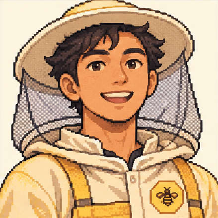

# MUHAMMAD FAHRUL ROZI RAMADHAN (W040)

**Peran:** Pembudidaya lebah
**Potret:** 
**Status:** Rancangan fiksi publik — belum disahkan sebagai kisah atau gameplay aktif.

> Seluruh cerita dan sifat di halaman ini adalah konsep untuk tokoh fiksi YZ Farm Life, bukan biografi seseorang di dunia nyata.

## Identitas

**preferredName:** Fahrul

**ageYears:** 28

**origin:** Fahrul lebih mudah mengingat Ciwidey dari suasana kebun yang sering berkabut daripada satu peristiwa besar. Di sanalah ia belajar membaca perubahan musim sebelum memutuskan, lalu mencoba menerapkannya di dekat kebun Pasirluyu. (latar fiksi; draf)

**language:** Bahasa Indonesia; sesekali memakai sapaan atau ungkapan Sunda saat suasana percakapan cocok.

**identity:** NPC fiksi berlatar Kota Bandung

**ageDesignNote:** Usia ini pilihan kreatif sementara berdasarkan kematangan visual potret, bukan pengukuran umur dari gambar.

**visualAgeBandDraft:** dewasa dalam rancangan karakter

## Penampilan dan bahasa tubuh

**general:** Potret canonical N04 memperlihatkan rincian visual yang dicatat di bawah; jangan menggantinya dengan identitas dari arsip legacy.

**physicalTraits:** Rambut gelap pendek di bawah topi penjaga lebah berjaring, hoodie krem dan rompi kuning beremblem lebah; tersenyum.

**bodyLanguageDirection:** tersenyum

**proposedPose:** Gunakan gestur yang terlihat pada potret sebagai rujukan satu pose interaksi; animasi final belum disetujui.

## Busana dan estetika

**signatureClothing:** Rambut gelap pendek di bawah topi penjaga lebah berjaring, hoodie krem dan rompi kuning beremblem lebah

**accessories**
- rompi

**aesthetic:** Pixel-art kehidupan Kota Bandung

**palette:** kuning, krem

**costumeConcept:** Pakaian kerja yang memudahkan kegiatan tanaman dan lingkungan, tanpa menganggapnya sebagai pakaian nyata sosok dalam dunia nyata

## Pekerjaan dan kehidupan sosial

**education:** Belajar pengamatan ekosistem dan penanganan lapangan melalui praktik komunitas.

**communityActivity:** Mengajak warga mencatat kebutuhan lebah agar pekerjaan tidak saling bertabrakan.

**functionInWorld:** lingkungan

**workRoutineConcept:** meninjau keadaan area kerja sebelum menerima bantuan

**workplaceConcept:** Situasi kerja fiksi mengenai tanaman dan lingkungan; lokasi spesifik belum ditetapkan

## Kepribadian fiksi

**traits**
- Kepedulian lingkungan
- Tekun
- Mau mendengar

**observableHabit:** mengamati dari jauh sebelum mendekat

**values:** Kepedulian lingkungan

**weakness:** terlalu hati-hati ketika harus bertindak

**strengthConcept:** mau mengubah cara kerja ketika ada bukti

**flawConcept:** cenderung menunda percakapan sulit

**microHabitConcept:** merapikan alat setelah meninjau keadaan area kerja sebelum menerima bantuan

## Motivasi dan konflik fiksi

**primaryMotivation:** Menjaga pekerjaan lebah tetap dapat dipertanggungjawabkan

**need:** Butuh ruang untuk menolak jalan pintas dalam pekerjaan lebah.

**innerConflict:** Rencana awal membuat sebagian orang menunggu lebih lama

**fear:** Habitat kehilangan keseimbangan

**motivationConcept:** Mencari cara menangani lebah dengan teliti ketika orang lain ingin pekerjaan cepat selesai

**conflictConcept:** Di bagian lebah, perubahan kecil pada tempat tumbuh membuat hasil pemeliharaan tidak seragam; pilihan yang serba cepat terasa berisiko baginya dalam premis fiksi ini

**agencyConcept:** Boleh menolak bantuan yang mengubah seluruh penataan sekaligus; dapat memilih menguji satu perubahan di area terbatas meskipun pemain tidak setuju

## Latar cerita

**familyContext:** Dalam keluarga Fahrul, tidak semua persoalan harus langsung dibicarakan. Ia menghormati ruang pribadi orang lain, tetapi sadar diam terlalu lama juga bisa menimbulkan salah paham. (latar fiksi; draf)

**formativeMemory:** Dulu, pada salah satu hari yang melelahkan, perubahan kecil pada tempat tumbuh membuat hasil pemeliharaan tidak seragam. Daripada cepat menyalahkan keadaan, ia belajar mengulang pemeriksaan kecil.

**narrativeBackground:** Di sela kandang, air, dan kehidupan di sekitar kota, Muhammad Fahrul Rozi Ramadhan menemukan cuaca berubah saat pekerjaan belum selesai.

**narrativeStatus:** Konsep fiksi baru; bukan riwayat orang asli

**sceneConcept:** Sebuah kegiatan sehari-hari tentang tanaman dan lingkungan terhambat karena perubahan kecil pada tempat tumbuh membuat hasil pemeliharaan tidak seragam. Ini hanya premis adegan, bukan riwayat pribadi.

## Interaksi dan hubungan

**relationshipHook:** Kedekatan dibangun melalui bantuan terkait catatan pengamatan, tanpa relasi keluarga yang ditebak

**trustBehavior:** Meningkat setelah pemain menepati janji dan menghormati pilihan tokoh

**personalBoundary:** Tidak langsung membicarakan masalah pribadi kepada pemain baru

**boundaryConcept:** Tidak membagi urusan pribadi hanya karena pemain sering menyapa; kedekatan tidak sama dengan persetujuan

## Suara dan dialog

**speechSignature:** Awalnya hati-hati ketika menjelaskan lebah, lalu lugas setelah melihat hasil.

**sampleLine:** Tunggu. Bagian lebah belum beres dicek. Jangan ditutup dulu.

**habitualGesture:** menunduk mengamati jejak atau permukaan air

**reactions**
- **neutral:** Menanggapi seperlunya dan kembali ke pekerjaan
- **happy:** Senyum kecil saat bantuan benar-benar berguna
- **worried:** Memeriksa catatan pengamatan sebelum memberi jawaban

**dialogueDrafts**
- Tunggu. Bagian lebah belum beres dicek. Jangan ditutup dulu.
- Boleh saja mengubah seluruh penataan sekaligus, tapi urusan lebah ini belum selesai diperiksa.
- Aku akan menguji satu perubahan di area terbatas. Kalau hasilnya beda, baru kita cari cara lain.

**speakingCadence:** to the point, lalu memberi kesempatan lawan bicara

## Perkembangan cerita

**storyArc:** Urusan catatan pengamatan mulai mengganggu rutinitas pembudidaya lebah

**questHook:** Ketika sedang menangani lebah, muncul masalah sederhana: perubahan kecil pada tempat tumbuh membuat hasil pemeliharaan tidak seragam. Pemain boleh membantu, menolak, atau mengajukan cara lain; belum ada quest runtime.

**threeActBeats**
- Masalah lebah terlihat ketika meninjau keadaan area kerja sebelum menerima bantuan
- Pemain mengetahui bahwa perubahan kecil pada tempat tumbuh membuat hasil pemeliharaan tidak seragam; pilihan warga tidak selalu sejalan
- Salah satu cara dicoba dalam kegiatan lebah, lalu hasilnya dievaluasi bersama

**playerChoices**
- Mendukung usulan untuk mengubah seluruh penataan sekaligus pada lebah
- Mengusulkan agar menguji satu perubahan di area terbatas untuk lebah

**implementation:** draft, belum diaktifkan otomatis

**sideQuestConcept**
- **premise:** Saat mengurus lebah, perubahan kecil pada tempat tumbuh membuat hasil pemeliharaan tidak seragam.
- **decisionA:** Mengubah seluruh penataan sekaligus.
- **decisionB:** Menguji satu perubahan di area terbatas.
- **state:** not-implemented

**choiceConsequencesConcept**
- - **choice:** A
- **result:** Kemungkinan lebih cepat; konsekuensi nyata harus ditulis dan diuji sebelum implementasi
- - **choice:** B
- **result:** Kemungkinan lebih teliti; konsekuensi nyata harus ditulis dan diuji sebelum implementasi

## Referensi visual

**visualContinuity:** Patokan ilustrasi: Rambut gelap pendek di bawah topi penjaga lebah berjaring, hoodie krem dan rompi kuning beremblem lebah; tersenyum. Cocokkan penutup kepala, warna, alat bantu, aksesori dan siluet dengan sprite; jangan mengganti portrait key.

**suggestedPalette:** kuning, krem

**animationRequired**
- idle
- walk-4-directions
- interact

**observedIllustrationStyle:** Potret pixel-art bertekstur dengan detail wajah kuat; lakukan QA ukuran dan animasi.

## Kontinuitas dan status runtime

**availability:** Katalog; jadwal dan spawn mengikuti ekspansi bertahap

**playerDependentState:** Tidak boleh tertukar dengan ID cerita lama

**canonStatus:** Nama, pekerjaan dan kunci potret terkunci; detail cerita masih rancangan

**playableRuntimeConfirmed:** Tidak

**questIntegrationConfirmed:** Tidak

**legacyAssociationApproved:** Tidak

**status:** Konsep publik; kehadiran karakter dan cerita di runtime memerlukan implementasi terpisah.

---
Karakter ini merupakan bagian dari katalog fiksi YZ Farm Life. Data identitas canonical dikunci; pengesahan lore dan implementasi gameplay dilakukan terpisah.
