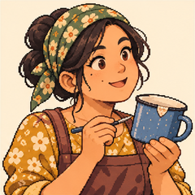

# NENG ANGGI ILIADI (W046)

**Peran:** Perawat perabot enamel
**Potret:** 
**Status:** Rancangan fiksi publik — belum disahkan sebagai kisah atau gameplay aktif.

> Seluruh cerita dan sifat di halaman ini adalah konsep untuk tokoh fiksi YZ Farm Life, bukan biografi seseorang di dunia nyata.

## Identitas

**identity:** NPC fiksi berlatar Kota Bandung

## Penampilan dan bahasa tubuh

**general:** Rancangan sprite disesuaikan dengan potret K21; tidak disimpulkan dari nama atau pekerjaan

**bodyLanguageDirection:** berhenti sejenak lalu membuka catatan

**proposedPose:** Baca siluet ketika sedang mengecek kebutuhan sebelum memulai pekerjaan; sesuaikan hanya setelah potret benar-benar ditinjau

## Busana dan estetika

**signatureClothing:** busana kasual yang sesuai pekerjaan dan cuaca Bandung

**aesthetic:** Pixel-art kehidupan Kota Bandung

**palette:** terracotta dan hijau zaitun

**costumeConcept:** Pakaian kerja yang memudahkan kegiatan urusan di lingkungan kerja, tanpa menganggapnya sebagai pakaian nyata sosok dalam dunia nyata

## Pekerjaan dan kehidupan sosial

**communityActivity:** Membahas cara memeriksa perabot enamel bersama warga sebelum mengambil keputusan.

**functionInWorld:** kehidupan kota

**workRoutineConcept:** mengecek kebutuhan sebelum memulai pekerjaan

**workplaceConcept:** Situasi kerja fiksi mengenai urusan di lingkungan kerja; lokasi spesifik belum ditetapkan

## Kepribadian fiksi

**traits**
- Saling membantu
- Tekun
- Mau mendengar

**observableHabit:** memperhatikan perubahan kecil di sekitar

**values:** Saling membantu

**weakness:** kadang menahan pendapat

**strengthConcept:** telaten menguji hasil sebelum dibagikan

**flawConcept:** terlalu lama mengecek rincian

**microHabitConcept:** menyebut risiko sebelum menyetujui perubahan urusan di lingkungan kerja

## Motivasi dan konflik fiksi

**primaryMotivation:** Menjaga pekerjaan perabot enamel tetap dapat dipertanggungjawabkan

**need:** Ingin hasil penanganan perabot enamel dinilai dari keadaan nyata, bukan janji.

**innerConflict:** Ada pelanggan atau warga yang belum mendapat giliran

**fear:** Urusan tertunda tanpa kabar

**motivationConcept:** Mencari cara menangani perabot enamel dengan teliti ketika orang lain ingin pekerjaan cepat selesai

**conflictConcept:** Di bagian perabot enamel, dua kebutuhan datang bersamaan dan belum jelas mana yang lebih mendesak; pilihan yang serba cepat terasa berisiko baginya dalam premis fiksi ini

**agencyConcept:** Boleh menolak bantuan yang menyelesaikan yang pertama terlihat; dapat memilih mengurutkan kebutuhan setelah pemeriksaan meskipun pemain tidak setuju

## Latar cerita

**narrativeBackground:** Di sela jalan kampung, pekerjaan, dan tetangga, Neng Anggi Iliadi menemukan permintaan mendadak di akhir hari.

**narrativeStatus:** Konsep fiksi baru; bukan riwayat orang asli

**sceneConcept:** Sebuah kegiatan sehari-hari tentang urusan di lingkungan kerja terhambat karena dua kebutuhan datang bersamaan dan belum jelas mana yang lebih mendesak. Ini hanya premis adegan, bukan riwayat pribadi.

## Interaksi dan hubungan

**relationshipHook:** Kedekatan dibangun melalui bantuan terkait catatan pekerjaan, tanpa relasi keluarga yang ditebak

**trustBehavior:** Meningkat setelah pemain menepati janji dan menghormati pilihan tokoh

**personalBoundary:** Tidak langsung membicarakan masalah pribadi kepada pemain baru

**boundaryConcept:** Tidak membagi urusan pribadi hanya karena pemain sering menyapa; kedekatan tidak sama dengan persetujuan

## Suara dan dialog

**speechSignature:** Bicara singkat soal perabot enamel; lebih banyak bertanya saat ada risiko.

**sampleLine:** Soal perabot enamel tadi ada yang kelewat. Aku mau lihat lagi sebentar.

**habitualGesture:** berhenti sejenak lalu membuka catatan

**reactions**
- **neutral:** Menanggapi seperlunya dan kembali ke pekerjaan
- **happy:** Senyum kecil saat bantuan benar-benar berguna
- **worried:** Memeriksa catatan pekerjaan sebelum memberi jawaban

**dialogueDrafts**
- Soal perabot enamel tadi ada yang kelewat. Aku mau lihat lagi sebentar.
- Jangan buru-buru menyelesaikan yang pertama terlihat. Nanti bagian perabot enamel malah terlewat.
- Untuk bagian perabot enamel, pilihanku mengurutkan kebutuhan setelah pemeriksaan. Kamu boleh tidak setuju.

**speakingCadence:** bertanya sebelum menilai pilihan

## Perkembangan cerita

**storyArc:** Urusan catatan pekerjaan mulai mengganggu rutinitas perawat perabot enamel

**questHook:** Ketika sedang menangani perabot enamel, muncul masalah sederhana: dua kebutuhan datang bersamaan dan belum jelas mana yang lebih mendesak. Pemain boleh membantu, menolak, atau mengajukan cara lain; belum ada quest runtime.

**threeActBeats**
- Masalah perabot enamel terlihat ketika mengecek kebutuhan sebelum memulai pekerjaan
- Pemain mengetahui bahwa dua kebutuhan datang bersamaan dan belum jelas mana yang lebih mendesak; pilihan warga tidak selalu sejalan
- Salah satu cara dicoba dalam kegiatan perabot enamel, lalu hasilnya dievaluasi bersama

**playerChoices**
- Mendukung usulan untuk menyelesaikan yang pertama terlihat pada perabot enamel
- Mengusulkan agar mengurutkan kebutuhan setelah pemeriksaan untuk perabot enamel

**implementation:** draft, belum diaktifkan otomatis

**sideQuestConcept**
- **premise:** Saat mengurus perabot enamel, dua kebutuhan datang bersamaan dan belum jelas mana yang lebih mendesak.
- **decisionA:** Menyelesaikan yang pertama terlihat.
- **decisionB:** Mengurutkan kebutuhan setelah pemeriksaan.
- **state:** not-implemented

**choiceConsequencesConcept**
- - **choice:** A
- **result:** Kemungkinan lebih cepat; konsekuensi nyata harus ditulis dan diuji sebelum implementasi
- - **choice:** B
- **result:** Kemungkinan lebih teliti; konsekuensi nyata harus ditulis dan diuji sebelum implementasi

## Referensi visual

**visualContinuity:** Cocokkan palet, proporsi tangan, ekspresi, pakaian, dan arah hadap antara potret, sprite dan aset pekerjaan

**suggestedPalette:** terracotta dan hijau zaitun

**animationRequired**
- idle
- walk-4-directions
- interact

## Kontinuitas dan status runtime

**availability:** Katalog; jadwal dan spawn mengikuti ekspansi bertahap

**playerDependentState:** Tidak boleh tertukar dengan ID cerita lama

**canonStatus:** Nama, pekerjaan dan kunci potret terkunci; detail cerita masih rancangan

**playableRuntimeConfirmed:** Tidak

**questIntegrationConfirmed:** Tidak

**legacyAssociationApproved:** Tidak

**status:** Konsep publik; kehadiran karakter dan cerita di runtime memerlukan implementasi terpisah.

---
Karakter ini merupakan bagian dari katalog fiksi YZ Farm Life. Data identitas canonical dikunci; pengesahan lore dan implementasi gameplay dilakukan terpisah.
