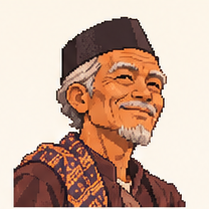

# OMANG ROCHMAN (W050)

**Peran:** Penjaga galeri kerajinan
**Potret:** 
**Status:** Rancangan fiksi publik — belum disahkan sebagai kisah atau gameplay aktif.

> Seluruh cerita dan sifat di halaman ini adalah konsep untuk tokoh fiksi YZ Farm Life, bukan biografi seseorang di dunia nyata.

## Identitas

**preferredName:** Omang

**ageYears:** 65

**origin:** Omang lebih mudah mengingat Arcamanik dari suasana ruang komunitas yang dipakai bersama daripada satu peristiwa besar. Di sanalah ia belajar mencatat hal kecil yang bisa diperbaiki, lalu mencoba menerapkannya di dekat kebun Pasirluyu. (latar fiksi; draf)

**language:** Bahasa Indonesia; sesekali memakai sapaan atau ungkapan Sunda saat suasana percakapan cocok.

**identity:** NPC fiksi berlatar Kota Bandung

**ageDesignNote:** Usia ini pilihan kreatif sementara berdasarkan kematangan visual potret, bukan pengukuran umur dari gambar.

**visualAgeBandDraft:** lanjut dalam rancangan karakter

## Penampilan dan bahasa tubuh

**general:** Potret canonical R038 memperlihatkan rincian visual yang dicatat di bawah; jangan menggantinya dengan identitas dari arsip legacy.

**physicalTraits:** Rambut dan janggut putih, peci hitam, busana batik jingga dan jaket cokelat; tersenyum.

**bodyLanguageDirection:** tersenyum

**proposedPose:** Gunakan gestur yang terlihat pada potret sebagai rujukan satu pose interaksi; animasi final belum disetujui.

## Busana dan estetika

**signatureClothing:** Rambut dan janggut putih, peci hitam, busana batik jingga dan jaket cokelat

**aesthetic:** Pixel-art kehidupan Kota Bandung

**palette:** cokelat, jingga, putih

**costumeConcept:** Pakaian kerja yang memudahkan kegiatan bahan kerajinan, tanpa menganggapnya sebagai pakaian nyata sosok dalam dunia nyata

## Pekerjaan dan kehidupan sosial

**education:** Mengasah keterampilan kriya lewat praktik, belajar dari pekerja berpengalaman, dan uji coba bahan.

**communityActivity:** Menyiapkan kegiatan kecil seputar galeri kerajinan tanpa bergantung pada pemain.

**functionInWorld:** kriya

**workRoutineConcept:** mengukur kebutuhan sebelum memotong atau merangkai bahan

**workplaceConcept:** Situasi kerja fiksi mengenai bahan kerajinan; lokasi spesifik belum ditetapkan

## Kepribadian fiksi

**traits**
- Kesabaran
- Tekun
- Mau mendengar

**observableHabit:** mengukur bahan sebelum memotong

**values:** Kesabaran

**weakness:** ingin hasil sempurna saat waktunya sempit

**strengthConcept:** memperhatikan risiko untuk orang lain

**flawConcept:** sulit melepas pekerjaan yang belum rapi

**microHabitConcept:** merapikan alat setelah mengukur kebutuhan sebelum memotong atau merangkai bahan

## Motivasi dan konflik fiksi

**primaryMotivation:** Menjaga pekerjaan galeri kerajinan tetap dapat dipertanggungjawabkan

**need:** Butuh ruang untuk menolak jalan pintas dalam pekerjaan galeri kerajinan.

**innerConflict:** Dua pihak sama-sama punya alasan yang kuat

**fear:** Bahan berharga terbuang

**motivationConcept:** Mencari cara menangani galeri kerajinan dengan teliti ketika orang lain ingin pekerjaan cepat selesai

**conflictConcept:** Di bagian galeri kerajinan, ukuran di catatan berbeda sedikit dari hasil kerja; pilihan yang serba cepat terasa berisiko baginya dalam premis fiksi ini

**agencyConcept:** Boleh menolak bantuan yang memperbaiki bentuk dengan cepat; dapat memilih mengulang pengukuran agar bahan tidak terbuang meskipun pemain tidak setuju

## Latar cerita

**familyContext:** Sebagai anak sulung, Omang sering dimintai pendapat dalam urusan rumah. Ia belajar bahwa pengalaman sebagai penjaga galeri kerajinan tidak menjadikannya paling tahu semua persoalan. (latar fiksi; draf)

**formativeMemory:** Bukan peristiwa besar, tetapi ia ingat betul saat ukuran di catatan berbeda sedikit dari hasil kerja. Kebiasaan mengukur bahan sebelum memotong tumbuh dari pengalaman itu.

**narrativeBackground:** Di sela bahan, warna, dan barang buatan tangan, Omang Rochman menemukan jadwal yang saling bertabrakan.

**narrativeStatus:** Konsep fiksi baru; bukan riwayat orang asli

**sceneConcept:** Sebuah kegiatan sehari-hari tentang bahan kerajinan terhambat karena ukuran di catatan berbeda sedikit dari hasil kerja. Ini hanya premis adegan, bukan riwayat pribadi.

## Interaksi dan hubungan

**relationshipHook:** Kedekatan dibangun melalui bantuan terkait pola kerja, tanpa relasi keluarga yang ditebak

**trustBehavior:** Meningkat setelah pemain menepati janji dan menghormati pilihan tokoh

**personalBoundary:** Tidak langsung membicarakan masalah pribadi kepada pemain baru

**boundaryConcept:** Tidak membagi urusan pribadi hanya karena pemain sering menyapa; kedekatan tidak sama dengan persetujuan

## Suara dan dialog

**speechSignature:** Pilih kata sederhana untuk galeri kerajinan; tidak berusaha selalu menyenangkan pemain.

**sampleLine:** Kalau bicara galeri kerajinan, aku lebih suka melihat kondisinya langsung.

**habitualGesture:** meraba sambungan atau merapikan bahan

**reactions**
- **neutral:** Menanggapi seperlunya dan kembali ke pekerjaan
- **happy:** Senyum kecil saat bantuan benar-benar berguna
- **worried:** Memeriksa pola kerja sebelum memberi jawaban

**dialogueDrafts**
- Kalau bicara galeri kerajinan, aku lebih suka melihat kondisinya langsung.
- Boleh saja memperbaiki bentuk dengan cepat, tapi urusan galeri kerajinan ini belum selesai diperiksa.
- Aku akan mengulang pengukuran agar bahan tidak terbuang. Kalau hasilnya beda, baru kita cari cara lain.

**speakingCadence:** to the point, lalu memberi kesempatan lawan bicara

## Perkembangan cerita

**storyArc:** Urusan pola kerja mulai mengganggu rutinitas penjaga galeri kerajinan

**questHook:** Ketika sedang menangani galeri kerajinan, muncul masalah sederhana: ukuran di catatan berbeda sedikit dari hasil kerja. Pemain boleh membantu, menolak, atau mengajukan cara lain; belum ada quest runtime.

**threeActBeats**
- Masalah galeri kerajinan terlihat ketika mengukur kebutuhan sebelum memotong atau merangkai bahan
- Pemain mengetahui bahwa ukuran di catatan berbeda sedikit dari hasil kerja; pilihan warga tidak selalu sejalan
- Salah satu cara dicoba dalam kegiatan galeri kerajinan, lalu hasilnya dievaluasi bersama

**playerChoices**
- Mendukung usulan untuk memperbaiki bentuk dengan cepat pada galeri kerajinan
- Mengusulkan agar mengulang pengukuran agar bahan tidak terbuang untuk galeri kerajinan

**implementation:** draft, belum diaktifkan otomatis

**sideQuestConcept**
- **premise:** Saat mengurus galeri kerajinan, ukuran di catatan berbeda sedikit dari hasil kerja.
- **decisionA:** Memperbaiki bentuk dengan cepat.
- **decisionB:** Mengulang pengukuran agar bahan tidak terbuang.
- **state:** not-implemented

**choiceConsequencesConcept**
- - **choice:** A
- **result:** Kemungkinan lebih cepat; konsekuensi nyata harus ditulis dan diuji sebelum implementasi
- - **choice:** B
- **result:** Kemungkinan lebih teliti; konsekuensi nyata harus ditulis dan diuji sebelum implementasi

## Referensi visual

**visualContinuity:** Patokan ilustrasi: Rambut dan janggut putih, peci hitam, busana batik jingga dan jaket cokelat; tersenyum. Cocokkan penutup kepala, warna, alat bantu, aksesori dan siluet dengan sprite; jangan mengganti portrait key.

**suggestedPalette:** cokelat, jingga, putih

**animationRequired**
- idle
- walk-4-directions
- interact

**observedIllustrationStyle:** Potret pixel-art bertekstur dengan variasi shading wajah; cocokkan kepadatan piksel antaraset.

## Kontinuitas dan status runtime

**availability:** Katalog; jadwal dan spawn mengikuti ekspansi bertahap

**playerDependentState:** Tidak boleh tertukar dengan ID cerita lama

**canonStatus:** Nama, pekerjaan dan kunci potret terkunci; detail cerita masih rancangan

**playableRuntimeConfirmed:** Tidak

**questIntegrationConfirmed:** Tidak

**legacyAssociationApproved:** Tidak

**status:** Konsep publik; kehadiran karakter dan cerita di runtime memerlukan implementasi terpisah.

---
Karakter ini merupakan bagian dari katalog fiksi YZ Farm Life. Data identitas canonical dikunci; pengesahan lore dan implementasi gameplay dilakukan terpisah.
