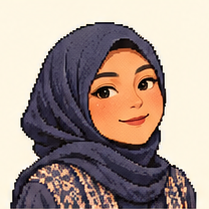

# RAMONA AYU PRIHANTINI (W055)

**Peran:** Perajin kain batik
**Potret:** 
**Status:** Rancangan fiksi publik — belum disahkan sebagai kisah atau gameplay aktif.

> Seluruh cerita dan sifat di halaman ini adalah konsep untuk tokoh fiksi YZ Farm Life, bukan biografi seseorang di dunia nyata.

## Identitas

**preferredName:** Ramona

**ageYears:** 43

**origin:** Dalam versi cerita ini, Ramona berasal dari lingkungan Kiaracondong dengan usaha rumahan di tengah permukiman. Ia membawa kebiasaan menyelaraskan cara kerja yang berbeda saat mulai membangun hubungan dengan tetangga baru. (latar fiksi; draf)

**language:** Bahasa Indonesia; sesekali memakai sapaan atau ungkapan Sunda saat suasana percakapan cocok.

**identity:** NPC fiksi berlatar Kota Bandung

**ageDesignNote:** Usia ini pilihan kreatif sementara berdasarkan kematangan visual potret, bukan pengukuran umur dari gambar.

**visualAgeBandDraft:** dewasa dalam rancangan karakter

## Penampilan dan bahasa tubuh

**general:** Potret canonical R004 memperlihatkan rincian visual yang dicatat di bawah; jangan menggantinya dengan identitas dari arsip legacy.

**physicalTraits:** Kerudung biru gelap, busana biru bermotif batik terang; tersenyum tenang.

**bodyLanguageDirection:** tersenyum tenang

**proposedPose:** Gunakan gestur yang terlihat pada potret sebagai rujukan satu pose interaksi; animasi final belum disetujui.

## Busana dan estetika

**signatureClothing:** Kerudung biru gelap, busana biru bermotif batik terang

**accessories**
- kerudung

**aesthetic:** Pixel-art kehidupan Kota Bandung

**palette:** biru kabut dan putih tulang

**costumeConcept:** Pakaian kerja yang memudahkan kegiatan bahan dan pola, tanpa menganggapnya sebagai pakaian nyata sosok dalam dunia nyata

## Pekerjaan dan kehidupan sosial

**education:** Mengasah keterampilan kriya lewat praktik, belajar dari pekerja berpengalaman, dan uji coba bahan.

**communityActivity:** Menyiapkan kegiatan kecil seputar kain batik tanpa bergantung pada pemain.

**functionInWorld:** kriya

**workRoutineConcept:** mencocokkan bahan, warna, serta potongan yang sedang dikerjakan

**workplaceConcept:** Situasi kerja fiksi mengenai bahan dan pola; lokasi spesifik belum ditetapkan

## Kepribadian fiksi

**traits**
- Kesabaran
- Tekun
- Mau mendengar

**observableHabit:** mengukur bahan sebelum memotong

**values:** Kesabaran

**weakness:** ingin hasil sempurna saat waktunya sempit

**strengthConcept:** memperhatikan risiko untuk orang lain

**flawConcept:** sulit melepas pekerjaan yang belum rapi

**microHabitConcept:** menunjuk bagian yang perlu dicek saat membicarakan bahan dan pola

## Motivasi dan konflik fiksi

**primaryMotivation:** Menjaga pekerjaan kain batik tetap dapat dipertanggungjawabkan

**need:** Berharap warga mau mendengarkan masalah kain batik sebelum memberi solusi.

**innerConflict:** Dua keterangan warga ternyata tidak sama

**fear:** Bahan berharga terbuang

**motivationConcept:** Mencari cara menangani kain batik dengan teliti ketika orang lain ingin pekerjaan cepat selesai

**conflictConcept:** Di bagian kain batik, pilihan warna yang menarik belum tentu sesuai dengan pesanan dan bahan; pilihan yang serba cepat terasa berisiko baginya dalam premis fiksi ini

**agencyConcept:** Boleh menolak bantuan yang mengubah desain mendadak; dapat memilih menguji padanan pada contoh kecil meskipun pemain tidak setuju

## Latar cerita

**familyContext:** Saat keluarga berkumpul, Ramona lebih suka membantu menyiapkan makanan daripada menjadi pusat percakapan. Mereka tahu ia bisa keras kepala jika membahas pekerjaan perajin kain batik. (latar fiksi; draf)

**formativeMemory:** Ketika baru terbiasa dengan pekerjaan perajin kain batik, pilihan warna yang menarik belum tentu sesuai dengan pesanan dan bahan. Sejak itu, Ramona terbiasa mengukur bahan sebelum memotong.

**narrativeBackground:** Di sela bahan, warna, dan barang buatan tangan, Ramona Ayu Prihantini menemukan catatan yang tercecer.

**narrativeStatus:** Konsep fiksi baru; bukan riwayat orang asli

**sceneConcept:** Sebuah kegiatan sehari-hari tentang bahan dan pola terhambat karena pilihan warna yang menarik belum tentu sesuai dengan pesanan dan bahan. Ini hanya premis adegan, bukan riwayat pribadi.

## Interaksi dan hubungan

**relationshipHook:** Kedekatan dibangun melalui bantuan terkait pola kerja, tanpa relasi keluarga yang ditebak

**trustBehavior:** Meningkat setelah pemain menepati janji dan menghormati pilihan tokoh

**personalBoundary:** Tidak langsung membicarakan masalah pribadi kepada pemain baru

**boundaryConcept:** Tidak membagi urusan pribadi hanya karena pemain sering menyapa; kedekatan tidak sama dengan persetujuan

## Suara dan dialog

**speechSignature:** Pilih kata sederhana untuk kain batik; tidak berusaha selalu menyenangkan pemain.

**sampleLine:** Kalau bicara kain batik, aku lebih suka melihat kondisinya langsung.

**habitualGesture:** meraba sambungan atau merapikan bahan

**reactions**
- **neutral:** Menanggapi seperlunya dan kembali ke pekerjaan
- **happy:** Senyum kecil saat bantuan benar-benar berguna
- **worried:** Memeriksa pola kerja sebelum memberi jawaban

**dialogueDrafts**
- Kalau bicara kain batik, aku lebih suka melihat kondisinya langsung.
- Kalau kamu memilih mengubah desain mendadak untuk kain batik, aku perlu tahu siapa yang bertanggung jawab.
- Kita coba menguji padanan pada contoh kecil untuk kain batik dulu. Kalau tidak cocok, kita ganti rencana.

**speakingCadence:** ringkas saat bekerja, lebih terbuka sesudahnya

## Perkembangan cerita

**storyArc:** Urusan pola kerja mulai mengganggu rutinitas perajin kain batik

**questHook:** Ketika sedang menangani kain batik, muncul masalah sederhana: pilihan warna yang menarik belum tentu sesuai dengan pesanan dan bahan. Pemain boleh membantu, menolak, atau mengajukan cara lain; belum ada quest runtime.

**threeActBeats**
- Masalah kain batik terlihat ketika mencocokkan bahan, warna, serta potongan yang sedang dikerjakan
- Pemain mengetahui bahwa pilihan warna yang menarik belum tentu sesuai dengan pesanan dan bahan; pilihan warga tidak selalu sejalan
- Salah satu cara dicoba dalam kegiatan kain batik, lalu hasilnya dievaluasi bersama

**playerChoices**
- Mendukung usulan untuk mengubah desain mendadak pada kain batik
- Mengusulkan agar menguji padanan pada contoh kecil untuk kain batik

**implementation:** draft, belum diaktifkan otomatis

**sideQuestConcept**
- **premise:** Saat mengurus kain batik, pilihan warna yang menarik belum tentu sesuai dengan pesanan dan bahan.
- **decisionA:** Mengubah desain mendadak.
- **decisionB:** Menguji padanan pada contoh kecil.
- **state:** not-implemented

**choiceConsequencesConcept**
- - **choice:** A
- **result:** Kemungkinan lebih cepat; konsekuensi nyata harus ditulis dan diuji sebelum implementasi
- - **choice:** B
- **result:** Kemungkinan lebih teliti; konsekuensi nyata harus ditulis dan diuji sebelum implementasi

## Referensi visual

**visualContinuity:** Patokan ilustrasi: Kerudung biru gelap, busana biru bermotif batik terang; tersenyum tenang. Cocokkan penutup kepala, warna, alat bantu, aksesori dan siluet dengan sprite; jangan mengganti portrait key.

**suggestedPalette:** biru kabut dan putih tulang

**animationRequired**
- idle
- walk-4-directions
- interact

**observedIllustrationStyle:** Potret pixel-art bertekstur dengan variasi shading wajah; cocokkan kepadatan piksel antaraset.

## Kontinuitas dan status runtime

**availability:** Katalog; jadwal dan spawn mengikuti ekspansi bertahap

**playerDependentState:** Tidak boleh tertukar dengan ID cerita lama

**canonStatus:** Nama, pekerjaan dan kunci potret terkunci; detail cerita masih rancangan

**playableRuntimeConfirmed:** Tidak

**questIntegrationConfirmed:** Tidak

**legacyAssociationApproved:** Tidak

**status:** Konsep publik; kehadiran karakter dan cerita di runtime memerlukan implementasi terpisah.

---
Karakter ini merupakan bagian dari katalog fiksi YZ Farm Life. Data identitas canonical dikunci; pengesahan lore dan implementasi gameplay dilakukan terpisah.
