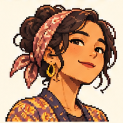

# RINA ROHAETI (W059)

**Peran:** Perancang hiasan kain
**Potret:** 
**Status:** Rancangan fiksi publik — belum disahkan sebagai kisah atau gameplay aktif.

> Seluruh cerita dan sifat di halaman ini adalah konsep untuk tokoh fiksi YZ Farm Life, bukan biografi seseorang di dunia nyata.

## Identitas

**preferredName:** Rina Rohaeti

**ageYears:** 40

**origin:** Cerita Rina Rohaeti bermula di Kiaracondong, dekat usaha rumahan di tengah permukiman. Ia terbiasa menyelaraskan cara kerja yang berbeda; kebiasaan ini sering membantu, tetapi terkadang membuat keputusan sederhana terasa panjang. (latar fiksi; draf)

**language:** Bahasa Indonesia; sesekali memakai sapaan atau ungkapan Sunda saat suasana percakapan cocok.

**identity:** NPC fiksi berlatar Kota Bandung

**ageDesignNote:** Usia ini pilihan kreatif sementara berdasarkan kematangan visual potret, bukan pengukuran umur dari gambar.

**visualAgeBandDraft:** dewasa dalam rancangan karakter

## Penampilan dan bahasa tubuh

**general:** Potret canonical R090 memperlihatkan rincian visual yang dicatat di bawah; jangan menggantinya dengan identitas dari arsip legacy.

**physicalTraits:** Rambut gelap disanggul dengan kain kepala merah muda, anting lingkaran kuning dan busana batik jingga; tersenyum.

**bodyLanguageDirection:** tersenyum

**proposedPose:** Gunakan gestur yang terlihat pada potret sebagai rujukan satu pose interaksi; animasi final belum disetujui.

## Busana dan estetika

**signatureClothing:** Rambut gelap disanggul dengan kain kepala merah muda, anting lingkaran kuning dan busana batik jingga

**accessories**
- kain kepala
- anting

**aesthetic:** Pixel-art kehidupan Kota Bandung

**palette:** merah muda, jingga, kuning

**costumeConcept:** Pakaian kerja yang memudahkan kegiatan bahan dan pola, tanpa menganggapnya sebagai pakaian nyata sosok dalam dunia nyata

## Pekerjaan dan kehidupan sosial

**education:** Mengasah keterampilan kriya lewat praktik, belajar dari pekerja berpengalaman, dan uji coba bahan.

**communityActivity:** Mengajak warga mencatat kebutuhan hiasan kain agar pekerjaan tidak saling bertabrakan.

**functionInWorld:** kriya

**workRoutineConcept:** mencocokkan bahan, warna, serta potongan yang sedang dikerjakan

**workplaceConcept:** Situasi kerja fiksi mengenai bahan dan pola; lokasi spesifik belum ditetapkan

## Kepribadian fiksi

**traits**
- Kesabaran
- Tekun
- Mau mendengar

**observableHabit:** mengukur bahan sebelum memotong

**values:** Kesabaran

**weakness:** ingin hasil sempurna saat waktunya sempit

**strengthConcept:** mencatat hal kecil yang kerap terlewat

**flawConcept:** terlalu berhati-hati ketika keadaan mendesak

**microHabitConcept:** menyebut risiko sebelum menyetujui perubahan bahan dan pola

## Motivasi dan konflik fiksi

**primaryMotivation:** Menjaga pekerjaan hiasan kain tetap dapat dipertanggungjawabkan

**need:** Ingin hasil penanganan hiasan kain dinilai dari keadaan nyata, bukan janji.

**innerConflict:** Tokoh harus menentukan mana yang lebih dulu ditolong

**fear:** Bahan berharga terbuang

**motivationConcept:** Mencari cara menangani hiasan kain dengan teliti ketika orang lain ingin pekerjaan cepat selesai

**conflictConcept:** Di bagian hiasan kain, pilihan warna yang menarik belum tentu sesuai dengan pesanan dan bahan; pilihan yang serba cepat terasa berisiko baginya dalam premis fiksi ini

**agencyConcept:** Boleh menolak bantuan yang mengubah desain mendadak; dapat memilih menguji padanan pada contoh kecil meskipun pemain tidak setuju

## Latar cerita

**familyContext:** Keluarga Rina Rohaeti tinggal di beberapa tempat dan berusaha berkumpul saat libur. Kesibukan sebagai perancang hiasan kain membuatnya belajar memberi kabar tanpa membuat janji berlebihan. (latar fiksi; draf)

**formativeMemory:** Ketika baru terbiasa dengan pekerjaan perancang hiasan kain, pilihan warna yang menarik belum tentu sesuai dengan pesanan dan bahan. Pelajaran yang dipegangnya sederhana: bekerja cepat tidak sama dengan bekerja tepat.

**narrativeBackground:** Di sela bahan, warna, dan barang buatan tangan, Rina Rohaeti menemukan pekerjaan terakhir sebelum hari libur.

**narrativeStatus:** Konsep fiksi baru; bukan riwayat orang asli

**sceneConcept:** Sebuah kegiatan sehari-hari tentang bahan dan pola terhambat karena pilihan warna yang menarik belum tentu sesuai dengan pesanan dan bahan. Ini hanya premis adegan, bukan riwayat pribadi.

## Interaksi dan hubungan

**relationshipHook:** Kedekatan dibangun melalui bantuan terkait pola kerja, tanpa relasi keluarga yang ditebak

**trustBehavior:** Meningkat setelah pemain menepati janji dan menghormati pilihan tokoh

**personalBoundary:** Tidak langsung membicarakan masalah pribadi kepada pemain baru

**boundaryConcept:** Tidak membagi urusan pribadi hanya karena pemain sering menyapa; kedekatan tidak sama dengan persetujuan

## Suara dan dialog

**speechSignature:** Awalnya hati-hati ketika menjelaskan hiasan kain, lalu lugas setelah melihat hasil.

**sampleLine:** Di catatan, urusan hiasan kain sudah selesai. Di lapangan ternyata belum.

**habitualGesture:** meraba sambungan atau merapikan bahan

**reactions**
- **neutral:** Menanggapi seperlunya dan kembali ke pekerjaan
- **happy:** Senyum kecil saat bantuan benar-benar berguna
- **worried:** Memeriksa pola kerja sebelum memberi jawaban

**dialogueDrafts**
- Di catatan, urusan hiasan kain sudah selesai. Di lapangan ternyata belum.
- Jangan buru-buru mengubah desain mendadak. Nanti bagian hiasan kain malah terlewat.
- Untuk bagian hiasan kain, pilihanku menguji padanan pada contoh kecil. Kamu boleh tidak setuju.

**speakingCadence:** bertanya sebelum menilai pilihan

## Perkembangan cerita

**storyArc:** Urusan pola kerja mulai mengganggu rutinitas perancang hiasan kain

**questHook:** Ketika sedang menangani hiasan kain, muncul masalah sederhana: pilihan warna yang menarik belum tentu sesuai dengan pesanan dan bahan. Pemain boleh membantu, menolak, atau mengajukan cara lain; belum ada quest runtime.

**threeActBeats**
- Masalah hiasan kain terlihat ketika mencocokkan bahan, warna, serta potongan yang sedang dikerjakan
- Pemain mengetahui bahwa pilihan warna yang menarik belum tentu sesuai dengan pesanan dan bahan; pilihan warga tidak selalu sejalan
- Salah satu cara dicoba dalam kegiatan hiasan kain, lalu hasilnya dievaluasi bersama

**playerChoices**
- Mendukung usulan untuk mengubah desain mendadak pada hiasan kain
- Mengusulkan agar menguji padanan pada contoh kecil untuk hiasan kain

**implementation:** draft, belum diaktifkan otomatis

**sideQuestConcept**
- **premise:** Saat mengurus hiasan kain, pilihan warna yang menarik belum tentu sesuai dengan pesanan dan bahan.
- **decisionA:** Mengubah desain mendadak.
- **decisionB:** Menguji padanan pada contoh kecil.
- **state:** not-implemented

**choiceConsequencesConcept**
- - **choice:** A
- **result:** Kemungkinan lebih cepat; konsekuensi nyata harus ditulis dan diuji sebelum implementasi
- - **choice:** B
- **result:** Kemungkinan lebih teliti; konsekuensi nyata harus ditulis dan diuji sebelum implementasi

## Referensi visual

**visualContinuity:** Patokan ilustrasi: Rambut gelap disanggul dengan kain kepala merah muda, anting lingkaran kuning dan busana batik jingga; tersenyum. Cocokkan penutup kepala, warna, alat bantu, aksesori dan siluet dengan sprite; jangan mengganti portrait key.

**suggestedPalette:** merah muda, jingga, kuning

**animationRequired**
- idle
- walk-4-directions
- interact

**observedIllustrationStyle:** Potret pixel-art bertekstur dengan variasi shading wajah; cocokkan kepadatan piksel antaraset.

## Kontinuitas dan status runtime

**availability:** Katalog; jadwal dan spawn mengikuti ekspansi bertahap

**playerDependentState:** Tidak boleh tertukar dengan ID cerita lama

**canonStatus:** Nama, pekerjaan dan kunci potret terkunci; detail cerita masih rancangan

**playableRuntimeConfirmed:** Tidak

**questIntegrationConfirmed:** Tidak

**legacyAssociationApproved:** Tidak

**status:** Konsep publik; kehadiran karakter dan cerita di runtime memerlukan implementasi terpisah.

---
Karakter ini merupakan bagian dari katalog fiksi YZ Farm Life. Data identitas canonical dikunci; pengesahan lore dan implementasi gameplay dilakukan terpisah.
