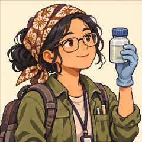

# WIDIARYATI (W085)

**Peran:** Teknisi pengamatan air
**Potret:** 
**Status:** Rancangan fiksi publik — belum disahkan sebagai kisah atau gameplay aktif.

> Seluruh cerita dan sifat di halaman ini adalah konsep untuk tokoh fiksi YZ Farm Life, bukan biografi seseorang di dunia nyata.

## Identitas

**preferredName:** Widiaryati

**ageYears:** 45

**language:** Bahasa Indonesia; sesekali memakai sapaan atau ungkapan Sunda saat suasana percakapan cocok.

**identity:** NPC fiksi berlatar Kota Bandung

**ageDesignNote:** Usia ini pilihan kreatif sementara berdasarkan kematangan visual potret, bukan pengukuran umur dari gambar.

**visualAgeBandDraft:** dewasa dalam rancangan karakter

## Penampilan dan bahasa tubuh

**general:** Potret canonical K07 memperlihatkan rincian visual yang dicatat di bawah; jangan menggantinya dengan identitas dari arsip legacy.

**physicalTraits:** Rambut gelap dikuncir, kain kepala krem bermotif merah, kacamata bundar, jaket lapangan hijau; mengenakan sarung tangan biru dan memeriksa botol sampel air.

**bodyLanguageDirection:** mengenakan sarung tangan biru dan memeriksa botol sampel air

**proposedPose:** Gunakan gestur yang terlihat pada potret sebagai rujukan satu pose interaksi; animasi final belum disetujui.

## Busana dan estetika

**signatureClothing:** Rambut gelap dikuncir, kain kepala krem bermotif merah, kacamata bundar, jaket lapangan hijau

**accessories**
- kacamata
- kain kepala
- sarung tangan

**aesthetic:** Pixel-art kehidupan Kota Bandung

**palette:** hijau, merah, biru

**costumeConcept:** Pakaian kerja yang memudahkan kegiatan aliran air, tanpa menganggapnya sebagai pakaian nyata sosok dalam dunia nyata

## Pekerjaan dan kehidupan sosial

**education:** Memperoleh keterampilan melalui latihan bengkel dan pemecahan masalah peralatan.

**communityActivity:** Membahas cara memeriksa pengamatan air bersama warga sebelum mengambil keputusan.

**functionInWorld:** pertanian

**workRoutineConcept:** memeriksa jalur air sebelum pekerjaan dilanjutkan

**workplaceConcept:** Situasi kerja fiksi mengenai aliran air; lokasi spesifik belum ditetapkan

## Kepribadian fiksi

**traits**
- Ketelitian
- Tekun
- Mau mendengar

**observableHabit:** kerap memeriksa tanah sebelum mengambil keputusan

**values:** Ketelitian

**weakness:** terlalu lama membandingkan pilihan

**strengthConcept:** telaten menguji hasil sebelum dibagikan

**flawConcept:** terlalu lama mengecek rincian

**microHabitConcept:** membandingkan dua catatan tentang aliran air sebelum menjawab

## Motivasi dan konflik fiksi

**primaryMotivation:** Menjaga pekerjaan pengamatan air tetap dapat dipertanggungjawabkan

**need:** Ingin ada waktu memeriksa urusan pengamatan air sebelum keputusan diambil bersama.

**innerConflict:** Pemilik alat meminta solusi yang berbeda dari kebiasaan

**fear:** Bibit yang rusak

**motivationConcept:** Mencari cara menangani pengamatan air dengan teliti ketika orang lain ingin pekerjaan cepat selesai

**conflictConcept:** Di bagian pengamatan air, satu sambungan terlihat baik di hulu, tetapi debit di ujung berbeda; pilihan yang serba cepat terasa berisiko baginya dalam premis fiksi ini

**agencyConcept:** Boleh menolak bantuan yang membuka aliran lebih cepat; dapat memilih menunda pekerjaan sampai jalur yang bermasalah diperiksa meskipun pemain tidak setuju

## Latar cerita

**formativeMemory:** Ketika baru terbiasa dengan pekerjaan teknisi pengamatan air, satu sambungan terlihat baik di hulu, tetapi debit di ujung berbeda. Daripada cepat menyalahkan keadaan, ia belajar mengulang pemeriksaan kecil.

**narrativeBackground:** Di sela bedengan, bibit, dan musim yang berubah, Widiaryati menemukan alat lama yang hampir tidak dipakai lagi.

**narrativeStatus:** Konsep fiksi baru; bukan riwayat orang asli

**sceneConcept:** Sebuah kegiatan sehari-hari tentang aliran air terhambat karena satu sambungan terlihat baik di hulu, tetapi debit di ujung berbeda. Ini hanya premis adegan, bukan riwayat pribadi.

## Interaksi dan hubungan

**relationshipHook:** Kedekatan dibangun melalui bantuan terkait jadwal tanam, tanpa relasi keluarga yang ditebak

**trustBehavior:** Meningkat setelah pemain menepati janji dan menghormati pilihan tokoh

**personalBoundary:** Tidak langsung membicarakan masalah pribadi kepada pemain baru

**boundaryConcept:** Tidak membagi urusan pribadi hanya karena pemain sering menyapa; kedekatan tidak sama dengan persetujuan

## Suara dan dialog

**speechSignature:** Bicara singkat soal pengamatan air; lebih banyak bertanya saat ada risiko.

**sampleLine:** Soal pengamatan air tadi ada yang kelewat. Aku mau lihat lagi sebentar.

**habitualGesture:** mengusap tanah dari telapak tangan

**reactions**
- **neutral:** Menanggapi seperlunya dan kembali ke pekerjaan
- **happy:** Senyum kecil saat bantuan benar-benar berguna
- **worried:** Memeriksa jadwal tanam sebelum memberi jawaban

**dialogueDrafts**
- Soal pengamatan air tadi ada yang kelewat. Aku mau lihat lagi sebentar.
- Aku kurang yakin kalau kita membuka aliran lebih cepat. Untuk pengamatan air, risikonya belum jelas.
- Kalau aku, lebih baik menunda pekerjaan sampai jalur yang bermasalah diperiksa. Urusan pengamatan air bisa menunggu sebentar.

**speakingCadence:** tenang dengan jeda saat memastikan rincian

## Perkembangan cerita

**storyArc:** Urusan jadwal tanam mulai mengganggu rutinitas teknisi pengamatan air

**questHook:** Ketika sedang menangani pengamatan air, muncul masalah sederhana: satu sambungan terlihat baik di hulu, tetapi debit di ujung berbeda. Pemain boleh membantu, menolak, atau mengajukan cara lain; belum ada quest runtime.

**threeActBeats**
- Masalah pengamatan air terlihat ketika memeriksa jalur air sebelum pekerjaan dilanjutkan
- Pemain mengetahui bahwa satu sambungan terlihat baik di hulu, tetapi debit di ujung berbeda; pilihan warga tidak selalu sejalan
- Salah satu cara dicoba dalam kegiatan pengamatan air, lalu hasilnya dievaluasi bersama

**playerChoices**
- Mendukung usulan untuk membuka aliran lebih cepat pada pengamatan air
- Mengusulkan agar menunda pekerjaan sampai jalur yang bermasalah diperiksa untuk pengamatan air

**implementation:** draft, belum diaktifkan otomatis

**sideQuestConcept**
- **premise:** Saat mengurus pengamatan air, satu sambungan terlihat baik di hulu, tetapi debit di ujung berbeda.
- **decisionA:** Membuka aliran lebih cepat.
- **decisionB:** Menunda pekerjaan sampai jalur yang bermasalah diperiksa.
- **state:** not-implemented

**choiceConsequencesConcept**
- - **choice:** A
- **result:** Kemungkinan lebih cepat; konsekuensi nyata harus ditulis dan diuji sebelum implementasi
- - **choice:** B
- **result:** Kemungkinan lebih teliti; konsekuensi nyata harus ditulis dan diuji sebelum implementasi

## Referensi visual

**visualContinuity:** Patokan ilustrasi: Rambut gelap dikuncir, kain kepala krem bermotif merah, kacamata bundar, jaket lapangan hijau; mengenakan sarung tangan biru dan memeriksa botol sampel air. Cocokkan penutup kepala, warna, alat bantu, aksesori dan siluet dengan sprite; jangan mengganti portrait key.

**suggestedPalette:** hijau, merah, biru

**animationRequired**
- idle
- walk-4-directions
- interact

**observedIllustrationStyle:** Potret ilustrasi karakter lingkungan; kepadatan piksel dan outline perlu diseragamkan.

## Kontinuitas dan status runtime

**availability:** Katalog; jadwal dan spawn mengikuti ekspansi bertahap

**playerDependentState:** Tidak boleh tertukar dengan ID cerita lama

**canonStatus:** Nama, pekerjaan dan kunci potret terkunci; detail cerita masih rancangan

**playableRuntimeConfirmed:** Tidak

**questIntegrationConfirmed:** Tidak

**legacyAssociationApproved:** Tidak

**status:** Konsep publik; kehadiran karakter dan cerita di runtime memerlukan implementasi terpisah.

---
Karakter ini merupakan bagian dari katalog fiksi YZ Farm Life. Data identitas canonical dikunci; pengesahan lore dan implementasi gameplay dilakukan terpisah.
