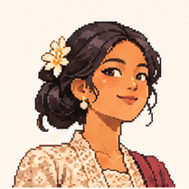

# ANI WIRATMA (W111)

**Peran:** Penata seserahan
**Potret:** 
**Status:** Rancangan fiksi publik — belum disahkan sebagai kisah atau gameplay aktif.

> Seluruh cerita dan sifat di halaman ini adalah konsep untuk tokoh fiksi YZ Farm Life, bukan biografi seseorang di dunia nyata.

## Identitas

**preferredName:** Ani Wiratma

**ageYears:** 37

**language:** Bahasa Indonesia; sesekali memakai sapaan atau ungkapan Sunda saat suasana percakapan cocok.

**identity:** NPC fiksi berlatar Kota Bandung

**ageDesignNote:** Usia ini pilihan kreatif sementara berdasarkan kematangan visual potret, bukan pengukuran umur dari gambar.

**visualAgeBandDraft:** dewasa dalam rancangan karakter

## Penampilan dan bahasa tubuh

**general:** Potret canonical R036 memperlihatkan rincian visual yang dicatat di bawah; jangan menggantinya dengan identitas dari arsip legacy.

**physicalTraits:** Rambut gelap disanggul dengan bunga putih, anting kuning dan kebaya putih krem bermotif; kain merah di bahu, tersenyum.

**bodyLanguageDirection:** kain merah di bahu, tersenyum

**proposedPose:** Gunakan gestur yang terlihat pada potret sebagai rujukan satu pose interaksi; animasi final belum disetujui.

## Busana dan estetika

**signatureClothing:** Rambut gelap disanggul dengan bunga putih, anting kuning dan kebaya putih krem bermotif

**accessories**
- anting

**aesthetic:** Pixel-art kehidupan Kota Bandung

**palette:** kuning, merah, putih

**costumeConcept:** Pakaian kerja yang memudahkan kegiatan bahan dan pola, tanpa menganggapnya sebagai pakaian nyata sosok dalam dunia nyata

## Pekerjaan dan kehidupan sosial

**education:** Mengasah keterampilan kriya lewat praktik, belajar dari pekerja berpengalaman, dan uji coba bahan.

**communityActivity:** Menyiapkan kegiatan kecil seputar seserahan tanpa bergantung pada pemain.

**functionInWorld:** kehidupan kota

**workRoutineConcept:** mencocokkan bahan, warna, serta potongan yang sedang dikerjakan

**workplaceConcept:** Situasi kerja fiksi mengenai bahan dan pola; lokasi spesifik belum ditetapkan

## Kepribadian fiksi

**traits**
- Saling membantu
- Tekun
- Mau mendengar

**observableHabit:** memperhatikan perubahan kecil di sekitar

**values:** Saling membantu

**weakness:** kadang menahan pendapat

**strengthConcept:** mengetahui kapan harus meminta bantuan

**flawConcept:** mudah terpaku pada jadwal yang sudah dibuat

**microHabitConcept:** menyebut risiko sebelum menyetujui perubahan bahan dan pola

## Motivasi dan konflik fiksi

**primaryMotivation:** Menjaga pekerjaan seserahan tetap dapat dipertanggungjawabkan

**need:** Ingin hasil penanganan seserahan dinilai dari keadaan nyata, bukan janji.

**innerConflict:** Dua keterangan warga ternyata tidak sama

**fear:** Urusan tertunda tanpa kabar

**motivationConcept:** Mencari cara menangani seserahan dengan teliti ketika orang lain ingin pekerjaan cepat selesai

**conflictConcept:** Di bagian seserahan, pilihan warna yang menarik belum tentu sesuai dengan pesanan dan bahan; pilihan yang serba cepat terasa berisiko baginya dalam premis fiksi ini

**agencyConcept:** Boleh menolak bantuan yang mengubah desain mendadak; dapat memilih menguji padanan pada contoh kecil meskipun pemain tidak setuju

## Latar cerita

**formativeMemory:** Ia sempat mengira semuanya akan lancar. Ternyata pilihan warna yang menarik belum tentu sesuai dengan pesanan dan bahan. Pelajaran yang dipegangnya sederhana: bekerja cepat tidak sama dengan bekerja tepat.

**narrativeBackground:** Di sela jalan kampung, pekerjaan, dan tetangga, Ani Wiratma menemukan catatan yang tercecer.

**narrativeStatus:** Konsep fiksi baru; bukan riwayat orang asli

**sceneConcept:** Sebuah kegiatan sehari-hari tentang bahan dan pola terhambat karena pilihan warna yang menarik belum tentu sesuai dengan pesanan dan bahan. Ini hanya premis adegan, bukan riwayat pribadi.

## Interaksi dan hubungan

**relationshipHook:** Kedekatan dibangun melalui bantuan terkait catatan pekerjaan, tanpa relasi keluarga yang ditebak

**trustBehavior:** Meningkat setelah pemain menepati janji dan menghormati pilihan tokoh

**personalBoundary:** Tidak langsung membicarakan masalah pribadi kepada pemain baru

**boundaryConcept:** Tidak membagi urusan pribadi hanya karena pemain sering menyapa; kedekatan tidak sama dengan persetujuan

## Suara dan dialog

**speechSignature:** Pilih kata sederhana untuk seserahan; tidak berusaha selalu menyenangkan pemain.

**sampleLine:** Kamu lihat seserahan tadi? Ada satu hal yang ingin kupastikan.

**habitualGesture:** berhenti sejenak lalu membuka catatan

**reactions**
- **neutral:** Menanggapi seperlunya dan kembali ke pekerjaan
- **happy:** Senyum kecil saat bantuan benar-benar berguna
- **worried:** Memeriksa catatan pekerjaan sebelum memberi jawaban

**dialogueDrafts**
- Kamu lihat seserahan tadi? Ada satu hal yang ingin kupastikan.
- Jangan buru-buru mengubah desain mendadak. Nanti bagian seserahan malah terlewat.
- Untuk bagian seserahan, pilihanku menguji padanan pada contoh kecil. Kamu boleh tidak setuju.

**speakingCadence:** bertanya sebelum menilai pilihan

## Perkembangan cerita

**storyArc:** Urusan catatan pekerjaan mulai mengganggu rutinitas penata seserahan

**questHook:** Ketika sedang menangani seserahan, muncul masalah sederhana: pilihan warna yang menarik belum tentu sesuai dengan pesanan dan bahan. Pemain boleh membantu, menolak, atau mengajukan cara lain; belum ada quest runtime.

**threeActBeats**
- Masalah seserahan terlihat ketika mencocokkan bahan, warna, serta potongan yang sedang dikerjakan
- Pemain mengetahui bahwa pilihan warna yang menarik belum tentu sesuai dengan pesanan dan bahan; pilihan warga tidak selalu sejalan
- Salah satu cara dicoba dalam kegiatan seserahan, lalu hasilnya dievaluasi bersama

**playerChoices**
- Mendukung usulan untuk mengubah desain mendadak pada seserahan
- Mengusulkan agar menguji padanan pada contoh kecil untuk seserahan

**implementation:** draft, belum diaktifkan otomatis

**sideQuestConcept**
- **premise:** Saat mengurus seserahan, pilihan warna yang menarik belum tentu sesuai dengan pesanan dan bahan.
- **decisionA:** Mengubah desain mendadak.
- **decisionB:** Menguji padanan pada contoh kecil.
- **state:** not-implemented

**choiceConsequencesConcept**
- - **choice:** A
- **result:** Kemungkinan lebih cepat; konsekuensi nyata harus ditulis dan diuji sebelum implementasi
- - **choice:** B
- **result:** Kemungkinan lebih teliti; konsekuensi nyata harus ditulis dan diuji sebelum implementasi

## Referensi visual

**visualContinuity:** Patokan ilustrasi: Rambut gelap disanggul dengan bunga putih, anting kuning dan kebaya putih krem bermotif; kain merah di bahu, tersenyum. Cocokkan penutup kepala, warna, alat bantu, aksesori dan siluet dengan sprite; jangan mengganti portrait key.

**suggestedPalette:** kuning, merah, putih

**animationRequired**
- idle
- walk-4-directions
- interact

**observedIllustrationStyle:** Potret pixel-art bertekstur dengan variasi shading wajah; cocokkan kepadatan piksel antaraset.

## Kontinuitas dan status runtime

**availability:** Katalog; jadwal dan spawn mengikuti ekspansi bertahap

**playerDependentState:** Tidak boleh tertukar dengan ID cerita lama

**canonStatus:** Nama, pekerjaan dan kunci potret terkunci; detail cerita masih rancangan

**playableRuntimeConfirmed:** Tidak

**questIntegrationConfirmed:** Tidak

**legacyAssociationApproved:** Tidak

**status:** Konsep publik; kehadiran karakter dan cerita di runtime memerlukan implementasi terpisah.

---
Karakter ini merupakan bagian dari katalog fiksi YZ Farm Life. Data identitas canonical dikunci; pengesahan lore dan implementasi gameplay dilakukan terpisah.
