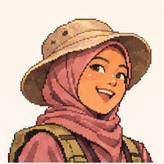

# DEWI SUMARNA (W112)

**Peran:** Pengawas persemaian
**Potret:** 
**Status:** Rancangan fiksi publik — belum disahkan sebagai kisah atau gameplay aktif.

> Seluruh cerita dan sifat di halaman ini adalah konsep untuk tokoh fiksi YZ Farm Life, bukan biografi seseorang di dunia nyata.

## Identitas

**identity:** NPC fiksi berlatar Kota Bandung

## Penampilan dan bahasa tubuh

**general:** Rancangan sprite disesuaikan dengan potret R037; tidak disimpulkan dari nama atau pekerjaan

**bodyLanguageDirection:** mengusap tanah dari telapak tangan

**proposedPose:** Baca siluet ketika sedang memeriksa catatan semai dan kondisi wadah; sesuaikan hanya setelah potret benar-benar ditinjau

## Busana dan estetika

**signatureClothing:** apron kerja, pakaian lapang dan alas kaki aman

**aesthetic:** Pixel-art kehidupan Kota Bandung

**palette:** emas kusam dan navy

**costumeConcept:** Pakaian kerja yang memudahkan kegiatan bibit dan persemaian, tanpa menganggapnya sebagai pakaian nyata sosok dalam dunia nyata

## Pekerjaan dan kehidupan sosial

**communityActivity:** Mengajak warga mencatat kebutuhan persemaian agar pekerjaan tidak saling bertabrakan.

**functionInWorld:** pertanian

**workRoutineConcept:** memeriksa catatan semai dan kondisi wadah

**workplaceConcept:** Situasi kerja fiksi mengenai bibit dan persemaian; lokasi spesifik belum ditetapkan

## Kepribadian fiksi

**traits**
- Ketelitian
- Tekun
- Mau mendengar

**observableHabit:** kerap memeriksa tanah sebelum mengambil keputusan

**values:** Ketelitian

**weakness:** terlalu lama membandingkan pilihan

**strengthConcept:** mau mengubah cara kerja ketika ada bukti

**flawConcept:** cenderung menunda percakapan sulit

**microHabitConcept:** menunjuk bagian yang perlu dicek saat membicarakan bibit dan persemaian

## Motivasi dan konflik fiksi

**primaryMotivation:** Menjaga pekerjaan persemaian tetap dapat dipertanggungjawabkan

**need:** Berharap warga mau mendengarkan masalah persemaian sebelum memberi solusi.

**innerConflict:** Rencana awal membuat sebagian orang menunggu lebih lama

**fear:** Bibit yang rusak

**motivationConcept:** Mencari cara menangani persemaian dengan teliti ketika orang lain ingin pekerjaan cepat selesai

**conflictConcept:** Di bagian persemaian, dua kelompok bibit tampak serupa, padahal kebutuhan perawatannya tidak sama; pilihan yang serba cepat terasa berisiko baginya dalam premis fiksi ini

**agencyConcept:** Boleh menolak bantuan yang menyatukan semua jadwal semai; dapat memilih menandai kelompok bibit sebelum membagi jadwal meskipun pemain tidak setuju

## Latar cerita

**narrativeBackground:** Di sela bedengan, bibit, dan musim yang berubah, Dewi Sumarna menemukan cuaca berubah saat pekerjaan belum selesai.

**narrativeStatus:** Konsep fiksi baru; bukan riwayat orang asli

**sceneConcept:** Sebuah kegiatan sehari-hari tentang bibit dan persemaian terhambat karena dua kelompok bibit tampak serupa, padahal kebutuhan perawatannya tidak sama. Ini hanya premis adegan, bukan riwayat pribadi.

## Interaksi dan hubungan

**relationshipHook:** Kedekatan dibangun melalui bantuan terkait jadwal tanam, tanpa relasi keluarga yang ditebak

**trustBehavior:** Meningkat setelah pemain menepati janji dan menghormati pilihan tokoh

**personalBoundary:** Tidak langsung membicarakan masalah pribadi kepada pemain baru

**boundaryConcept:** Tidak membagi urusan pribadi hanya karena pemain sering menyapa; kedekatan tidak sama dengan persetujuan

## Suara dan dialog

**speechSignature:** Awalnya hati-hati ketika menjelaskan persemaian, lalu lugas setelah melihat hasil.

**sampleLine:** Tunggu. Bagian persemaian belum beres dicek. Jangan ditutup dulu.

**habitualGesture:** mengusap tanah dari telapak tangan

**reactions**
- **neutral:** Menanggapi seperlunya dan kembali ke pekerjaan
- **happy:** Senyum kecil saat bantuan benar-benar berguna
- **worried:** Memeriksa jadwal tanam sebelum memberi jawaban

**dialogueDrafts**
- Tunggu. Bagian persemaian belum beres dicek. Jangan ditutup dulu.
- Kalau kamu memilih menyatukan semua jadwal semai untuk persemaian, aku perlu tahu siapa yang bertanggung jawab.
- Kita coba menandai kelompok bibit sebelum membagi jadwal untuk persemaian dulu. Kalau tidak cocok, kita ganti rencana.

**speakingCadence:** ringkas saat bekerja, lebih terbuka sesudahnya

## Perkembangan cerita

**storyArc:** Urusan jadwal tanam mulai mengganggu rutinitas pengawas persemaian

**questHook:** Ketika sedang menangani persemaian, muncul masalah sederhana: dua kelompok bibit tampak serupa, padahal kebutuhan perawatannya tidak sama. Pemain boleh membantu, menolak, atau mengajukan cara lain; belum ada quest runtime.

**threeActBeats**
- Masalah persemaian terlihat ketika memeriksa catatan semai dan kondisi wadah
- Pemain mengetahui bahwa dua kelompok bibit tampak serupa, padahal kebutuhan perawatannya tidak sama; pilihan warga tidak selalu sejalan
- Salah satu cara dicoba dalam kegiatan persemaian, lalu hasilnya dievaluasi bersama

**playerChoices**
- Mendukung usulan untuk menyatukan semua jadwal semai pada persemaian
- Mengusulkan agar menandai kelompok bibit sebelum membagi jadwal untuk persemaian

**implementation:** draft, belum diaktifkan otomatis

**sideQuestConcept**
- **premise:** Saat mengurus persemaian, dua kelompok bibit tampak serupa, padahal kebutuhan perawatannya tidak sama.
- **decisionA:** Menyatukan semua jadwal semai.
- **decisionB:** Menandai kelompok bibit sebelum membagi jadwal.
- **state:** not-implemented

**choiceConsequencesConcept**
- - **choice:** A
- **result:** Kemungkinan lebih cepat; konsekuensi nyata harus ditulis dan diuji sebelum implementasi
- - **choice:** B
- **result:** Kemungkinan lebih teliti; konsekuensi nyata harus ditulis dan diuji sebelum implementasi

## Referensi visual

**visualContinuity:** Cocokkan palet, proporsi tangan, ekspresi, pakaian, dan arah hadap antara potret, sprite dan aset pekerjaan

**suggestedPalette:** emas kusam dan navy

**animationRequired**
- idle
- walk-4-directions
- interact

## Kontinuitas dan status runtime

**availability:** Katalog; jadwal dan spawn mengikuti ekspansi bertahap

**playerDependentState:** Tidak boleh tertukar dengan ID cerita lama

**canonStatus:** Nama, pekerjaan dan kunci potret terkunci; detail cerita masih rancangan

**playableRuntimeConfirmed:** Tidak

**questIntegrationConfirmed:** Tidak

**legacyAssociationApproved:** Tidak

**status:** Konsep publik; kehadiran karakter dan cerita di runtime memerlukan implementasi terpisah.

---
Karakter ini merupakan bagian dari katalog fiksi YZ Farm Life. Data identitas canonical dikunci; pengesahan lore dan implementasi gameplay dilakukan terpisah.
