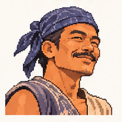

# AGUS KUSNENDAR (W125)

**Peran:** Pembudidaya ikan kolam
**Potret:** 
**Status:** Rancangan fiksi publik — belum disahkan sebagai kisah atau gameplay aktif.

> Seluruh cerita dan sifat di halaman ini adalah konsep untuk tokoh fiksi YZ Farm Life, bukan biografi seseorang di dunia nyata.

## Identitas

**preferredName:** Agus Kusnendar

**ageYears:** 46

**language:** Bahasa Indonesia; sesekali memakai sapaan atau ungkapan Sunda saat suasana percakapan cocok.

**identity:** NPC fiksi berlatar Kota Bandung

**ageDesignNote:** Usia ini pilihan kreatif sementara berdasarkan kematangan visual potret, bukan pengukuran umur dari gambar.

**visualAgeBandDraft:** dewasa dalam rancangan karakter

## Penampilan dan bahasa tubuh

**general:** Potret canonical R061 memperlihatkan rincian visual yang dicatat di bawah; jangan menggantinya dengan identitas dari arsip legacy.

**physicalTraits:** Rambut gelap, ikat kepala biru, kumis tipis dan baju tanpa lengan dengan kain biru di bahu; tersenyum.

**bodyLanguageDirection:** tersenyum

**proposedPose:** Gunakan gestur yang terlihat pada potret sebagai rujukan satu pose interaksi; animasi final belum disetujui.

## Busana dan estetika

**signatureClothing:** Rambut gelap, ikat kepala biru, kumis tipis dan baju tanpa lengan dengan kain biru di bahu

**accessories**
- ikat kepala

**aesthetic:** Pixel-art kehidupan Kota Bandung

**palette:** biru abu dan cokelat tanah

**costumeConcept:** Pakaian kerja yang memudahkan kegiatan hewan dan habitatnya, tanpa menganggapnya sebagai pakaian nyata sosok dalam dunia nyata

## Pekerjaan dan kehidupan sosial

**education:** Belajar pengamatan ekosistem dan penanganan lapangan melalui praktik komunitas.

**communityActivity:** Mengajak warga mencatat kebutuhan ikan kolam agar pekerjaan tidak saling bertabrakan.

**functionInWorld:** lingkungan

**workRoutineConcept:** mengamati kondisi lingkungan sebelum memindahkan peralatan

**workplaceConcept:** Situasi kerja fiksi mengenai hewan dan habitatnya; lokasi spesifik belum ditetapkan

## Kepribadian fiksi

**traits**
- Kepedulian lingkungan
- Tekun
- Mau mendengar

**observableHabit:** mengamati dari jauh sebelum mendekat

**values:** Kepedulian lingkungan

**weakness:** terlalu hati-hati ketika harus bertindak

**strengthConcept:** mencatat hal kecil yang kerap terlewat

**flawConcept:** terlalu berhati-hati ketika keadaan mendesak

**microHabitConcept:** membandingkan dua catatan tentang hewan dan habitatnya sebelum menjawab

## Motivasi dan konflik fiksi

**primaryMotivation:** Menjaga pekerjaan ikan kolam tetap dapat dipertanggungjawabkan

**need:** Ingin ada waktu memeriksa urusan ikan kolam sebelum keputusan diambil bersama.

**innerConflict:** Pemilik alat meminta solusi yang berbeda dari kebiasaan

**fear:** Habitat kehilangan keseimbangan

**motivationConcept:** Mencari cara menangani ikan kolam dengan teliti ketika orang lain ingin pekerjaan cepat selesai

**conflictConcept:** Di bagian ikan kolam, tanda-tanda di sekitar habitat belum cukup untuk mengambil keputusan cepat; pilihan yang serba cepat terasa berisiko baginya dalam premis fiksi ini

**agencyConcept:** Boleh menolak bantuan yang mengikuti kebiasaan lama tanpa pemeriksaan; dapat memilih mencatat pengamatan lebih dulu dan mengubah langkah seperlunya meskipun pemain tidak setuju

## Latar cerita

**formativeMemory:** Bukan peristiwa besar, tetapi ia ingat betul saat tanda-tanda di sekitar habitat belum cukup untuk mengambil keputusan cepat. Pelajaran yang dipegangnya sederhana: bekerja cepat tidak sama dengan bekerja tepat.

**narrativeBackground:** Di sela kandang, air, dan kehidupan di sekitar kota, Agus Kusnendar menemukan alat lama yang hampir tidak dipakai lagi.

**narrativeStatus:** Konsep fiksi baru; bukan riwayat orang asli

**sceneConcept:** Sebuah kegiatan sehari-hari tentang hewan dan habitatnya terhambat karena tanda-tanda di sekitar habitat belum cukup untuk mengambil keputusan cepat. Ini hanya premis adegan, bukan riwayat pribadi.

## Interaksi dan hubungan

**relationshipHook:** Kedekatan dibangun melalui bantuan terkait catatan pengamatan, tanpa relasi keluarga yang ditebak

**trustBehavior:** Meningkat setelah pemain menepati janji dan menghormati pilihan tokoh

**personalBoundary:** Tidak langsung membicarakan masalah pribadi kepada pemain baru

**boundaryConcept:** Tidak membagi urusan pribadi hanya karena pemain sering menyapa; kedekatan tidak sama dengan persetujuan

## Suara dan dialog

**speechSignature:** Awalnya hati-hati ketika menjelaskan ikan kolam, lalu lugas setelah melihat hasil.

**sampleLine:** Di catatan, urusan ikan kolam sudah selesai. Di lapangan ternyata belum.

**habitualGesture:** menunduk mengamati jejak atau permukaan air

**reactions**
- **neutral:** Menanggapi seperlunya dan kembali ke pekerjaan
- **happy:** Senyum kecil saat bantuan benar-benar berguna
- **worried:** Memeriksa catatan pengamatan sebelum memberi jawaban

**dialogueDrafts**
- Di catatan, urusan ikan kolam sudah selesai. Di lapangan ternyata belum.
- Aku kurang yakin kalau kita mengikuti kebiasaan lama tanpa pemeriksaan. Untuk ikan kolam, risikonya belum jelas.
- Kalau aku, lebih baik mencatat pengamatan lebih dulu dan mengubah langkah seperlunya. Urusan ikan kolam bisa menunggu sebentar.

**speakingCadence:** tenang dengan jeda saat memastikan rincian

## Perkembangan cerita

**storyArc:** Urusan catatan pengamatan mulai mengganggu rutinitas pembudidaya ikan kolam

**questHook:** Ketika sedang menangani ikan kolam, muncul masalah sederhana: tanda-tanda di sekitar habitat belum cukup untuk mengambil keputusan cepat. Pemain boleh membantu, menolak, atau mengajukan cara lain; belum ada quest runtime.

**threeActBeats**
- Masalah ikan kolam terlihat ketika mengamati kondisi lingkungan sebelum memindahkan peralatan
- Pemain mengetahui bahwa tanda-tanda di sekitar habitat belum cukup untuk mengambil keputusan cepat; pilihan warga tidak selalu sejalan
- Salah satu cara dicoba dalam kegiatan ikan kolam, lalu hasilnya dievaluasi bersama

**playerChoices**
- Mendukung usulan untuk mengikuti kebiasaan lama tanpa pemeriksaan pada ikan kolam
- Mengusulkan agar mencatat pengamatan lebih dulu dan mengubah langkah seperlunya untuk ikan kolam

**implementation:** draft, belum diaktifkan otomatis

**sideQuestConcept**
- **premise:** Saat mengurus ikan kolam, tanda-tanda di sekitar habitat belum cukup untuk mengambil keputusan cepat.
- **decisionA:** Mengikuti kebiasaan lama tanpa pemeriksaan.
- **decisionB:** Mencatat pengamatan lebih dulu dan mengubah langkah seperlunya.
- **state:** not-implemented

**choiceConsequencesConcept**
- - **choice:** A
- **result:** Kemungkinan lebih cepat; konsekuensi nyata harus ditulis dan diuji sebelum implementasi
- - **choice:** B
- **result:** Kemungkinan lebih teliti; konsekuensi nyata harus ditulis dan diuji sebelum implementasi

## Referensi visual

**visualContinuity:** Patokan ilustrasi: Rambut gelap, ikat kepala biru, kumis tipis dan baju tanpa lengan dengan kain biru di bahu; tersenyum. Cocokkan penutup kepala, warna, alat bantu, aksesori dan siluet dengan sprite; jangan mengganti portrait key.

**suggestedPalette:** biru abu dan cokelat tanah

**animationRequired**
- idle
- walk-4-directions
- interact

**observedIllustrationStyle:** Potret pixel-art bertekstur dengan variasi shading wajah; cocokkan kepadatan piksel antaraset.

## Kontinuitas dan status runtime

**availability:** Katalog; jadwal dan spawn mengikuti ekspansi bertahap

**playerDependentState:** Tidak boleh tertukar dengan ID cerita lama

**canonStatus:** Nama, pekerjaan dan kunci potret terkunci; detail cerita masih rancangan

**playableRuntimeConfirmed:** Tidak

**questIntegrationConfirmed:** Tidak

**legacyAssociationApproved:** Tidak

**status:** Konsep publik; kehadiran karakter dan cerita di runtime memerlukan implementasi terpisah.

---
Karakter ini merupakan bagian dari katalog fiksi YZ Farm Life. Data identitas canonical dikunci; pengesahan lore dan implementasi gameplay dilakukan terpisah.
