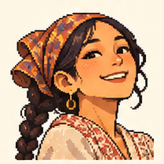

# DEWI SURYANI (W147)

**Peran:** Penata rambut acara
**Potret:** 
**Status:** Rancangan fiksi publik — belum disahkan sebagai kisah atau gameplay aktif.

> Seluruh cerita dan sifat di halaman ini adalah konsep untuk tokoh fiksi YZ Farm Life, bukan biografi seseorang di dunia nyata.

## Identitas

**preferredName:** Dewi Suryani

**ageYears:** 33

**origin:** Sebelum dikenal warga Pasirluyu, Dewi Suryani menghabiskan banyak waktu di Pasirluyu. Di tengah gang di tepi kebun, ia terbiasa menghargai percakapan setelah pekerjaan; tak semua cara lama itu cocok di tempat yang baru. (latar fiksi; draf)

**language:** Bahasa Indonesia; sesekali memakai sapaan atau ungkapan Sunda saat suasana percakapan cocok.

**identity:** NPC fiksi berlatar Kota Bandung

**ageDesignNote:** Usia ini pilihan kreatif sementara berdasarkan kematangan visual potret, bukan pengukuran umur dari gambar.

**visualAgeBandDraft:** dewasa dalam rancangan karakter

## Penampilan dan bahasa tubuh

**general:** Potret canonical R114 memperlihatkan rincian visual yang dicatat di bawah; jangan menggantinya dengan identitas dari arsip legacy.

**physicalTraits:** Rambut gelap dikepang panjang, kain kepala batik merah-oranye, anting lingkaran dan pakaian terang bermotif; tersenyum lebar.

**bodyLanguageDirection:** tersenyum lebar

**proposedPose:** Gunakan gestur yang terlihat pada potret sebagai rujukan satu pose interaksi; animasi final belum disetujui.

## Busana dan estetika

**signatureClothing:** Rambut gelap dikepang panjang, kain kepala batik merah-oranye, anting lingkaran dan pakaian terang bermotif

**accessories**
- kain kepala
- anting

**aesthetic:** Pixel-art kehidupan Kota Bandung

**palette:** oranye, merah

**costumeConcept:** Pakaian kerja yang memudahkan kegiatan bahan dan pola, tanpa menganggapnya sebagai pakaian nyata sosok dalam dunia nyata

## Pekerjaan dan kehidupan sosial

**education:** Keterampilan kerja diperoleh lewat praktik dan bimbingan komunitas.

**communityActivity:** Membahas cara memeriksa rambut acara bersama warga sebelum mengambil keputusan.

**functionInWorld:** kriya

**workRoutineConcept:** mencocokkan bahan, warna, serta potongan yang sedang dikerjakan

**workplaceConcept:** Situasi kerja fiksi mengenai bahan dan pola; lokasi spesifik belum ditetapkan

## Kepribadian fiksi

**traits**
- Kesabaran
- Tekun
- Mau mendengar

**observableHabit:** mengukur bahan sebelum memotong

**values:** Kesabaran

**weakness:** ingin hasil sempurna saat waktunya sempit

**strengthConcept:** telaten menguji hasil sebelum dibagikan

**flawConcept:** terlalu lama mengecek rincian

**microHabitConcept:** membandingkan dua catatan tentang bahan dan pola sebelum menjawab

## Motivasi dan konflik fiksi

**primaryMotivation:** Menjaga pekerjaan rambut acara tetap dapat dipertanggungjawabkan

**need:** Ingin ada waktu memeriksa urusan rambut acara sebelum keputusan diambil bersama.

**innerConflict:** Tokoh harus menentukan mana yang lebih dulu ditolong

**fear:** Bahan berharga terbuang

**motivationConcept:** Mencari cara menangani rambut acara dengan teliti ketika orang lain ingin pekerjaan cepat selesai

**conflictConcept:** Di bagian rambut acara, pilihan warna yang menarik belum tentu sesuai dengan pesanan dan bahan; pilihan yang serba cepat terasa berisiko baginya dalam premis fiksi ini

**agencyConcept:** Boleh menolak bantuan yang mengubah desain mendadak; dapat memilih menguji padanan pada contoh kecil meskipun pemain tidak setuju

## Latar cerita

**familyContext:** Seorang paman mengajarkan Dewi Suryani memperbaiki barang sebelum membuangnya. Kebiasaan itu kadang berguna saat bekerja sebagai penata rambut acara, namun harus ditinggalkan bila keselamatan dipertaruhkan. (latar fiksi; draf)

**formativeMemory:** Ketika baru terbiasa dengan pekerjaan penata rambut acara, pilihan warna yang menarik belum tentu sesuai dengan pesanan dan bahan. Sejak itu, Dewi Suryani terbiasa mengukur bahan sebelum memotong.

**narrativeBackground:** Di sela bahan, warna, dan barang buatan tangan, Dewi Suryani menemukan pekerjaan terakhir sebelum hari libur.

**narrativeStatus:** Konsep fiksi baru; bukan riwayat orang asli

**sceneConcept:** Sebuah kegiatan sehari-hari tentang bahan dan pola terhambat karena pilihan warna yang menarik belum tentu sesuai dengan pesanan dan bahan. Ini hanya premis adegan, bukan riwayat pribadi.

## Interaksi dan hubungan

**relationshipHook:** Kedekatan dibangun melalui bantuan terkait pola kerja, tanpa relasi keluarga yang ditebak

**trustBehavior:** Meningkat setelah pemain menepati janji dan menghormati pilihan tokoh

**personalBoundary:** Tidak langsung membicarakan masalah pribadi kepada pemain baru

**boundaryConcept:** Tidak membagi urusan pribadi hanya karena pemain sering menyapa; kedekatan tidak sama dengan persetujuan

## Suara dan dialog

**speechSignature:** Bicara singkat soal rambut acara; lebih banyak bertanya saat ada risiko.

**sampleLine:** Soal rambut acara tadi ada yang kelewat. Aku mau lihat lagi sebentar.

**habitualGesture:** meraba sambungan atau merapikan bahan

**reactions**
- **neutral:** Menanggapi seperlunya dan kembali ke pekerjaan
- **happy:** Senyum kecil saat bantuan benar-benar berguna
- **worried:** Memeriksa pola kerja sebelum memberi jawaban

**dialogueDrafts**
- Soal rambut acara tadi ada yang kelewat. Aku mau lihat lagi sebentar.
- Aku kurang yakin kalau kita mengubah desain mendadak. Untuk rambut acara, risikonya belum jelas.
- Kalau aku, lebih baik menguji padanan pada contoh kecil. Urusan rambut acara bisa menunggu sebentar.

**speakingCadence:** tenang dengan jeda saat memastikan rincian

## Perkembangan cerita

**storyArc:** Urusan pola kerja mulai mengganggu rutinitas penata rambut acara

**questHook:** Ketika sedang menangani rambut acara, muncul masalah sederhana: pilihan warna yang menarik belum tentu sesuai dengan pesanan dan bahan. Pemain boleh membantu, menolak, atau mengajukan cara lain; belum ada quest runtime.

**threeActBeats**
- Masalah rambut acara terlihat ketika mencocokkan bahan, warna, serta potongan yang sedang dikerjakan
- Pemain mengetahui bahwa pilihan warna yang menarik belum tentu sesuai dengan pesanan dan bahan; pilihan warga tidak selalu sejalan
- Salah satu cara dicoba dalam kegiatan rambut acara, lalu hasilnya dievaluasi bersama

**playerChoices**
- Mendukung usulan untuk mengubah desain mendadak pada rambut acara
- Mengusulkan agar menguji padanan pada contoh kecil untuk rambut acara

**implementation:** draft, belum diaktifkan otomatis

**sideQuestConcept**
- **premise:** Saat mengurus rambut acara, pilihan warna yang menarik belum tentu sesuai dengan pesanan dan bahan.
- **decisionA:** Mengubah desain mendadak.
- **decisionB:** Menguji padanan pada contoh kecil.
- **state:** not-implemented

**choiceConsequencesConcept**
- - **choice:** A
- **result:** Kemungkinan lebih cepat; konsekuensi nyata harus ditulis dan diuji sebelum implementasi
- - **choice:** B
- **result:** Kemungkinan lebih teliti; konsekuensi nyata harus ditulis dan diuji sebelum implementasi

## Referensi visual

**visualContinuity:** Patokan ilustrasi: Rambut gelap dikepang panjang, kain kepala batik merah-oranye, anting lingkaran dan pakaian terang bermotif; tersenyum lebar. Cocokkan penutup kepala, warna, alat bantu, aksesori dan siluet dengan sprite; jangan mengganti portrait key.

**suggestedPalette:** oranye, merah

**animationRequired**
- idle
- walk-4-directions
- interact

**observedIllustrationStyle:** Potret pixel-art bertekstur dengan variasi shading wajah; cocokkan kepadatan piksel antaraset.

## Kontinuitas dan status runtime

**availability:** Katalog; jadwal dan spawn mengikuti ekspansi bertahap

**playerDependentState:** Tidak boleh tertukar dengan ID cerita lama

**canonStatus:** Nama, pekerjaan dan kunci potret terkunci; detail cerita masih rancangan

**playableRuntimeConfirmed:** Tidak

**questIntegrationConfirmed:** Tidak

**legacyAssociationApproved:** Tidak

**status:** Konsep publik; kehadiran karakter dan cerita di runtime memerlukan implementasi terpisah.

---
Karakter ini merupakan bagian dari katalog fiksi YZ Farm Life. Data identitas canonical dikunci; pengesahan lore dan implementasi gameplay dilakukan terpisah.
