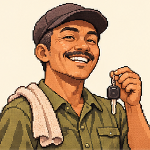

# DADANG KUSUMADINATA (W587)

**Peran:** Sopir angkot
**Potret:** 
**Status:** Rancangan fiksi publik — belum disahkan sebagai kisah atau gameplay aktif.

> Seluruh cerita dan sifat di halaman ini adalah konsep untuk tokoh fiksi YZ Farm Life, bukan biografi seseorang di dunia nyata.

## Identitas

**preferredName:** Dadang Kusumadinata

**ageYears:** 44

**language:** Bahasa Indonesia; sesekali memakai sapaan atau ungkapan Sunda saat suasana percakapan cocok.

**identity:** NPC fiksi berlatar Kota Bandung

**ageDesignNote:** Usia ini pilihan kreatif sementara berdasarkan kematangan visual potret, bukan pengukuran umur dari gambar.

**visualAgeBandDraft:** dewasa dalam rancangan karakter

## Penampilan dan bahasa tubuh

**general:** Potret canonical R187 memperlihatkan rincian visual yang dicatat di bawah; jangan menggantinya dengan identitas dari arsip legacy.

**physicalTraits:** Rambut gelap, topi pet cokelat, kumis tipis dan kemeja hijau; tertawa sambil menunjukkan kunci kendaraan.

**bodyLanguageDirection:** tertawa sambil menunjukkan kunci kendaraan

**proposedPose:** Gunakan gestur yang terlihat pada potret sebagai rujukan satu pose interaksi; animasi final belum disetujui.

## Busana dan estetika

**signatureClothing:** Rambut gelap, topi pet cokelat, kumis tipis dan kemeja hijau

**accessories**
- topi pet

**aesthetic:** Pixel-art kehidupan Kota Bandung

**palette:** cokelat, hijau

**costumeConcept:** Pakaian kerja yang memudahkan kegiatan rute dan kiriman, tanpa menganggapnya sebagai pakaian nyata sosok dalam dunia nyata

## Pekerjaan dan kehidupan sosial

**education:** Belajar rute, keselamatan kerja, dan layanan penumpang atau pelanggan melalui praktik.

**communityActivity:** Membahas cara memeriksa angkot bersama warga sebelum mengambil keputusan.

**functionInWorld:** transportasi

**workRoutineConcept:** memastikan jalan serta tujuan sebelum berangkat

**workplaceConcept:** Situasi kerja fiksi mengenai rute dan kiriman; lokasi spesifik belum ditetapkan

## Kepribadian fiksi

**traits**
- Keandalan
- Tekun
- Mau mendengar

**observableHabit:** mengingat belokan dan ciri gang

**values:** Keandalan

**weakness:** terlalu percaya pada jalan pintas

**strengthConcept:** telaten menguji hasil sebelum dibagikan

**flawConcept:** terlalu lama mengecek rincian

**microHabitConcept:** membandingkan dua catatan tentang rute dan kiriman sebelum menjawab

## Motivasi dan konflik fiksi

**primaryMotivation:** Menjaga pekerjaan angkot tetap dapat dipertanggungjawabkan

**need:** Ingin ada waktu memeriksa urusan angkot sebelum keputusan diambil bersama.

**innerConflict:** Dua keterangan warga ternyata tidak sama

**fear:** Kiriman tiba terlambat

**motivationConcept:** Mencari cara menangani angkot dengan teliti ketika orang lain ingin pekerjaan cepat selesai

**conflictConcept:** Di bagian angkot, jalur tercepat tidak selalu aman untuk barang atau rombongan; pilihan yang serba cepat terasa berisiko baginya dalam premis fiksi ini

**agencyConcept:** Boleh menolak bantuan yang mengambil jalan pintas; dapat memilih memilih rute yang dapat dilalui dengan aman meskipun pemain tidak setuju

## Latar cerita

**formativeMemory:** Di awal pekerjaannya sebagai sopir angkot, jalur tercepat tidak selalu aman untuk barang atau rombongan. Pengalaman itu membuatnya percaya pada ketelitian, bukan sekadar rutinitas.

**narrativeBackground:** Di sela jalan sempit, kiriman, dan waktu tempuh, Dadang Kusumadinata menemukan catatan yang tercecer.

**narrativeStatus:** Konsep fiksi baru; bukan riwayat orang asli

**sceneConcept:** Sebuah kegiatan sehari-hari tentang rute dan kiriman terhambat karena jalur tercepat tidak selalu aman untuk barang atau rombongan. Ini hanya premis adegan, bukan riwayat pribadi.

## Interaksi dan hubungan

**relationshipHook:** Kedekatan dibangun melalui bantuan terkait rute kiriman, tanpa relasi keluarga yang ditebak

**trustBehavior:** Meningkat setelah pemain menepati janji dan menghormati pilihan tokoh

**personalBoundary:** Tidak langsung membicarakan masalah pribadi kepada pemain baru

**boundaryConcept:** Tidak membagi urusan pribadi hanya karena pemain sering menyapa; kedekatan tidak sama dengan persetujuan

## Suara dan dialog

**speechSignature:** Bicara singkat soal angkot; lebih banyak bertanya saat ada risiko.

**sampleLine:** Soal angkot tadi ada yang kelewat. Aku mau lihat lagi sebentar.

**habitualGesture:** mengecek tali atau roda sebelum berangkat

**reactions**
- **neutral:** Menanggapi seperlunya dan kembali ke pekerjaan
- **happy:** Senyum kecil saat bantuan benar-benar berguna
- **worried:** Memeriksa rute kiriman sebelum memberi jawaban

**dialogueDrafts**
- Soal angkot tadi ada yang kelewat. Aku mau lihat lagi sebentar.
- Aku kurang yakin kalau kita mengambil jalan pintas. Untuk angkot, risikonya belum jelas.
- Kalau aku, lebih baik memilih rute yang dapat dilalui dengan aman. Urusan angkot bisa menunggu sebentar.

**speakingCadence:** tenang dengan jeda saat memastikan rincian

## Perkembangan cerita

**storyArc:** Urusan rute kiriman mulai mengganggu rutinitas sopir angkot

**questHook:** Ketika sedang menangani angkot, muncul masalah sederhana: jalur tercepat tidak selalu aman untuk barang atau rombongan. Pemain boleh membantu, menolak, atau mengajukan cara lain; belum ada quest runtime.

**threeActBeats**
- Masalah angkot terlihat ketika memastikan jalan serta tujuan sebelum berangkat
- Pemain mengetahui bahwa jalur tercepat tidak selalu aman untuk barang atau rombongan; pilihan warga tidak selalu sejalan
- Salah satu cara dicoba dalam kegiatan angkot, lalu hasilnya dievaluasi bersama

**playerChoices**
- Mendukung usulan untuk mengambil jalan pintas pada angkot
- Mengusulkan agar memilih rute yang dapat dilalui dengan aman untuk angkot

**implementation:** draft, belum diaktifkan otomatis

**sideQuestConcept**
- **premise:** Saat mengurus angkot, jalur tercepat tidak selalu aman untuk barang atau rombongan.
- **decisionA:** Mengambil jalan pintas.
- **decisionB:** Memilih rute yang dapat dilalui dengan aman.
- **state:** not-implemented

**choiceConsequencesConcept**
- - **choice:** A
- **result:** Kemungkinan lebih cepat; konsekuensi nyata harus ditulis dan diuji sebelum implementasi
- - **choice:** B
- **result:** Kemungkinan lebih teliti; konsekuensi nyata harus ditulis dan diuji sebelum implementasi

## Referensi visual

**visualContinuity:** Patokan ilustrasi: Rambut gelap, topi pet cokelat, kumis tipis dan kemeja hijau; tertawa sambil menunjukkan kunci kendaraan. Cocokkan penutup kepala, warna, alat bantu, aksesori dan siluet dengan sprite; jangan mengganti portrait key.

**suggestedPalette:** cokelat, hijau

**animationRequired**
- idle
- walk-4-directions
- interact

**observedIllustrationStyle:** Potret pixel-art bertekstur dengan variasi shading wajah; cocokkan kepadatan piksel antaraset.

## Kontinuitas dan status runtime

**availability:** Katalog; jadwal dan spawn mengikuti ekspansi bertahap

**playerDependentState:** Tidak boleh tertukar dengan ID cerita lama

**canonStatus:** Nama, pekerjaan dan kunci potret terkunci; detail cerita masih rancangan

**playableRuntimeConfirmed:** Tidak

**questIntegrationConfirmed:** Tidak

**legacyAssociationApproved:** Tidak

**status:** Konsep publik; kehadiran karakter dan cerita di runtime memerlukan implementasi terpisah.

---
Karakter ini merupakan bagian dari katalog fiksi YZ Farm Life. Data identitas canonical dikunci; pengesahan lore dan implementasi gameplay dilakukan terpisah.
