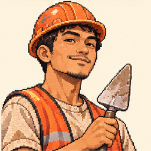

# UJANG JAYAPRAJA (W588)

**Peran:** Tukang bangunan
**Potret:** 
**Status:** Rancangan fiksi publik — belum disahkan sebagai kisah atau gameplay aktif.

> Seluruh cerita dan sifat di halaman ini adalah konsep untuk tokoh fiksi YZ Farm Life, bukan biografi seseorang di dunia nyata.

## Identitas

**preferredName:** Ujang Jayapraja

**ageYears:** 32

**language:** Bahasa Indonesia; sesekali memakai sapaan atau ungkapan Sunda saat suasana percakapan cocok.

**identity:** NPC fiksi berlatar Kota Bandung

**ageDesignNote:** Usia ini pilihan kreatif sementara berdasarkan kematangan visual potret, bukan pengukuran umur dari gambar.

**visualAgeBandDraft:** dewasa dalam rancangan karakter

## Penampilan dan bahasa tubuh

**general:** Potret canonical R188 memperlihatkan rincian visual yang dicatat di bawah; jangan menggantinya dengan identitas dari arsip legacy.

**physicalTraits:** Rambut gelap, helm proyek oranye, rompi keselamatan oranye dan kaus krem; membawa cetok semen.

**bodyLanguageDirection:** membawa cetok semen

**proposedPose:** Gunakan gestur yang terlihat pada potret sebagai rujukan satu pose interaksi; animasi final belum disetujui.

## Busana dan estetika

**signatureClothing:** Rambut gelap, helm proyek oranye, rompi keselamatan oranye dan kaus krem

**accessories**
- helm
- rompi

**aesthetic:** Pixel-art kehidupan Kota Bandung

**palette:** oranye, krem

**costumeConcept:** Pakaian kerja yang memudahkan kegiatan peralatan kerja, tanpa menganggapnya sebagai pakaian nyata sosok dalam dunia nyata

## Pekerjaan dan kehidupan sosial

**education:** Belajar keselamatan konstruksi, pengukuran, dan teknik kerja melalui praktik lapangan.

**communityActivity:** Mengajak warga mencatat kebutuhan bangunan agar pekerjaan tidak saling bertabrakan.

**functionInWorld:** kehidupan kota

**workRoutineConcept:** mencari sumber gangguan sebelum mengganti bagian

**workplaceConcept:** Situasi kerja fiksi mengenai peralatan kerja; lokasi spesifik belum ditetapkan

## Kepribadian fiksi

**traits**
- Saling membantu
- Tekun
- Mau mendengar

**observableHabit:** memperhatikan perubahan kecil di sekitar

**values:** Saling membantu

**weakness:** kadang menahan pendapat

**strengthConcept:** mau mengubah cara kerja ketika ada bukti

**flawConcept:** cenderung menunda percakapan sulit

**microHabitConcept:** menunjuk bagian yang perlu dicek saat membicarakan peralatan kerja

## Motivasi dan konflik fiksi

**primaryMotivation:** Menjaga pekerjaan bangunan tetap dapat dipertanggungjawabkan

**need:** Berharap warga mau mendengarkan masalah bangunan sebelum memberi solusi.

**innerConflict:** Rencana awal membuat sebagian orang menunggu lebih lama

**fear:** Urusan tertunda tanpa kabar

**motivationConcept:** Mencari cara menangani bangunan dengan teliti ketika orang lain ingin pekerjaan cepat selesai

**conflictConcept:** Di bagian bangunan, gejala kerusakan terlihat di satu bagian, tetapi penyebabnya belum jelas; pilihan yang serba cepat terasa berisiko baginya dalam premis fiksi ini

**agencyConcept:** Boleh menolak bantuan yang mengganti komponen yang paling mudah dijangkau; dapat memilih melakukan pemeriksaan bertahap meskipun pemain tidak setuju

## Latar cerita

**formativeMemory:** Sebuah urusan lama masih teringat: gejala kerusakan terlihat di satu bagian, tetapi penyebabnya belum jelas. Hari tersebut membuatnya lebih sabar mendengar pendapat orang lain.

**narrativeBackground:** Di sela jalan kampung, pekerjaan, dan tetangga, Ujang Jayapraja menemukan cuaca berubah saat pekerjaan belum selesai.

**narrativeStatus:** Konsep fiksi baru; bukan riwayat orang asli

**sceneConcept:** Sebuah kegiatan sehari-hari tentang peralatan kerja terhambat karena gejala kerusakan terlihat di satu bagian, tetapi penyebabnya belum jelas. Ini hanya premis adegan, bukan riwayat pribadi.

## Interaksi dan hubungan

**relationshipHook:** Kedekatan dibangun melalui bantuan terkait catatan pekerjaan, tanpa relasi keluarga yang ditebak

**trustBehavior:** Meningkat setelah pemain menepati janji dan menghormati pilihan tokoh

**personalBoundary:** Tidak langsung membicarakan masalah pribadi kepada pemain baru

**boundaryConcept:** Tidak membagi urusan pribadi hanya karena pemain sering menyapa; kedekatan tidak sama dengan persetujuan

## Suara dan dialog

**speechSignature:** Awalnya hati-hati ketika menjelaskan bangunan, lalu lugas setelah melihat hasil.

**sampleLine:** Tunggu. Bagian bangunan belum beres dicek. Jangan ditutup dulu.

**habitualGesture:** berhenti sejenak lalu membuka catatan

**reactions**
- **neutral:** Menanggapi seperlunya dan kembali ke pekerjaan
- **happy:** Senyum kecil saat bantuan benar-benar berguna
- **worried:** Memeriksa catatan pekerjaan sebelum memberi jawaban

**dialogueDrafts**
- Tunggu. Bagian bangunan belum beres dicek. Jangan ditutup dulu.
- Kalau kamu memilih mengganti komponen yang paling mudah dijangkau untuk bangunan, aku perlu tahu siapa yang bertanggung jawab.
- Kita coba melakukan pemeriksaan bertahap untuk bangunan dulu. Kalau tidak cocok, kita ganti rencana.

**speakingCadence:** ringkas saat bekerja, lebih terbuka sesudahnya

## Perkembangan cerita

**storyArc:** Urusan catatan pekerjaan mulai mengganggu rutinitas tukang bangunan

**questHook:** Ketika sedang menangani bangunan, muncul masalah sederhana: gejala kerusakan terlihat di satu bagian, tetapi penyebabnya belum jelas. Pemain boleh membantu, menolak, atau mengajukan cara lain; belum ada quest runtime.

**threeActBeats**
- Masalah bangunan terlihat ketika mencari sumber gangguan sebelum mengganti bagian
- Pemain mengetahui bahwa gejala kerusakan terlihat di satu bagian, tetapi penyebabnya belum jelas; pilihan warga tidak selalu sejalan
- Salah satu cara dicoba dalam kegiatan bangunan, lalu hasilnya dievaluasi bersama

**playerChoices**
- Mendukung usulan untuk mengganti komponen yang paling mudah dijangkau pada bangunan
- Mengusulkan agar melakukan pemeriksaan bertahap untuk bangunan

**implementation:** draft, belum diaktifkan otomatis

**sideQuestConcept**
- **premise:** Saat mengurus bangunan, gejala kerusakan terlihat di satu bagian, tetapi penyebabnya belum jelas.
- **decisionA:** Mengganti komponen yang paling mudah dijangkau.
- **decisionB:** Melakukan pemeriksaan bertahap.
- **state:** not-implemented

**choiceConsequencesConcept**
- - **choice:** A
- **result:** Kemungkinan lebih cepat; konsekuensi nyata harus ditulis dan diuji sebelum implementasi
- - **choice:** B
- **result:** Kemungkinan lebih teliti; konsekuensi nyata harus ditulis dan diuji sebelum implementasi

## Referensi visual

**visualContinuity:** Patokan ilustrasi: Rambut gelap, helm proyek oranye, rompi keselamatan oranye dan kaus krem; membawa cetok semen. Cocokkan penutup kepala, warna, alat bantu, aksesori dan siluet dengan sprite; jangan mengganti portrait key.

**suggestedPalette:** oranye, krem

**animationRequired**
- idle
- walk-4-directions
- interact

**observedIllustrationStyle:** Potret pixel-art bertekstur dengan variasi shading wajah; cocokkan kepadatan piksel antaraset.

## Kontinuitas dan status runtime

**availability:** Katalog; jadwal dan spawn mengikuti ekspansi bertahap

**playerDependentState:** Tidak boleh tertukar dengan ID cerita lama

**canonStatus:** Nama, pekerjaan dan kunci potret terkunci; detail cerita masih rancangan

**playableRuntimeConfirmed:** Tidak

**questIntegrationConfirmed:** Tidak

**legacyAssociationApproved:** Tidak

**status:** Konsep publik; kehadiran karakter dan cerita di runtime memerlukan implementasi terpisah.

---
Karakter ini merupakan bagian dari katalog fiksi YZ Farm Life. Data identitas canonical dikunci; pengesahan lore dan implementasi gameplay dilakukan terpisah.
