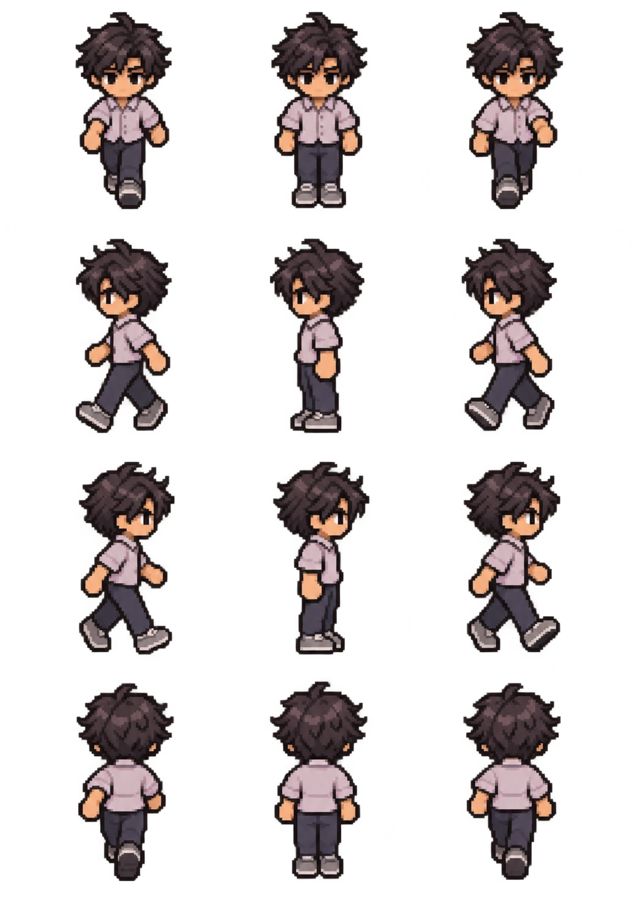
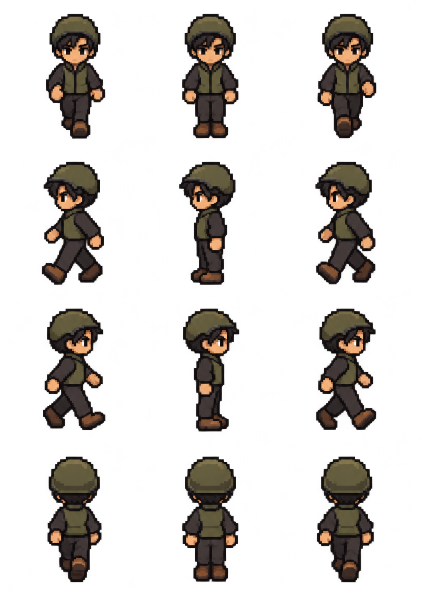

# C-series character preview

Names and attributes are fictional game profiles. See [all profiles](../../catalog/CHARACTER_BIBLE.md). All C-series characters are NPCs; C15 / Malik retains his wheelchair. See [QA](QA.md) before runtime use.

| Sheet | Sheet | Sheet | Sheet |
|---|---|---|---|
| **C01 · Nani**  | **C02 · Adang**  | **C03 · Tatang**  | **C04 · Ratna**  |
| **C05 · Naufal**  | **C06 · Alifia**  | **C07 · Agung**  | **C08 · Inggit**  |
| **C09 · Rhesa**  | **C10 · Toni**  | **C11 · Ray**  | **C12 · Leny**  |
| **C13 · Yayan**  | **C14 · Adep**  | **C15 · Malik**  | **C16 · Karisma**  |
