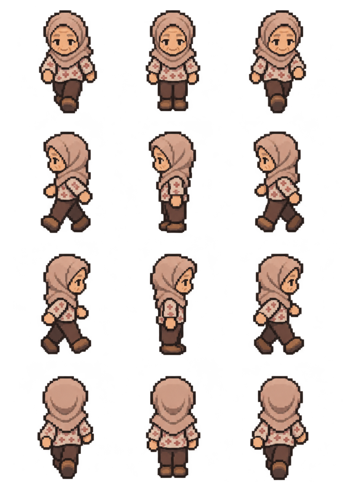
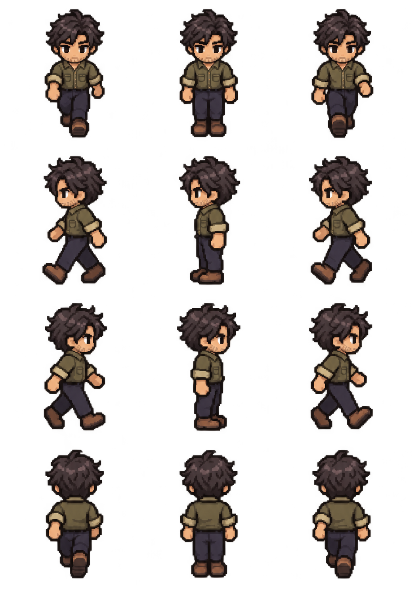
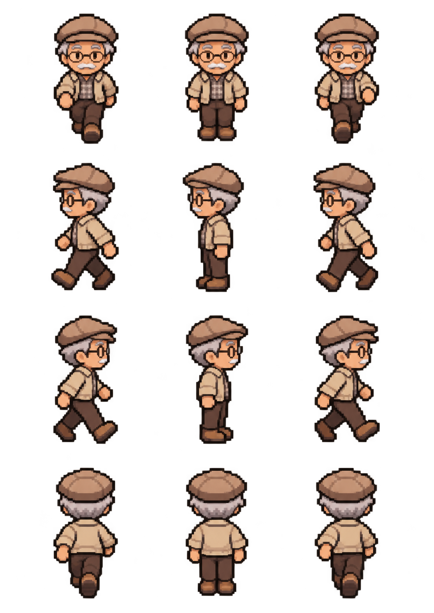
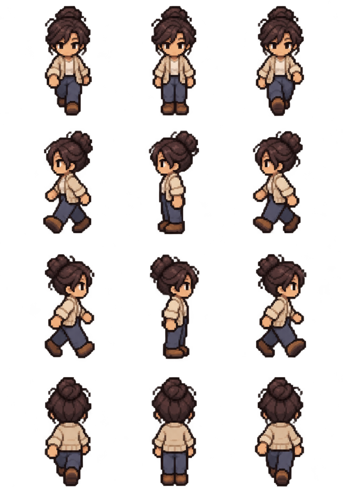
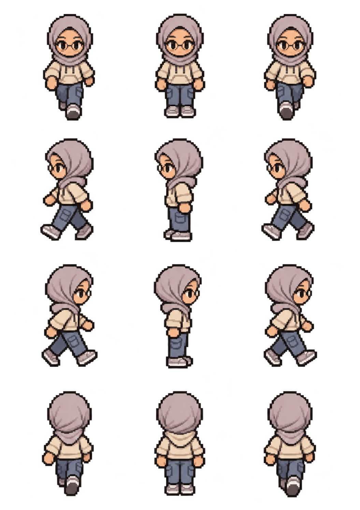
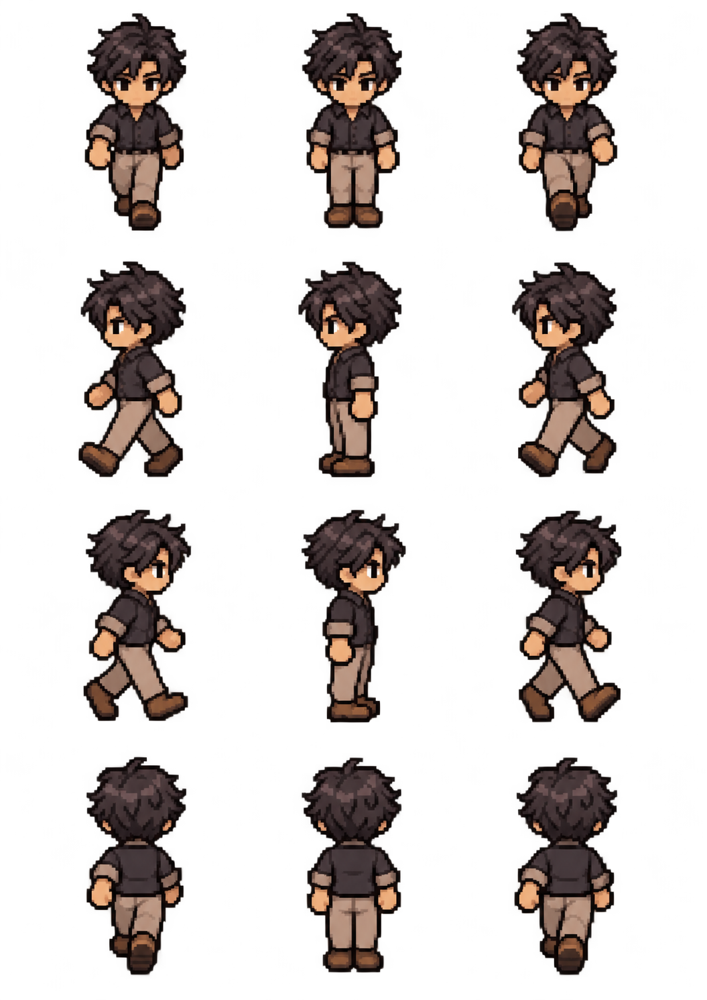
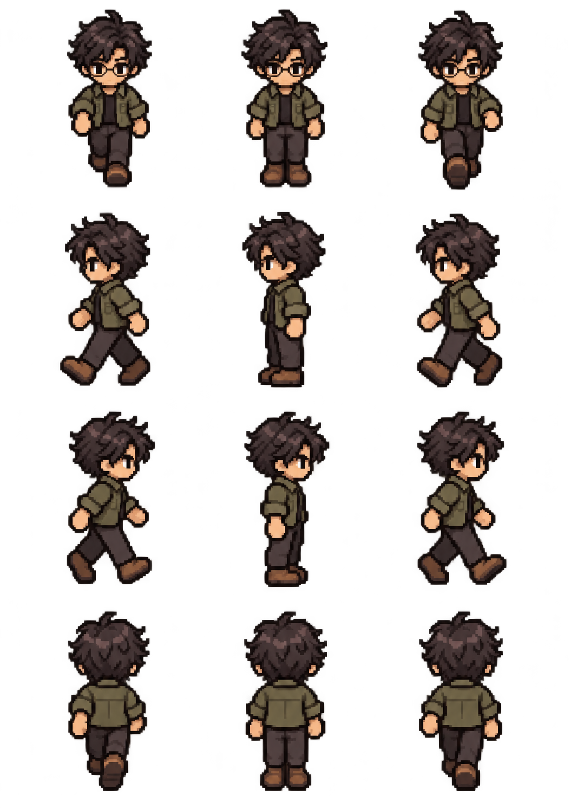
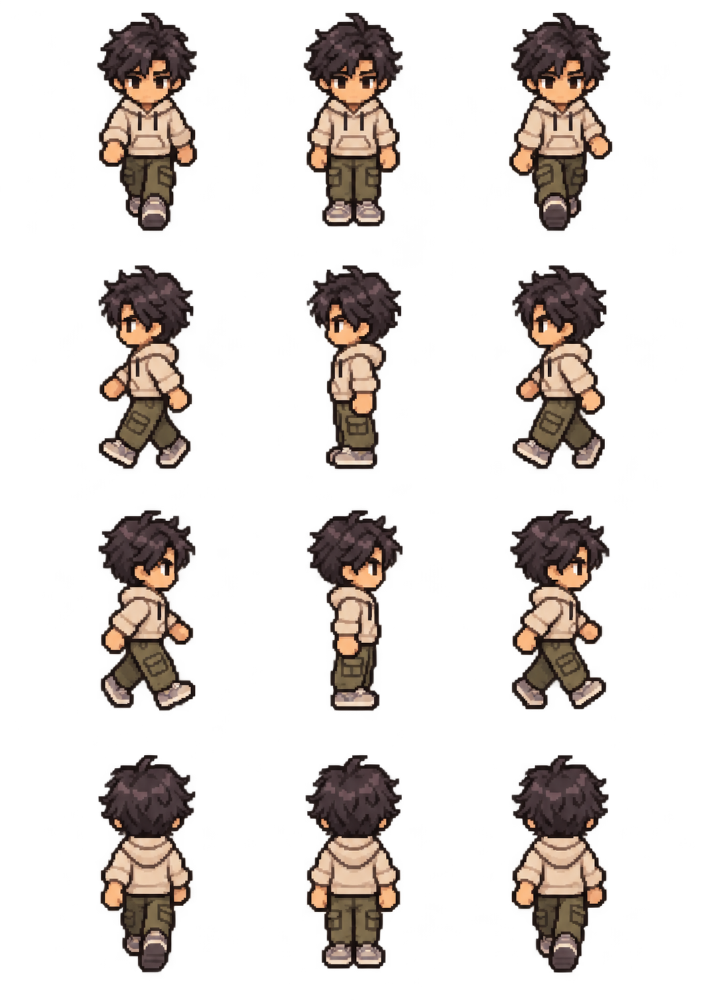
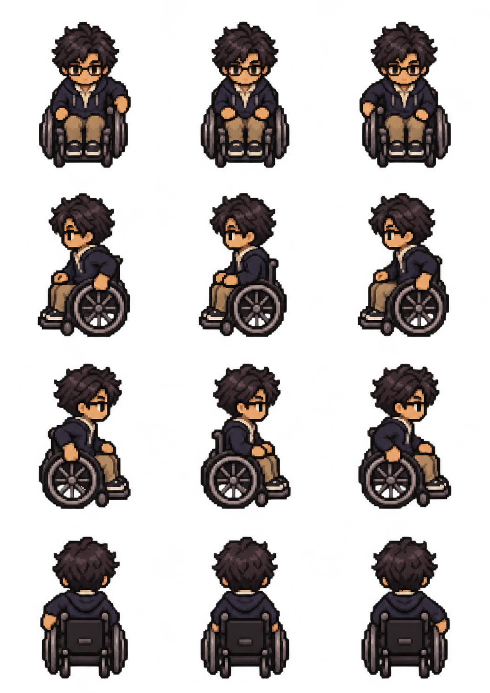
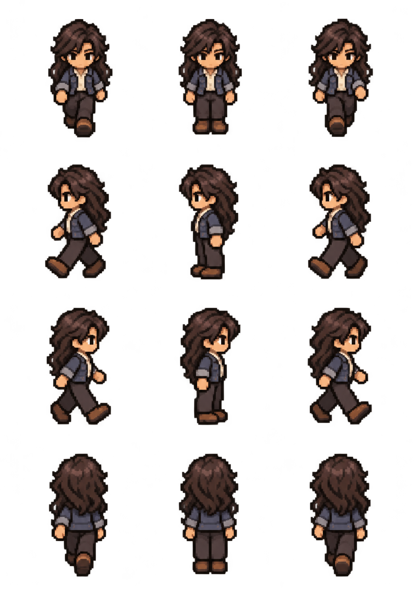

# C-series character preview

Names and attributes are fictional game profiles. See [all profiles](../../catalog/CHARACTER_BIBLE.md). All C-series characters are NPCs; C15 / Malik retains his wheelchair. See [QA](QA.md) before runtime use.

| Sheet | Sheet | Sheet | Sheet |
|---|---|---|---|
| **C01 · Nani**  | **C02 · Risky**  | **C03 · Tatang**  | **C04 · Desi**  |
| **C05 · Eza**  | **C06 · Yani**  | **C07 · Widi**  | **C08 · Inggit**  |
| **C09 · Bela**  | **C10 · Yogi**  | **C11 · Ray**  | **C12 · Fatihah**  |
| **C13 · Heri**  | **C14 · Arya**  | **C15 · Malik**  | **C16 · Karisma**  |
