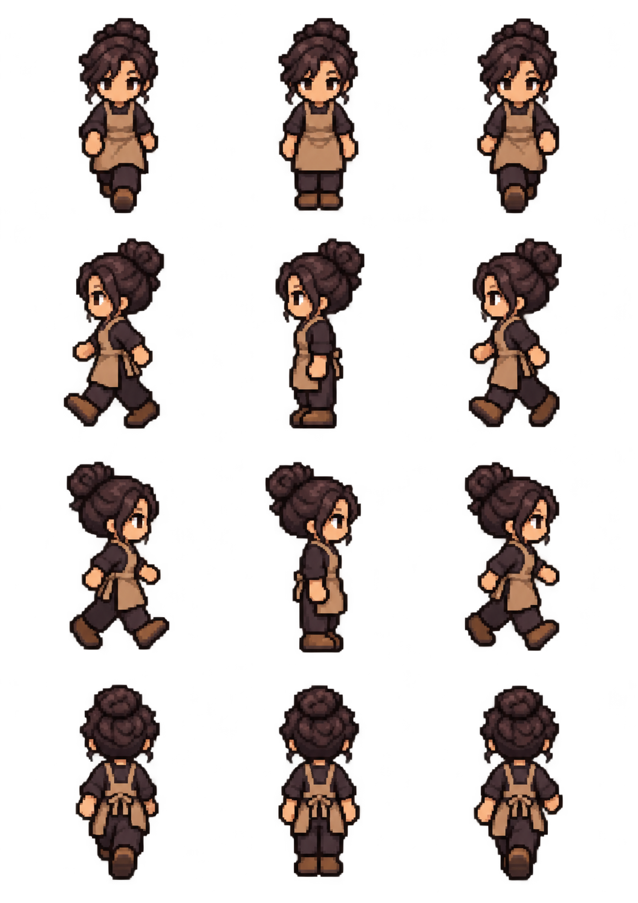
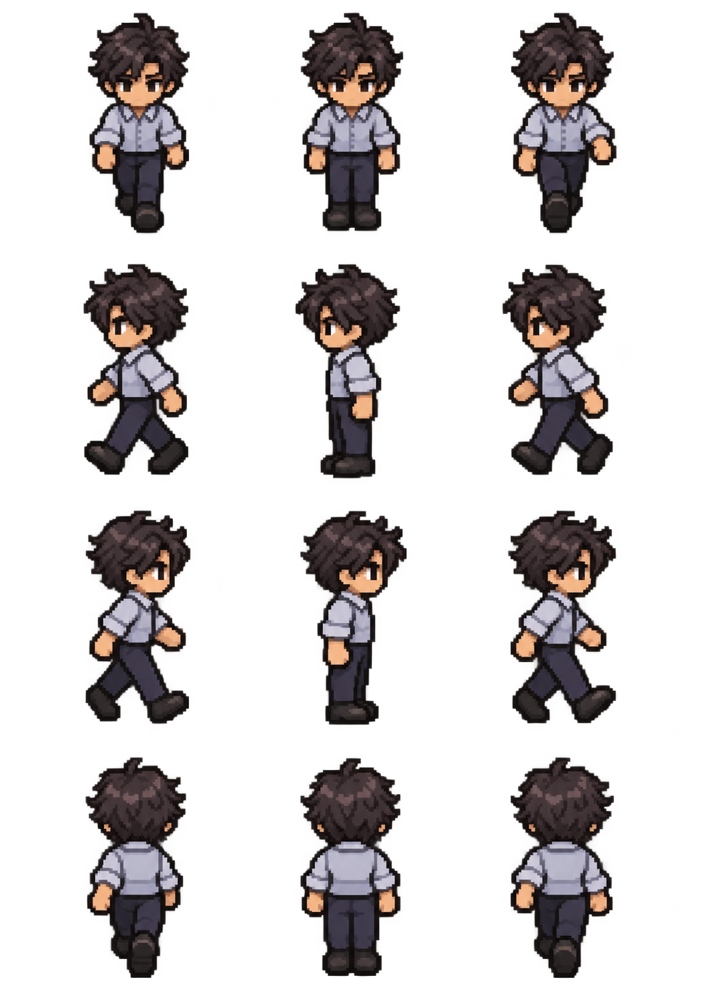
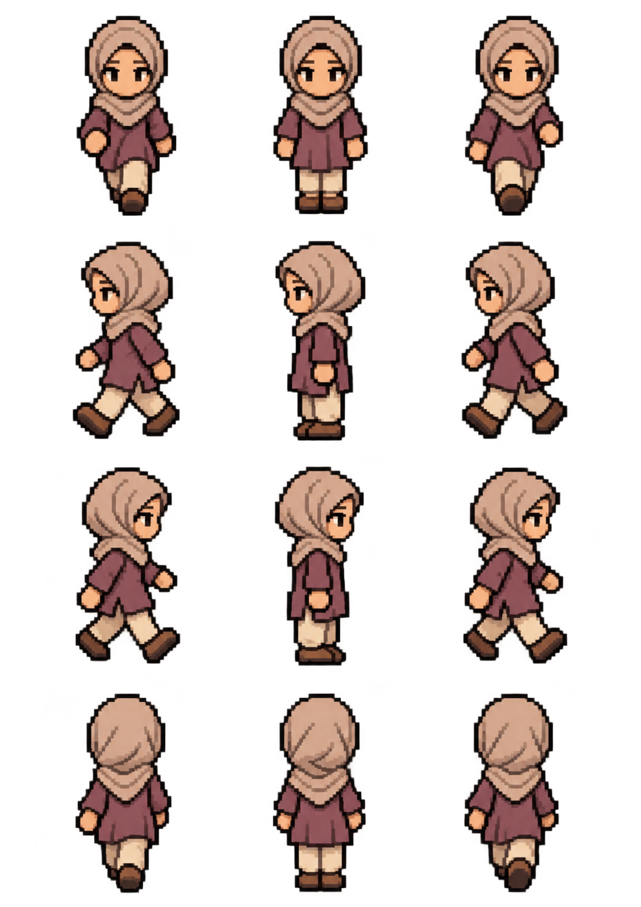
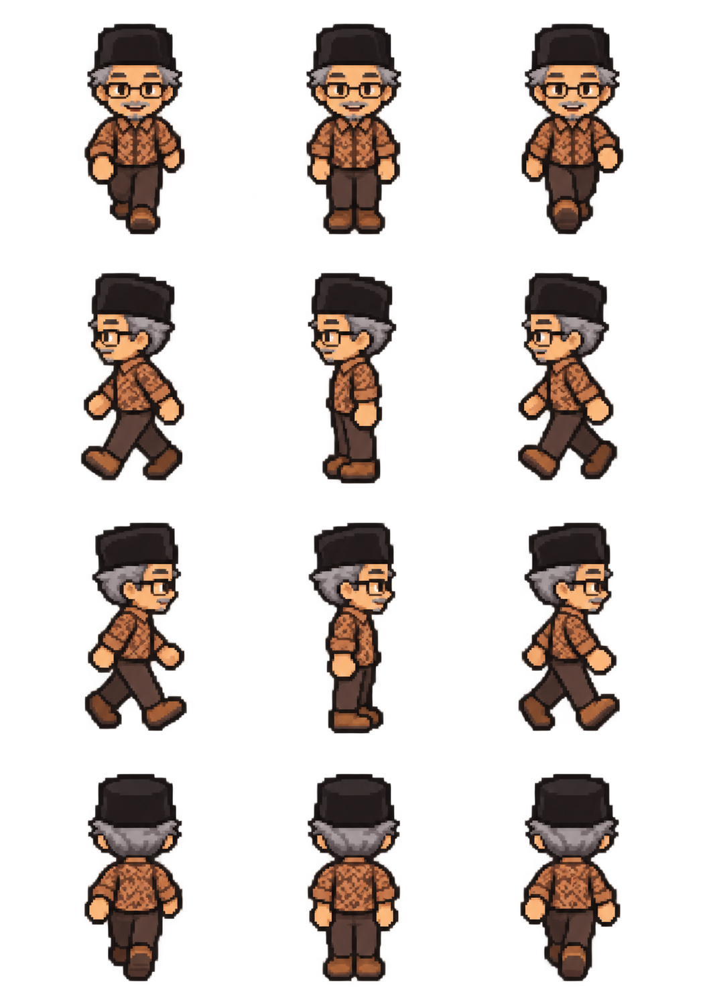

# C-series preview

All 16 are NPCs. C15 uses a wheelchair. Each thumbnail opens its complete four-direction sheet. See [QA](QA.md) before runtime use.

| Sheet | Sheet | Sheet | Sheet |
|---|---|---|---|
| C01  | C02  | C03  | C04  |
| C05  | C06  | C07  | C08  |
| C09  | C10  | C11  | C12  |
| C13  | C14  | C15  | C16  |

