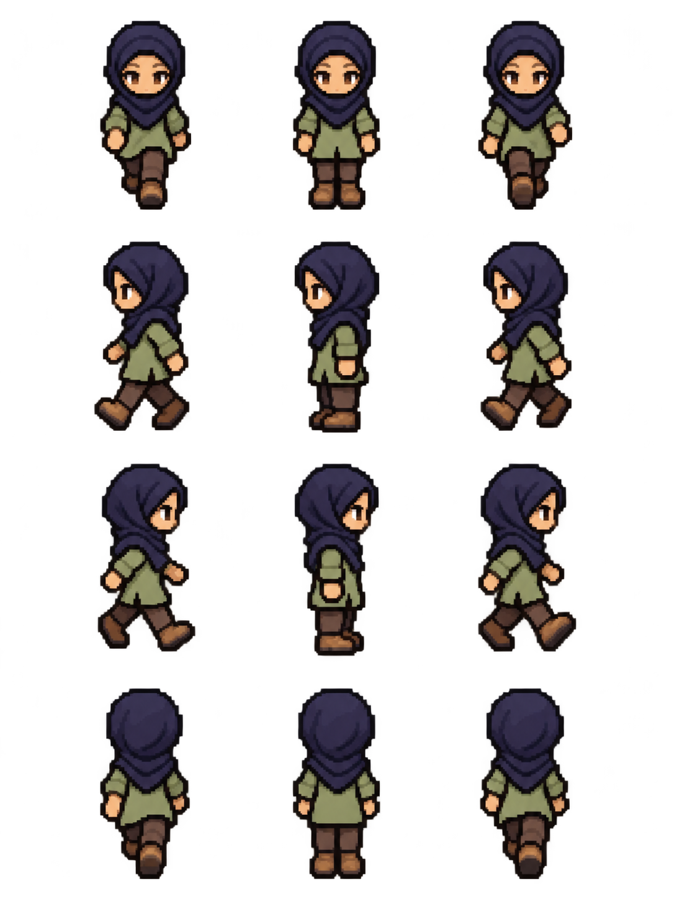
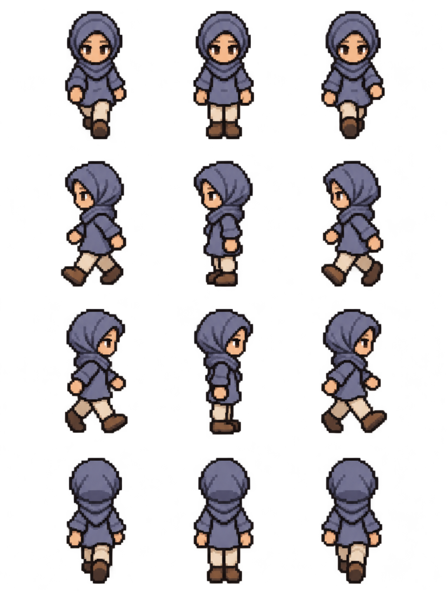
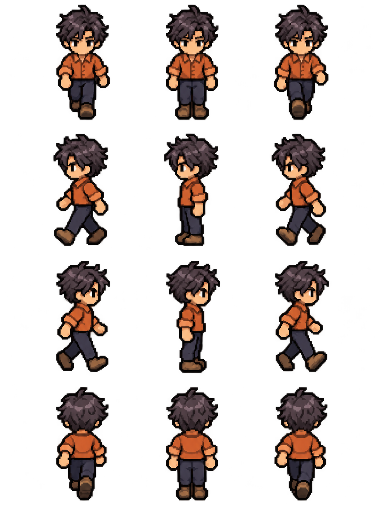
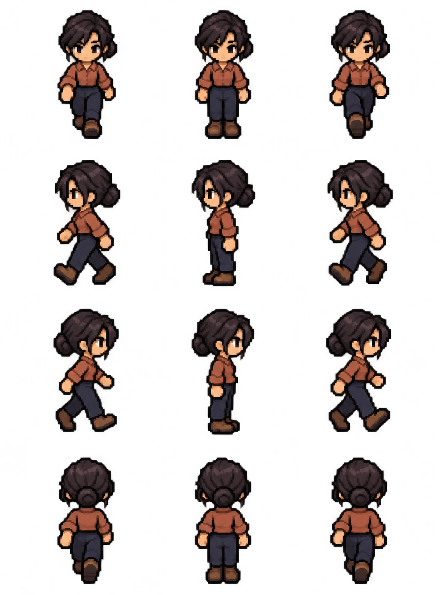
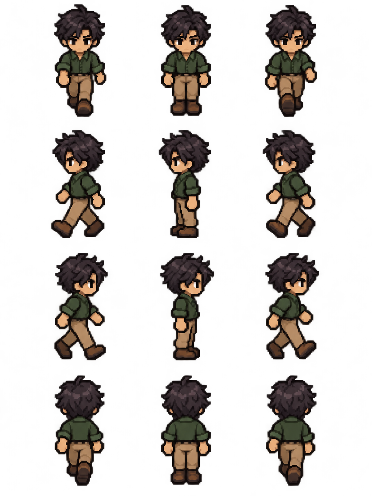
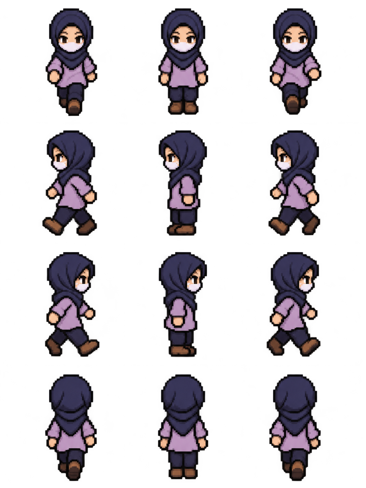
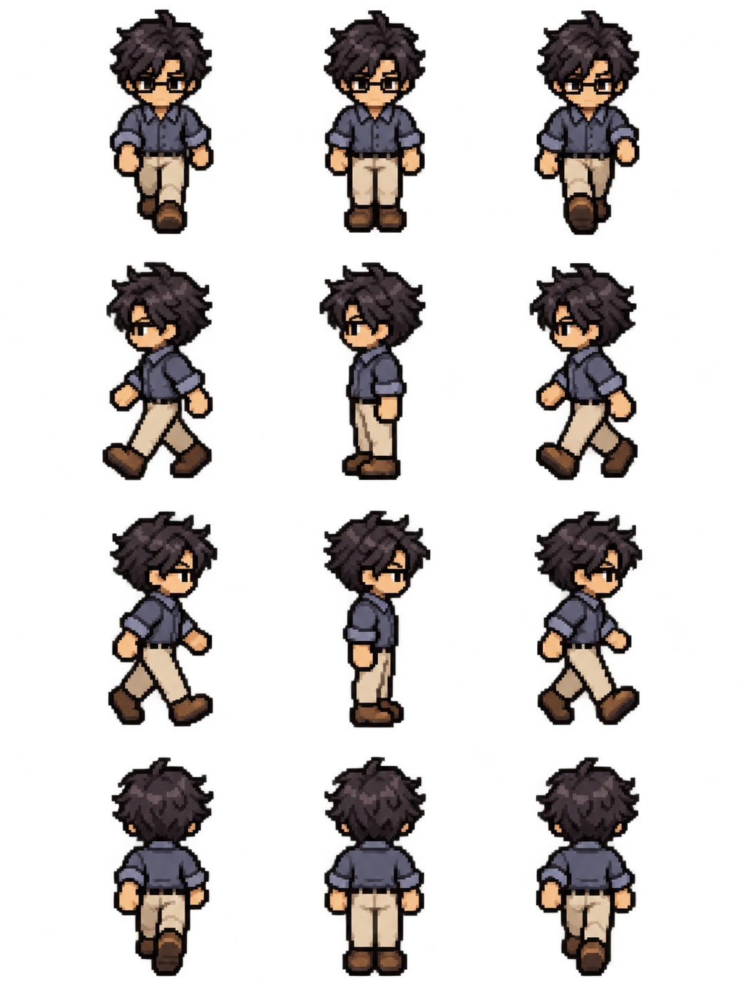
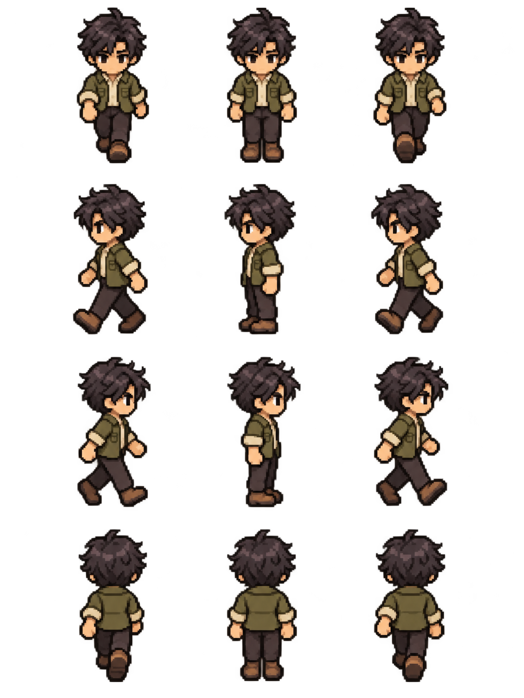
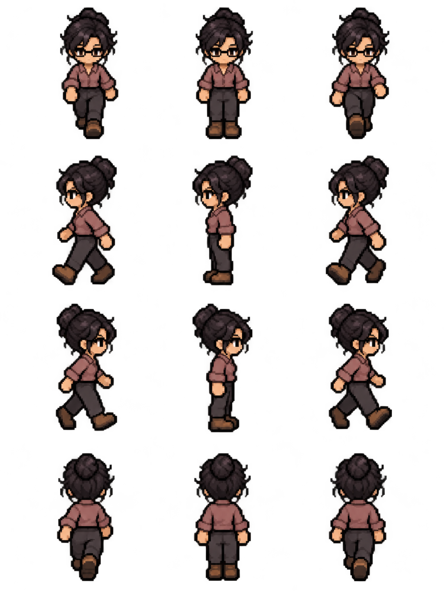

# Character pack preview

A01 = main character; A02–A16 = NPCs. Each thumbnail links to the complete four-direction sheet. See [QA](QA.md) before runtime use.

| A01 · Main | A02 · NPC | A03 · NPC | A04 · NPC |
|---|---|---|---|
|  |  |  |  |
|  |  |  |  |
|  |  |  |  |
|  |  |  |  |

