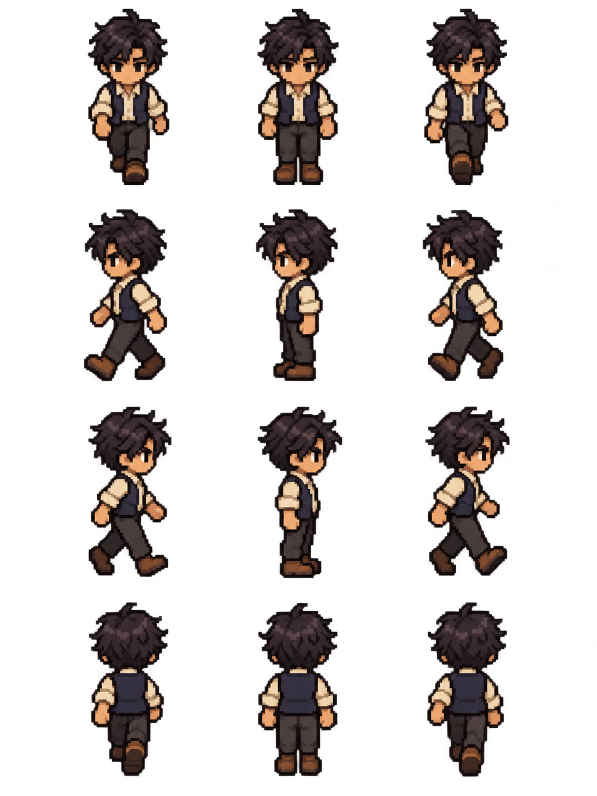
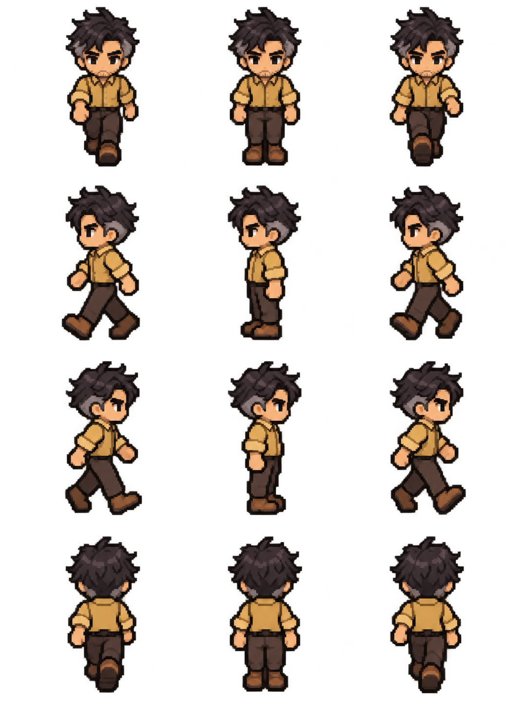
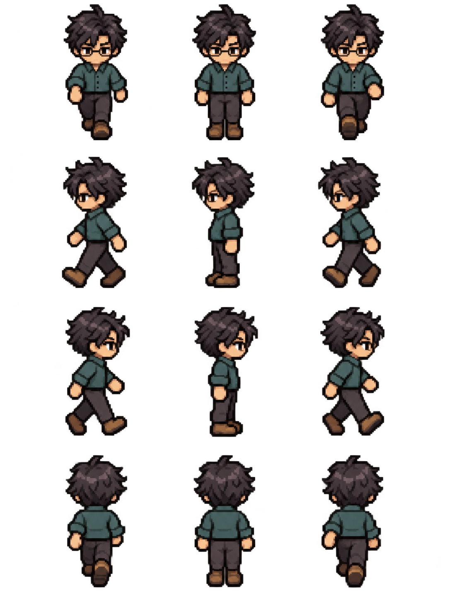
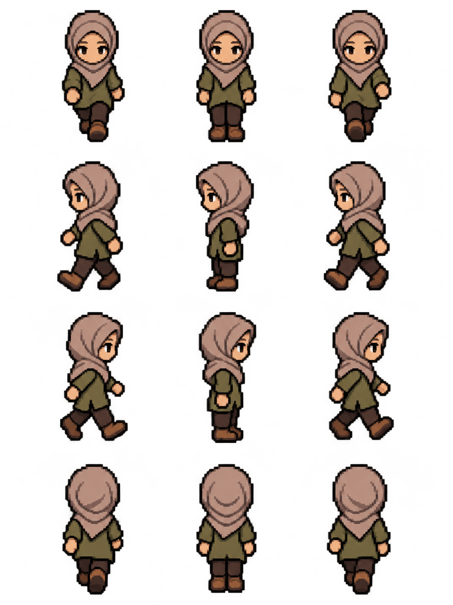
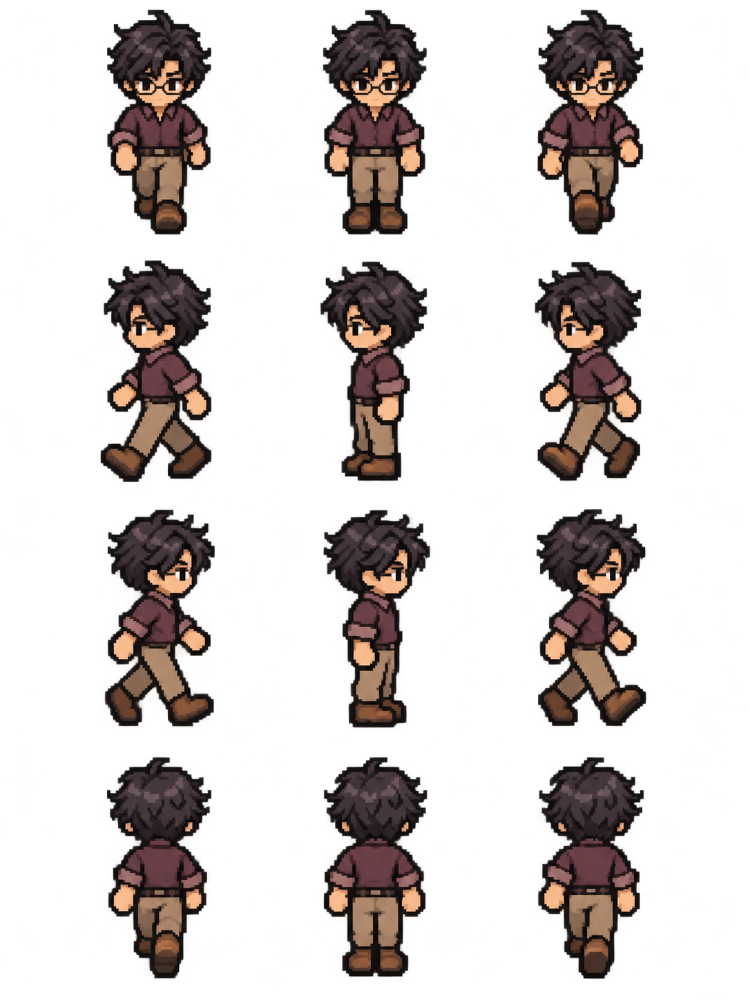
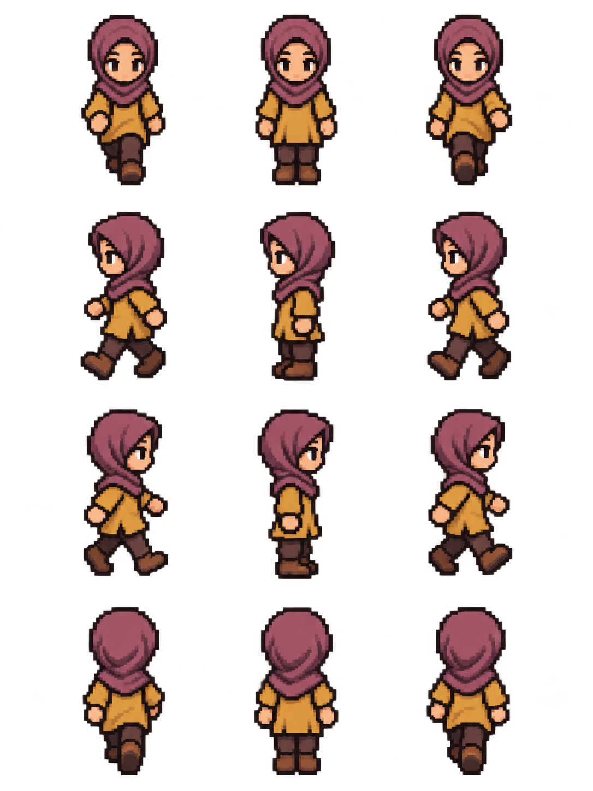
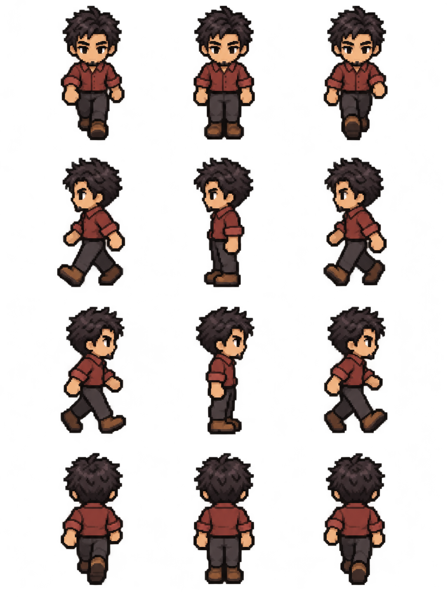

# A-series character preview

Names and attributes are fictional game profiles. See [all profiles](../../catalog/CHARACTER_BIBLE.md). A01 / Yanzen is the sole main character. See [QA](QA.md) before runtime use.

| Sheet | Sheet | Sheet | Sheet |
|---|---|---|---|
| **A01 · Yanzen**  | **A02 · Nabila**  | **A03 · Farid**  | **A04 · Ayu**  |
| **A05 · Dian**  | **A06 · Bima**  | **A07 · Dewi**  | **A08 · Asti**  |
| **A09 · Galih**  | **A10 · Dadan**  | **A11 · Rani**  | **A12 · Denden**  |
| **A13 · Fahima**  | **A14 · Arie**  | **A15 · Bayu**  | **A16 · Khansa**  |
